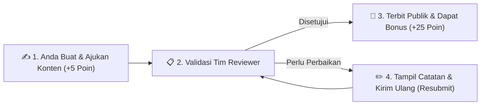

# 📖 Buku Panduan Pengguna GrowHub (User Manual)
**Platform Berbagi Pengetahuan & Gamifikasi Karyawan**  
*Tagline: "Grow Together, Share Knowledge"*

---

## 🌟 Daftar Isi
1. [Mengenal GrowHub](#1-mengenal-growhub)
2. [Hak Akses & Peran Pengguna (Role)](#2-hak-akses--peran-pengguna-role)
3. [Panduan Masuk (Login) & Pengaturan Akun](#3-panduan-masuk-login--pengaturan-akun)
4. [Menjelajahi Menu Utama & Fitur Lipat Sidebar (Bookmark Tab)](#4-menjelajahi-menu-utama--fitur-lipat-sidebar-bookmark-tab)
5. [Panduan Menulis & Membagikan Konten](#5-panduan-menulis--membagikan-konten)
6. [Memantau Status Tulisan & Alur Revisi (Revision & Resubmit)](#6-memantau-status-tulisan--alur-revisi-revision--resubmit)
7. [Interaksi Sosial & Berdiskusi](#7-interaksi-sosial--berdiskusi)
8. [Pusat Belajar Mandiri (Learning Center)](#8-pusat-belajar-mandiri-learning-center)
9. [Komunitas Karyawan (Communities)](#9-komunitas-karyawan-communities)
10. [Sistem Poin, Streak, dan Level Gamifikasi](#10-sistem-poin-streak-dan-level-gamifikasi)
11. [Mengelola Profil Pribadi & Foto Avatar](#11-mengelola-profil-pribadi--foto-avatar)
12. [Panduan Khusus Tim Reviewer (Kurator)](#12-panduan-khusus-tim-reviewer-kurator)
13. [Panduan Khusus Administrator (User, Point, Level & Rank Settings)](#13-panduan-khusus-administrator-user-point-level--rank-settings)
14. [Pertanyaan yang Sering Diajukan (FAQ) & Bantuan](#14-pertanyaan-yang-sering-diajukan-faq--bantuan)
15. [Etika & Aturan Berbagi di GrowHub](#15-etika--aturan-berbagi-di-growhub)

---

## 1. Mengenal GrowHub

### Apa itu GrowHub?
**GrowHub** adalah portal web internal perusahaan yang dirancang khusus bagi seluruh karyawan (baik staf toko, kasir, pramuniaga, staf gudang/logistik, hingga staf kantor pusat) untuk saling bertukar ilmu, berbagi solusi masalah di lapangan, membaca panduan standar kerja (SOP), dan mengikuti pelatihan mandiri secara interaktif dan menyenangkan.

### Mengapa Menggunakan GrowHub?
* **Mudah Menemukan Solusi Lapangan:** Menghadapi kendala mesin kasir, penataan rak (*visual display*), atau menangani komplain pelanggan? Anda dapat mencari tips praktis yang sudah terbukti berhasil dari rekan-rekan toko lain.
* **Ide & Kontribusi Anda Diakui:** Setiap tulisan, foto penataan barang, atau usulan inovasi kerja yang Anda bagikan akan dibaca dan diapresiasi oleh rekan kerja se-Indonesia.
* **Kumpulkan Poin & Naikkan Level:** Setiap keaktifan positif (seperti login harian, membaca materi rekan, berbagi solusi, hingga menyelesaikan modul kursus) akan menghasilkan **Poin** dan meningkatkan **Level Kehormatan** Anda di Papan Peringkat (*Leaderboard*).

---

## 2. Hak Akses & Peran Pengguna (Role)

Di dalam sistem GrowHub terdapat 3 peran pengguna:

| Peran (Role) | Siapa Mereka? | Apa yang Bisa Dilakukan? |
| :--- | :--- | :--- |
| **Karyawan (Employee)** | Seluruh staf toko, kasir, pramuniaga, staf gudang, hingga staf kantor pusat. | Membaca feed artikel, menulis ide/tips, berdiskusi, mengikuti kursus pelatihan, mengumpulkan poin reward, dan bergabung di komunitas. |
| **Reviewer (Kurator Konten)** | Supervisor, Kepala Cabang/Toko, atau tim kurasi materi yang ditunjuk. | Memeriksa kiriman artikel dari karyawan sebelum terbit, menyetujui (*Approve*), atau mengembalikan dengan catatan perbaikan (*Reject with Feedback*). |
| **Administrator (Admin)** | Tim IT, HC/HR pusat, atau PIC Sistem. | Mengelola data karyawan, membantu reset kata sandi, mengatur aturan bobot poin gamifikasi, mengelola jenjang level (*Level Settings*), serta membatasi kuota peringkat yang tampil di leaderboard (*Rank Settings*). |

---

## 3. Panduan Masuk (Login) & Pengaturan Akun

### 3.1 Cara Masuk ke Aplikasi
1. Buka peramban (*web browser*) di komputer toko atau laptop/ponsel Anda (disarankan menggunakan **Google Chrome** atau **Microsoft Edge**).
2. Masukkan alamat URL portal GrowHub perusahaan Anda.
3. Pada halaman Login:
   * **NIP:** Masukkan Nomor Induk Pegawai Anda (9–10 digit angka).
   * **Password Awal:** Masukkan NIP Anda sendiri (jika baru pertama kali login).
4. Klik tombol hijau **"Sign In"**.

```
    ┌──────────────────────────────────────────────┐
    │                MASUK KE GROWHUB              │
    │                                              │
    │   NIP       : [ 198501152010011002         ] │
    │   Password  : [ ••••••••••••••••••         ] │
    │                                              │
    │              [  Tombol SIGN IN  ]            │
    └──────────────────────────────────────────────┘
```

---

### 3.2 Wajib Ganti Password (Khusus Login Pertama Kali atau Pasca-Reset)
Demi keamanan akun Anda, sistem secara otomatis mewajibkan pembuatan password baru saat login pertama:
1. Masukkan **Password Baru** yang Anda inginkan (minimal 8 karakter).
2. Masukkan kembali pada kolom **Konfirmasi Password Baru**.
3. Pastikan kata sandi baru **tidak sama dengan NIP default** Anda.
4. Klik **"Simpan & Lanjutkan"**. Setelah berhasil disimpan, Anda langsung masuk ke halaman Beranda.

> ⚠️ **Catatan Penting:** Harap catat dan ingat kata sandi baru Anda. Jangan meminjamkan akun atau membagikan kata sandi kepada orang lain.

---

### 3.3 Bagaimana Jika Lupa Kata Sandi?
* Sistem GrowHub tidak memiliki tombol "Lupa Password Mandiri" guna mencegah pembobolan akun di komputer toko yang digunakan bergantian antar-shift.
* Jika Anda lupa password, cukup hubungi **Supervisor Toko** atau **Admin IT/HR**. Admin dapat melakukan reset password Anda kembali ke NIP awal dalam 1 kali klik.

---

## 4. Menjelajahi Menu Utama & Fitur Lipat Sidebar (Bookmark Tab)

Antarmuka GrowHub dirancang modern, rapi, dan mudah dinavigasi:

```
┌──────────────┬──────────────────────────────────────────────────────────┐
│  🌱 GrowHub  │ 🔍 Cari materi...              🔥 5 Hari  ⭐ 340 Pts [A]  │
├──────────────┼──────────────────────────────────────────────────────────┤
│ 🏠 Beranda   │                                                          │
│ 📰 Feed      │                HALAMAN UTAMA / KONTEN                    │
│ ✍️ Tulis     │                                                          │
│ 🎓 Belajar   │                                                          │
│ 👥 Komunitas │                                                          │
│ 🏆 Peringkat │                                                          │
│ 🔖 Tersimpan │                                                          │
│ ❓ Bantuan   │                                                          │
│              │                                                          │
│ 🏷️ [TAB]     │  (Klik Tab Pita Penanda Buku untuk Melebarkan Layar!)     │
└──────────────┴──────────────────────────────────────────────────────────┘
```

### 4.1 Bilah Atas (Header Bar)
* **Kolom Pencarian:** Cari topik, solusi masalah kasir, tips display barang, atau SOP kerja hanya dengan mengetik kata kunci.
* **🔥 Api Streak:** Menghitung berapa hari berturut-turut Anda aktif menggunakan GrowHub.
* **⭐ Total Poin & Level:** Menampilkan saldo poin terkumpul dan level gelar Anda saat ini.
* **🔔 Lonceng Notifikasi:** Pemberitahuan instan saat artikel Anda disukai, dikomentari rekan, atau diverifikasi oleh reviewer.
* **Foto Profil:** Menu untuk membuka profil diri atau keluar sistem (*Logout*).

---

### 4.2 Bilah Menu Samping (Sidebar) yang Terstruktur
Menu navigasi samping dikelompokkan ke dalam beberapa bagian yang jelas:

1. **Main Menu (Menu Utama):**
   * **🏠 Home (Beranda):** Sambutan personal, ringkasan capaian pribadi, artikel terpopuler, dan pemenang poin minggu ini.
   * **📰 Knowledge Feed:** Linimasa artikel, tips trik, foto pajangan produk, dan diskusi rekan kerja dari seluruh cabang.
   * **📊 My Dashboard:** Dasbor pribadi lengkap dengan grafik perolehan poin harian, kalender streak, dan lencana capaian.
   * **🎓 Learning Center:** Modul kursus mandiri (*micro-learning*) untuk mengasah keterampilan kerja.
   * **👥 Communities:** Forum kelompok diskusi berdasarkan bidang atau minat karyawan.
   * **🔖 Saved:** Tempat menyimpan materi favorit agar mudah ditemukan kembali.
   * **🏆 Leaderboard:** Papan peringkat karyawan paling aktif dan inspiratif.

2. **My Workspace (Ruang Kerja Saya):**
   * **📂 My Contributions:** Tempat mengelola seluruh artikel yang pernah Anda buat (draf, dalam peninjauan, terbit, atau butuh revisi).

3. **Administration (Khusus Reviewer & Admin):**
   * **🛡️ Content Validation:** Portal kurasi bagi Reviewer untuk memvalidasi kiriman artikel.
   * **👥 User Management:** Portal Admin untuk mengelola akun karyawan.
   * **✨ Point Settings:** Pengaturan bobot poin per aktivitas dan batas harian.
   * **📈 Level Settings:** Pengaturan jenjang tingkatan level, ambang poin, dan desain lencana.
   * **🏆 Rank Settings:** Pengaturan batas kuota peringkat teratas (*Top Ranks*) yang tampil di Leaderboard dan Beranda.

4. **Support & Profile:**
   * **🔔 Notifications:** Daftar lengkap riwayat notifikasi Anda.
   * **❓ Help & Support:** Panduan aturan poin, FAQ, dan form pengajuan tiket bantuan.
   * **👤 Profile:** Portofolio pribadi, riwayat mutasi poin, dan pengaturan foto profil.

5. **Mini Gamification Card:**
   * Terletak di bagian paling bawah sidebar; menampilkan progress bar level Anda, persentase kemajuan, dan sisa poin yang dibutuhkan untuk naik ke level berikutnya secara seketika (*real-time*).

---

### 4.3 🏷️ Fitur Lipat Sidebar Berbentuk Pita Penanda Buku (Bookmark Tab)
Ingin membaca artikel panjang atau modul pelatihan dengan layar yang lebih luas dan bebas gangguan?
* Di tepi samping kanan sidebar, terdapat **Tombol Tab Pita Penanda Buku (Bookmark Tab)** yang unik.
* **Cara Menggunakan:**
  * Klik tab pita penanda buku tersebut untuk **melipat / menyembunyikan sidebar** ke samping kiri. Halaman baca akan otomatis melebar memenuhi layar.
  * Untuk **memunculkan kembali menu sidebar**, cukup klik kembali tab pita penanda buku yang tetap menempel rapi di sisi kiri layar.

---

## 5. Panduan Menulis & Membagikan Konten

Mempunyai kiat sukses meningkatkan penjualan produk baru? Cara cepat menghitung stok opname? Bagikan ke rekan kerja Anda!

### 5.1 Alur Kurasi & Penerbitan Konten



---

### 5.2 Langkah-Langkah Mengisi Formulir Konten
1. Klik tombol hijau **"+ Share Knowledge"** atau buka menu **"Buat Konten"**.
2. **Judul Konten (Wajib):**
   * Buat judul yang jelas dan informatif (maksimal 200 karakter).
   * *Contoh:* *"5 Cara Efektif Mengurangi Antrean Panjang di Kasir Saat Akhir Pekan"*.
3. **Isi Pembahasan (Wajib):**
   * Uraikan situasi yang dihadapi, langkah kerja praktis yang dilakukan, kendala, dan hasil positif yang diperoleh toko.
   * Minimal 20 karakter. Anda dapat menggunakan format paragraf dan poin-poin.
4. **Lampiran Media (Foto / Video / Berkas SOP):**
   * Unggah dokumen pendukung seperti foto display barang (JPG/PNG), video tutorial singkat (MP4), atau dokumen pedoman (PDF, Word, Excel).
   * Kapasitas maksimal: hingga **50 MB per file** dengan dukungan multi-upload.
5. **Kategori Konten (Wajib):**
   * *Best Practice* (Praktik Terbaik Teruji)
   * *Tips & Trick* (Kiat Praktis Kerja)
   * *Lesson Learned* (Pelajaran Berharga dari Kendala Lapangan)
   * *Innovation & Ideas* (Gagasan atau Usulan Inovasi Baru)
   * *Document / SOP* (Standar Operasional Prosedur Resmi)
   * *Success Story* (Kisah Sukses Pencapaian Target Kerja)
6. **Hubungkan ke Komunitas (Opsional):**
   * Pilih komunitas spesifik jika materi ditujukan untuk kelompok tertentu, atau pilih *General* jika untuk seluruh karyawan.
7. **Kata Kunci / Tag (#):**
   * Ketik tag pendukung lalu tekan Enter (misal: `#kasir`, `#display`, `#sop`, `#pelayanan`).
8. **Simpan atau Kirim:**
   * **Save as Draft:** Jika tulisan belum selesai dan ingin dilanjutkan nanti.
   * **Submit for Review:** Ajukan tulisan ke tim kurator. Anda otomatis mendapatkan **+5 Poin** saat pengajuan berhasil!

---

## 6. Memantau Status Tulisan & Alur Revisi (Revision & Resubmit)

Di menu **"My Contributions" (Kontribusi Saya)**, Anda dapat memantau status setiap tulisan yang pernah dibuat melalui tab status:

| Status Tab | Arti Status | Yang Perlu Dilakukan |
| :--- | :--- | :--- |
| 🟡 **In Review (Menunggu)** | Tulisan Anda sedang dalam antrean evaluasi oleh tim Reviewer. | Menunggu verifikasi (biasanya 1–2 hari kerja). |
| 🟢 **Published (Terbit)** | Tulisan Anda lolos kurasi dan resmi tayang di Knowledge Feed! | Selamat! Poin apresiasi **+25 Poin** otomatis masuk ke akun Anda. |
| 🔴 **Needs Revision (Revisi)** | Reviewer meminta perbaikan (misal foto kurang jelas atau langkah kerja kurang lengkap). | Ikuti panduan revisi dan kirim ulang di bawah ini. |
| ⚪ **Draft (Draf)** | Tulisan yang baru Anda simpan sendiri dan belum diajukan. | Klik tombol *Edit*, lengkapi tulisan, lalu klik *Submit for Review*. |

---

### 6.1 Alur Transparan Revisi & Kirim Ulang (Resubmit)
Jika tulisan Anda berstatus **Needs Revision (Perlu Perbaikan)**:
1. Buka menu **My Contributions** dan pilih tab **Needs Revision**.
2. Klik tombol **Edit** pada tulisan tersebut.
3. Anda akan melihat **Kotak Peringatan Khusus Berwarna Merah** di bagian atas formulir yang memuat **Catatan Revisi Langsung dari Reviewer**.
4. Perbaiki bagian yang diminta (misalnya memperjelas langkah kerja atau mengganti foto lampiran).
5. Setelah selesai diperbaiki, klik tombol hijau **"Resubmit for Review"**.
6. Konten akan kembali masuk ke antrean reviewer untuk disetujui tanpa perlu membuat tulisan baru dari nol!

---

## 7. Interaksi Sosial & Berdiskusi

GrowHub mengedepankan kolaborasi aktif antarkaryawan:
* **Suka (Like) ❤️:** Mengapresiasi tulisan rekan kerja yang bermanfaat. Penulis mendapatkan **+2 Poin**.
* **Simpan (Bookmark) 🔖:** Menandai materi penting agar tersimpan di menu *Saved Knowledge* pribadi Anda.
* **Komentar Diskusi 💬:** Berikan komentar atau pertanyaan yang santun. Anda mendapatkan **+1 Poin**, dan pemilik tulisan mendapatkan **+3 Poin** karena tulisannya memicu diskusi produktif.
* **Bagikan (Share) 🔗:** Bagikan tautan artikel langsung ke WhatsApp Web rekan kerja atau salin link materi.

---

## 8. Pusat Belajar Mandiri (Learning Center)

Asah keterampilan operasional Anda melalui modul kursus singkat (*micro-learning*):
1. Buka menu **Learning Center**.
2. Pilih modul yang tersedia (misalnya: *Keunggulan Pelayanan Pelanggan*, *Teknik Penataan Visual Merchandising*, atau *Keselamatan & Kesehatan Kerja di Toko*).
3. Pelajari rangkuman materi, baca langkah kerja, dan tonton video tutorial yang disediakan.
4. Jika telah memahami seluruh isi materi, klik tombol hijau **"Tandai Selesai" / "Complete Course"**.
5. Sistem akan memberikan lencana centang hijau dan mentransfer **+15 hingga +35 Poin** langsung ke profil Anda!

---

## 9. Komunitas Karyawan (Communities)

* **Bergabung ke Komunitas:** Buka menu **Communities**, cari grup yang sesuai dengan bidang Anda (seperti *Store Operations Squad*, *Customer Care Champions*, atau *Logistics & Inventory*), lalu klik tombol **"Join Community"**.
* **Manfaat:** Anda dapat membaca kiriman materi yang khusus dibagikan bagi anggota komunitas dan berdiskusi dengan rekan seprofesi dari berbagai cabang.
* **Membuat Komunitas Baru:** Klik tombol **"+ Create New Community"**, isi nama komunitas, jelaskan tujuannya, dan pilih ikon warna representatif.

---

## 10. Sistem Poin, Streak, dan Level Gamifikasi

### 10.1 Tabel Perolehan Poin Harian
Kumpulkan poin sebanyak-banyaknya melalui aktivitas bermanfaat:

| Aktivitas Karyawan | Hadiah Poin | Keterangan |
| :--- | :---: | :--- |
| **Login Pertama Setiap Hari** | **+2 Poin** | Menjaga api keaktifan (*streak*) tetap menyala. |
| **Mengajukan Konten ke Reviewer** | **+5 Poin** | Diberikan saat pertama kali mengirim draf ke kurasi. |
| **Konten Lolos Kurasi & Terbit** | **+25 Poin** | Hadiah utama atas sumbangsih ilmu bagi perusahaan. |
| **Menerima Like dari Rekan Kerja** | **+2 Poin** | Setiap ada rekan yang menyukai karya Anda. |
| **Menerima Komentar di Tulisan Anda** | **+3 Poin** | Ketika artikel Anda menghasilkan diskusi bermanfaat. |
| **Menulis Komentar Positif** | **+1 Poin** | Berpartisipasi dalam diskusi di tulisan rekan lain. |
| **Membaca Artikel Rekan Kerja** | **+1 Poin** | Menambah wawasan dari artikel di feed. |
| **Membagikan Materi (Share)** | **+1 Poin** | Menyebarkan artikel bermanfaat ke rekan kerja. |
| **Menuntaskan Kursus Pelatihan** | **+15 s/d +35 Poin** | Menyelesaikan modul di Learning Center. |
| **Bonus Mingguan (Streak 7 Hari) 🔥** | **+15 Poin Ekstra** | Bonus ekstra setiap aktif 7 hari berturut-turut! |

> 💡 **Informasi Tambahan:** Besaran poin dan kuota harian (*daily caps*) dapat disesuaikan sewaktu-waktu oleh Manajemen/Administrator perusahaan (misalnya ada program festival poin ganda pada bulan tertentu).

---

### 10.2 Apa itu Daily Streak (Api Konsistensi)?
* Indikator **Daily Streak (🔥)** menghitung jumlah hari berturut-turut Anda membuka dan aktif di GrowHub.
* **Perhatian:** Jika Anda libur atau tidak membuka GrowHub sama sekali dalam 1 hari kalender kerja, angka streak akan kembali ke 1. Jaga agar api konsistensi Anda tetap membara!

---

### 10.3 Jenjang Tingkatan Level (8 Level Bawaan)
Akumulasi poin Anda akan menentukan tingkatan level gelar kehormatan Anda di perusahaan:

```
  🌱 Level 1: Seedling (0 - 99 Pts)           — Langkah awal menanam benih pengetahuan
  🌿 Level 2: Sprout (100 - 249 Pts)          — Tunas mulai tumbuh aktif membaca & berbagi
  🪴 Level 3: Sapling (250 - 499 Pts)         — Pohon muda yang giat berdiskusi
  🌳 Level 4: Grower (500 - 899 Pts)          — Rutin membagikan tips kerja berkualitas
  🌾 Level 5: Cultivator (900 - 1.399 Pts)    — Penggerak komunitas yang menginspirasi
  🍎 Level 6: Harvester (1.400 - 1.999 Pts)   — Menuai banyak manfaat dan membimbing rekan
  ⭐ Level 7: Mentor (2.000 - 2.999 Pts)      — Teladan rujukan ilmu di seluruh cabang
  👑 Level 8: Evergreen (3.000+ Pts)          — Legenda pengetahuan yang kokoh & abadi
```

*(Catatan: Nama level, ambang batas poin, warna lencana, dan jumlah tingkatan level dapat disesuaikan atau ditambah oleh Administrator melalui panel Level Settings).*

---

### 10.4 Leaderboard (Papan Peringkat)
Buka menu **Leaderboard** untuk melihat prestasi Anda dan rekan-rekan kerja:
* **Batas Kuota Peringkat Teratas (Top X):** Leaderboard menampilkan kuota peringkat teratas (misalnya: **Top 10**, **Top 25**, **Top 50**, atau **Top 100**) sesuai konfigurasi batas yang diatur oleh Administrator.
* **Informasi Siklus Reset Leaderboard:** Pada bagian atas Leaderboard terdapat lencana indikator siklus kompetisi:
  * ♾️ **Tanpa Reset (Sepanjang Waktu):** Seluruh poin dihitung secara kumulatif sejak pertama kali bergabung.
  * 🔄 **Reset Berkala (Mingguan / Bulanan / Triwulan / Tahunan):** Poin leaderboard akan mulai dihitung segar dari awal setiap siklus baru, memberikan peluang adil bagi seluruh karyawan (termasuk karyawan baru) untuk meraih podium juara!
  * *(Catatan: Level keahlian dan lencana Seedling hingga Evergreen Anda tetap abadi dan tidak terhapus).*
* **Filter Waktu:**
  * **This Week (Minggu Ini):** Persaingan paling hangat dalam 7 hari terakhir.
  * **This Month (Bulan Ini):** Akumulasi prestasi sepanjang bulan berjalan.
  * **All-Time (Sepanjang Masa):** Gelar kehormatan tertinggi karyawan terbaik perusahaan.
* **Filter Departemen:** Saring daftar untuk melihat persaingan rekan satu divisi kerja Anda sendiri.
* **Panggung Podium Top 3:** Menampilkan juara 1 (Emas), juara 2 (Perak), dan juara 3 (Perunggu) secara visual di atas tabel utama.
* **Kartu Posisi Peringkat Pribadi (Sticky Footer):**
  * Terletak di bagian bawah layar; jika Anda masuk dalam kuota Top X, kartu akan menampilkan nomor peringkat Anda.
  * Jika Anda belum masuk ke dalam kuota Top X (misal peringkat #68 dari batas Top 50), kartu tetap menampilkan posisi aktual Anda disertai keterangan motivasi untuk terus aktif menembus batas Top X!

---

## 11. Mengelola Profil Pribadi & Foto Avatar

Halaman profil adalah portofolio keaktifan Anda di hadapan seluruh rekan kerja:
1. Klik menu **Profile** di sidebar atau klik nama Anda di pojok kanan atas.
2. **Ganti Foto Profil (Avatar):**
   * Klik ikon **Kamera** pada lingkaran foto profil Anda.
   * Pilih foto resmi atau foto seragam kerja terbaik Anda dari komputer/ponsel. Foto akan langsung terpasang!
3. **Melihat Statistik Pribadi:**
   * Pantau berapa total like yang sudah Anda terima, jumlah artikel yang telah terbit, dan modul kursus yang telah diselesaikan.
4. **Riwayat Buku Besar Poin (Point Transactions):**
   * Di bagian bawah profil, Anda dapat melihat transparansi riwayat mutasi poin (kapan poin masuk, dari aktivitas apa, dan berapa jumlahnya).

---

## 12. Panduan Khusus Tim Reviewer (Kurator)

*(Bagian ini khusus untuk pengguna yang ditunjuk sebagai Reviewer)*

Sebagai kurator, Anda bertugas memastikan kualitas informasi yang beredar di perusahaan tetap akurat, bermanfaat, dan santun.

### 12.1 Cara Memvalidasi Konten Masuk
1. Klik menu **"Content Validation"** di sidebar.
2. Pada antrean **Pending Queue**, klik artikel yang ingin diperiksa.
3. Tinjau isi tulisan, kejelasan panduan, serta kesesuaian lampiran foto/video dengan SOP perusahaan.
4. Ambil keputusan:
   * **Approve & Publish:** Klik tombol hijau jika konten berkualitas. Artikel seketika terbit di feed publik, penulis mendapatkan **+25 Poin**, dan Reviewer mendapatkan poin evaluasi.
   * **Reject / Request Revision:** Jika artikel butuh perbaikan, klik tombol merah. **Wajib tuliskan catatan revisi yang jelas** (misal: *"Mohon tambahkan rincian cara merapikan display pada rak nomor 2"*). Catatan ini akan tampil di form edit penulis.

---

## 13. Panduan Khusus Administrator (User, Point, Level & Rank Settings)

*(Bagian ini khusus untuk tim IT, HC/HR, dan PIC Sistem dengan hak akses Administrator)*

Administrator memiliki kontrol menyeluruh atas operasional dan konfigurasi sistem gamifikasi tanpa perlu menyentuh kode pemrograman:

### 13.1 Manajemen Pengguna (User Management)
* **Pencarian & Filter Cepat:** Cari data karyawan berdasarkan Nama, NIP, Departemen, atau Lokasi Cabang.
* **Tambah Karyawan Baru:** Masukkan NIP, Nama Lengkap, Email, Departemen, dan Role. Terdapat opsi memberikan *Welcome Bonus Points*.
* **Reset Password 1-Klik:** Jika ada karyawan yang lupa kata sandi, Admin cukup menekan tombol **"Reset Password ke NIP"**. Akun karyawan akan kembali ke password NIP dan wajib mengganti kata sandi saat login berikutnya.
* **Penyesuaian Poin Manual:** Admin dapat menambahkan atau mengoreksi saldo poin karyawan secara langsung untuk keperluan apresiasi khusus.

---

### 13.2 Pengaturan Sistem Poin Dinamis (Point Settings)
Diakses melalui menu **"Point Settings"** (`/admin/point-rules`):
* **Ubah Nilai Poin:** Ubah bobot poin per aksi (login harian, buat artikel, kursus, like, dll) menggunakan input angka atau tombol stepper (+/-).
* **Saklar On/Off Mandiri (Instant Toggle):** Aktifkan atau nonaktifkan aturan poin tertentu kapan saja dengan menekan tombol saklar geser. Aksi yang dimatikan akan otomatis menghasilkan 0 poin.
* **Atur Batas Harian (Daily Cap):** Tentukan batas maksimal frekuensi perolehan poin per hari untuk mencegah kecurangan/spamming.
* **Simpan Perubahan Massal:** Klik tombol hijau **"Simpan Semua Perubahan"** untuk menerapkan seluruh konfigurasi sekaligus.
* **Tombol Cepat:** Tersedia tombol **"Aktifkan Semua"**, **"Nonaktifkan Semua"**, serta **"Reset Default"** untuk mengembalikan aturan ke setelan pabrik.

---

### 13.3 Pengaturan Jenjang Level Dinamis (Level Settings) -> Ongoing Development Phase
Fitur terbaru yang diakses melalui menu **"Level Settings"** (`/admin/level-rules`):
* **Kelola Tingkatan Level:** Ubah nama level, tingkatan tier, serta ambang batas minimal poin (*min points*) yang harus diraih karyawan untuk mencapai level tersebut.
* **Kustomisasi Tampilan Lencana (Badge):** Pilih ikon lencana (Sprout, Leaf, Tree, Flame, Award, Star, Sparkles, Crown) dan warna representatif untuk setiap level.
* **Tambah Level Baru:** Tambahkan tingkatan level baru di atas level yang sudah ada jika perusahaan ingin memperpanjang jenjang karir gamifikasi karyawan.
* **Level Progression Roadmap:** Lihat visualisasi alur tangga kenaikan level dan jumlah karyawan yang sedang berada di setiap tingkatan level.
* **Simpan Massal & Reset Default:** Simpan seluruh modifikasi level dalam satu klik atau kembalikan ke struktur 8-tier bawaan sistem.

---

### 13.4 Pengaturan Batas Peringkat & Jadwal Reset (Rank Settings) Ongoing Development Phase
Fitur terbaru yang diakses melalui menu **"Rank Settings"** (`/admin/rank-settings`):

1. **Jadwal & Siklus Reset Leaderboard (`reset_frequency`):**
   * Admin memiliki wewenang penuh untuk mengatur kapan skor Leaderboard direset ulang atau membiarkannya berjalan tanpa pernah direset:
     * ♾️ **Tidak Pernah Reset (Sepanjang Waktu / Never):** Poin dihitung secara kumulatif dari seluruh riwayat kontribusi karyawan tanpa batasan waktu.
     * 📅 **Reset Mingguan (Weekly):** Papan peringkat otomatis direset setiap hari Senin pukul 00:00 untuk memulai kompetisi mingguan baru.
     * 🗓️ **Reset Bulanan (Monthly):** Papan peringkat otomatis direset setiap tanggal 1 awal bulan pukul 00:00.
     * 🏢 **Reset Per Triwulan (Quarterly):** Papan peringkat otomatis direset setiap 3 bulan sekali (Januari, April, Juli, Oktober).
     * 🎆 **Reset Tahunan (Yearly):** Papan peringkat otomatis direset setiap 1 Januari awal tahun.
   * **Informasi Tanggal & Waktu:** Sistem otomatis menampilkan jadwal tanggal reset berikutnya (*Next Reset Date*) dan waktu reset terakhir yang pernah dilakukan.

2. **Tindakan Reset Instan Sekarang (*Manual Reset Now*):**
   * Tombol **"Reset Leaderboard Sekarang"** memungkinkan Admin membuka musim kompetisi baru seketika di luar jadwal reguler (misalnya saat pembukaan cabang baru atau perlombaan khusus perusahaan).
   * Seluruh hitungan peringkat leaderboard akan dimulai dari 0 sejak saat tombol ditekan.
   * Admin juga dapat menekan **"Batalkan Reset Manual"** kapan saja untuk mengembalikan leaderboard ke siklus normal.
   * *(Penting: Level akumulasi gelar karyawan Lv.1 Seedling s/d Lv.8 Evergreen tidak akan hilang dan tetap aman).*

3. **Batas Kuota Peringkat Leaderboard (`leaderboard_limit`):**
   * Mengatur berapa banyak karyawan teratas yang diambil dari basis data dan ditampilkan pada tabel Leaderboard utama.
   * Pilihan preset cepat: **Top 10**, **Top 20**, **Top 25**, **Top 50**, dan **Top 100**, serta tombol stepper dan slider manual (rentang 3 hingga 500 karyawan).

4. **Batas Peringkat Widget Beranda (`home_widget_limit`):**
   * Mengatur kuota karyawan terbaik mingguan yang ditampilkan pada kartu ringkasan di halaman Beranda (pilihan preset: **Top 3**, **Top 5**, atau **Top 10** mingguan).

5. **Saklar Panggung Podium Top 3 (`show_podium`):**
   * Saklar geser On/Off untuk mengaktifkan atau menyembunyikan panggung visual medali Emas (#1), Perak (#2), dan Perunggu (#3) di bagian atas Leaderboard.

6. **Saklar Transparansi Posisi Pribadi di Luar Top Limit (`show_my_rank_outside`):**
   * Mengatur apakah karyawan yang berada di luar kuota Top X (misal rank #75) tetap dapat melihat nomor posisi aslinya di kartu sticky bawah untuk memacu motivasi sportif.

7. **Pratinjau Langsung (*Live Interactive Simulation Preview*):**
   * Kolom pratinjau interaktif di sisi kanan formulir yang menyajikan simulasi visual nyata tampilan Leaderboard (mockup podium, tabel, dan sticky footer) secara *real-time* saat Admin mengubah kuota atau jadwal reset sebelum disimpan.

8. **Reset Default Bawaan:**
   * Tombol 1-klik untuk mengembalikan seluruh pengaturan ke nilai standar sistem (Siklus: Tanpa Reset, Top 50 Leaderboard, Top 5 Beranda, Podium Aktif).

---

## 14. Pertanyaan yang Sering Diajukan (FAQ) & Bantuan

#### 1. "Saya tidak sengaja salah memasukkan kata sandi hingga terkunci, apa yang harus saya lakukan?"
> **Solusi:** Hubungi Supervisor Toko atau Admin IT/HR cabang Anda. Admin dapat mereset kata sandi Anda kembali ke NIP awal dalam sekejap.

#### 2. "Berapa lama waktu peninjauan artikel oleh Reviewer?"
> **Solusi:** Kurasi artikel biasanya berlangsung antara 1x24 jam hingga 2x24 jam kerja. Anda akan menerima notifikasi otomatis ketika artikel disetujui atau memerlukan revisi.

#### 3. "Bagaimana cara membaca artikel dengan tampilan layar penuh tanpa menu samping?"
> **Solusi:** Cukup klik **Tombol Tab Pita Penanda Buku (Bookmark Tab)** di tepi kanan sidebar. Menu samping akan terlipat rapi dan area baca menjadi lebih luas. Klik kembali tab penanda buku untuk membuka menu.

#### 4. "Mengapa tulisan saya berstatus 'Needs Revision' dan bagaimana cara memperbaikinya?"
> **Solusi:** Buka menu **My Contributions** > tab **Needs Revision** > klik **Edit**. Di bagian atas formulir akan tampil kotak merah berisi masukan dari kurator. Perbaiki sesuai petunjuk lalu klik **"Resubmit for Review"**.

#### 5. "Berapa kapasitas maksimal lampiran file yang bisa saya unggah?"
> **Solusi:** Maksimal **50 MB per berkas**. Mendukung foto (JPG, PNG, WEBP), video (MP4, WEBM), dan dokumen SOP (PDF, DOCX, XLSX, PPTX).

#### 6. "Bagaimana cara menyampaikan kendala teknis atau saran perbaikan aplikasi?"
> **Solusi:** Buka menu **Help & Support** di bilah navigasi kiri, isi formulir **Submit Support Ticket**, lalu klik tombol kirim. Anda dapat memantau status penyelesaian tiket langsung di halaman tersebut.

---

## 15. Etika & Aturan Berbagi di GrowHub

1. 🔒 **Jaga Kerahasiaan Data Perusahaan & Pelanggan:**
   * Dilarang keras mengunggah nomor kartu kredit/debit pelanggan, PIN mesin kasir, data pribadi konsumen, atau laporan keuangan internal yang bersifat rahasia.
2. 🤝 **Saling Menghargai & Berbahasa Positif:**
   * Berikan kritik yang santun dan membangun di kolom komentar. Hindari perdebatan yang menyinggung antartoko/cabang atau isu SARA.
3. 📸 **Dokumentasi Asli & Relevan:**
   * Foto atau video yang diunggah harus berkaitan dengan kegiatan kerja operasional toko atau inovasi kerja yang sah.
4. 🚀 **Jujur dan Sportif:**
   * Raih poin dan tingkatkan level Anda secara alami dengan berbagi ilmu yang bermanfaat, bukan melalui cara spamming.

---


