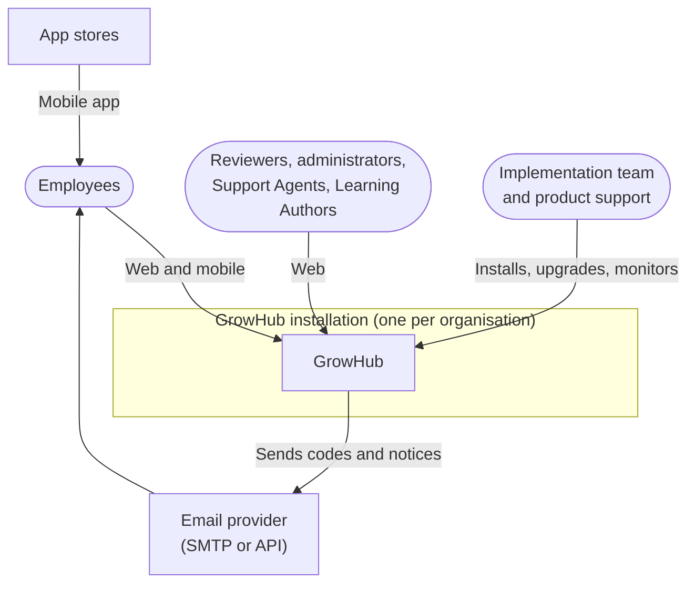
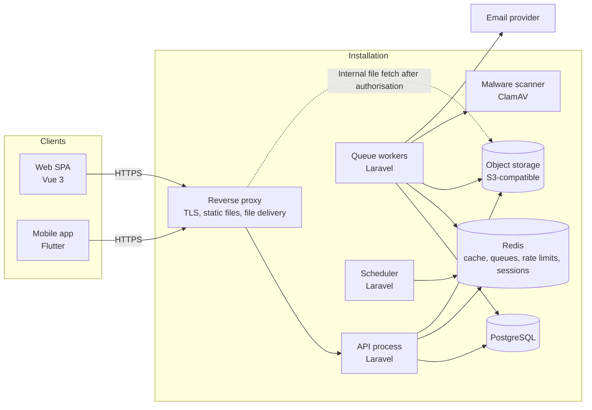
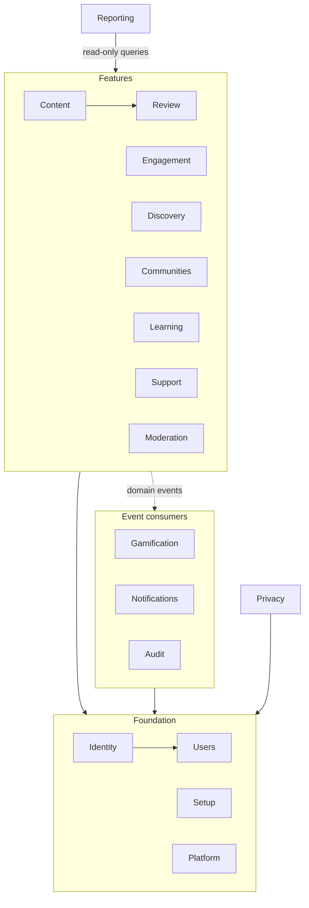
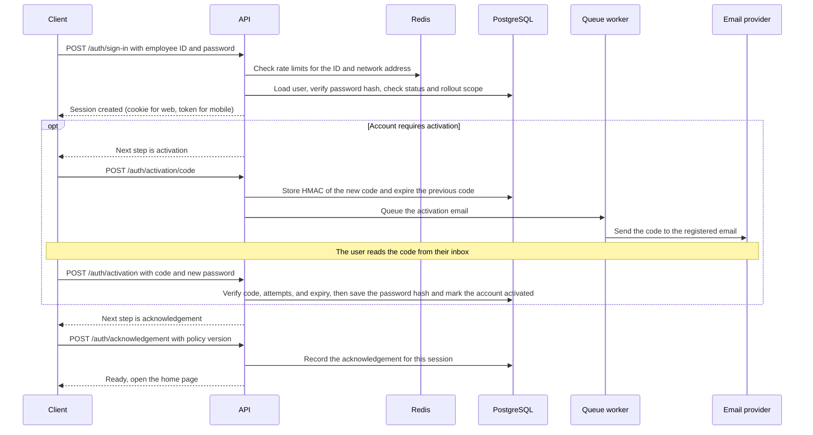
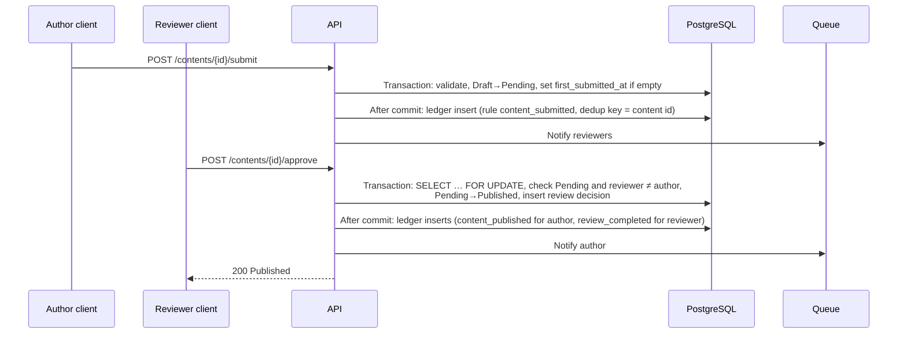
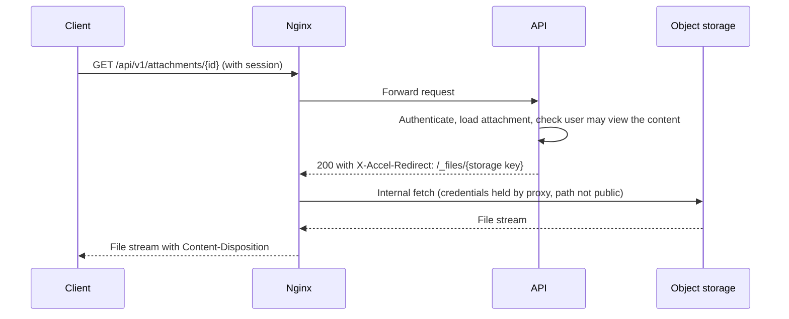
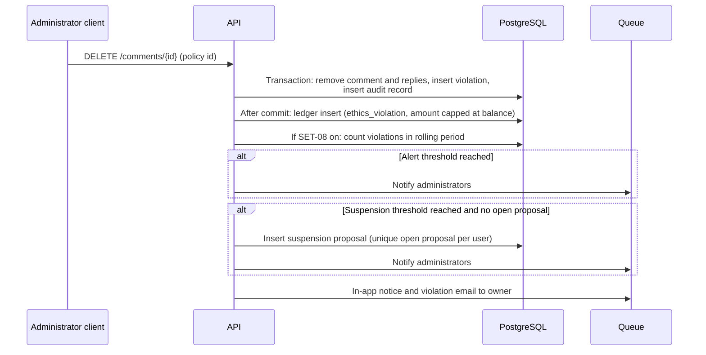
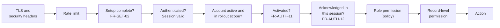
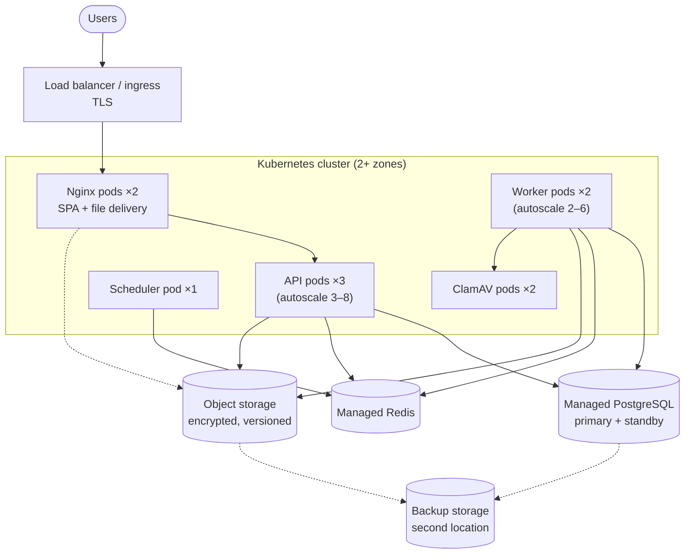

# GrowHub System Architecture Document

| Item | Detail |
| :--- | :--- |
| Product | GrowHub, a configurable knowledge-sharing and gamification platform for organisations |
| Document version | 1.0 (draft for architecture review) |
| Document date | 19 November 2026 |
| Document status | Awaiting product owner and technical lead approval |
| Sources | [BRD v3.1](BRD.md), [Use Case Specification v1.1](USE_CASES.md), [SRS v1.1](SRS.md) |

## How to read this document

This document describes the architecture recommended for building GrowHub. It explains the structure of the system, the technology chosen, how the main scenarios run, and how the quality targets in the SRS are met. Each significant choice is recorded as an architecture decision (ADR) in [Section 15](#15-architecture-decisions), with the alternatives considered.

IDs such as FR-xx, QR-xx, IR-xx, and DC-xx refer to the SRS. BR, SET, and NFR refer to the BRD. UC refers to the use case specification.

## Contents

1. [Architectural drivers](#1-architectural-drivers)
2. [Architecture overview](#2-architecture-overview)
3. [Technology stack](#3-technology-stack)
4. [Backend design](#4-backend-design)
5. [Key runtime scenarios](#5-key-runtime-scenarios)
6. [Data architecture](#6-data-architecture)
7. [Service interface design](#7-service-interface-design)
8. [Security architecture](#8-security-architecture)
9. [Client architecture](#9-client-architecture)
10. [Asynchronous processing](#10-asynchronous-processing)
11. [Configuration and installation model](#11-configuration-and-installation-model)
12. [Deployment architecture](#12-deployment-architecture)
13. [Observability and operations](#13-observability-and-operations)
14. [Development and delivery](#14-development-and-delivery)
15. [Architecture decisions](#15-architecture-decisions)
16. [Quality attribute strategies](#16-quality-attribute-strategies)
17. [Architecture risks](#17-architecture-risks)

---

## 1. Architectural drivers

### 1.1 Key functional drivers

| Driver | Why it shapes the architecture | Sources |
| :--- | :--- | :--- |
| One product, many organisations, configured at setup | Organisation data and policy must live in data, never in code or builds | BR-70 to BR-79, DC-03, QR-25 |
| Consistent, abuse-resistant point rules | Point awarding must be atomic and exactly-once under concurrent requests | FR-PTS, Section 7.1 of the SRS |
| Strict access to content and attachments | Every read, including file downloads, must be authorised by the service | FR-ATT-03, FR-ACL-01 |
| Time-based rules in the organisation's time zone | Days, streaks, resets, and working-day targets need one calendar service | BR-77, Section 7 of the SRS |
| Complete audit trail | Sensitive actions must be recorded reliably and immutably | FR-AUD |
| Web for all roles, mobile for employees | One service interface must serve two clients with different session models | DC-02, IR-08 |

### 1.2 Quality attribute drivers

| Attribute | Target | Source |
| :--- | :--- | :--- |
| Performance | 95% of requests within 1 second; search within 2 seconds | QR-01, QR-04 |
| Capacity | 20,000 users, 2,000 concurrent users, 100,000 items, 2 TB of files per installation | QR-03 |
| Availability | 99.5% per month | QR-12 |
| Recovery | RPO 24 hours or less; RTO 8 hours or less; daily backups | QR-13 |
| Security | OWASP ASVS Level 2; encryption in transit and at rest | QR-07, QR-08, QR-11 |
| Configurability | No code change or redeployment for organisation-specific values | NFR-16 |
| Isolation | No data access across installations | DC-04, NFR-17 |
| Operability | New installation with documented steps and no code changes | QR-24 |

### 1.3 Constraints

- One installation serves one organisation (DC-04).
- Every installation of a release runs the same code (QR-25).
- Production installations contain no demo or sample data (DC-05).
- Interface text is available in Indonesian and English from translation resources (DC-06).
- The mobile client must work with any installation from one app build (IR-12).

### 1.4 Architecture principles

| ID | Principle | Consequence |
| :--- | :--- | :--- |
| AP-01 | **The service is the single source of truth.** | Clients render and validate for convenience only. Every rule is enforced in the service. |
| AP-02 | **Configuration is data.** | Settings, starter content, and branding are read at runtime. Builds contain no organisation values. |
| AP-03 | **Simple until proven otherwise.** | One deployable service, one relational database, and no additional platform until a measured need appears. |
| AP-04 | **Modules own their data.** | A module changes only its own tables. Other modules call its public services or react to its events. |
| AP-05 | **Facts are append-only.** | Point transactions, audit records, review decisions, and violations are inserted, never updated. |
| AP-06 | **Every side effect is idempotent.** | Jobs, retries, and duplicate requests cannot award points twice or send duplicate notices. |
| AP-07 | **Store UTC, compute in the organisation's time zone.** | All timestamps are stored in UTC. A calendar service converts them to the organisation's day. |

## 2. Architecture overview

### 2.1 Architecture style

GrowHub uses a **modular monolith**: one backend application, divided into business modules with explicit boundaries, deployed as several processes from the same image. Each organisation runs its own **single-tenant installation**. Clients are a web single-page application and a Flutter mobile application, both using one versioned REST API.

The reasons, and the alternatives rejected, are in ADR-01 and ADR-02.

### 2.2 System context



### 2.3 Containers



| Container | Responsibility | Scaling |
| :--- | :--- | :--- |
| Reverse proxy | TLS termination, security headers, serving the built web SPA, request size limits, internal file delivery after the API authorises it | Horizontal |
| API process | All HTTP endpoints, authentication, authorisation, validation, and synchronous business logic | Horizontal, stateless |
| Queue workers | Emails, notifications fan-out, malware scans, imports, report and data exports, retention | Horizontal |
| Scheduler | Triggers time-based tasks every minute; runs as a single instance | Exactly one |
| PostgreSQL | All business data, the point ledger, and audit records | Vertical, with a standby for failover |
| Redis | Cache, queues, rate limit counters, and web sessions | Single instance or managed service |
| Object storage | Attachments, module media, photos, logos, and generated exports | Managed or self-hosted |
| Malware scanner | Scans uploaded files before they become available | Horizontal |

The API, workers, and scheduler run from **one container image** with different start commands.

## 3. Technology stack

| Layer | Technology | Reason |
| :--- | :--- | :--- |
| Backend language and framework | PHP 8.4, Laravel 13 | Mature framework with built-in queues, scheduler, mail, localisation, policies, rate limiting, and migrations; productive for a small team; widely available skills in Indonesia (ADR-07) |
| API authentication | Laravel Sanctum | Supports both cookie sessions for the SPA and revocable tokens for mobile (ADR-06) |
| Database | PostgreSQL 17 | Strong transactions and constraints for the point ledger, partial unique indexes, `pg_trgm` search, JSONB settings, and mature managed offerings (ADR-03) |
| Cache, queues, rate limits | Redis 7 (or a compatible service such as Valkey) | One component covers several needs with low operational cost (ADR-08) |
| File storage | S3-compatible object storage (cloud bucket or MinIO on premises) | Scales to 2 TB and beyond, supports encryption and versioning |
| Malware scanning | ClamAV daemon | Open source, runs as a sidecar service |
| Web client | Vue 3, Vite, Pinia, Vue Router, vue-i18n, TypeScript | Lightweight SPA, strong ecosystem, good fit for responsive pages |
| Rich text | Markdown (CommonMark subset), rendered with markdown-it and sanitised with DOMPurify on web; flutter_markdown on mobile | Safe, portable between web and mobile, easy to search (ADR-09) |
| Mobile client | Flutter 3, flutter_bloc, Dio, flutter_secure_storage, drift (SQLite) for offline cache, intl | One codebase for Android and iOS with native performance |
| Reverse proxy | Nginx | Fast static serving and `X-Accel-Redirect` for authorised file delivery (ADR-05) |
| API contract | OpenAPI 3.1 | Generates typed clients for web and mobile and drives contract tests |
| Container runtime | Docker images; Docker Compose for small installations; Kubernetes with a Helm chart for larger ones (ADR-10) | Same image everywhere, two operating profiles |
| Observability | OpenTelemetry, structured JSON logs, Prometheus metrics, Sentry-compatible error tracking | Vendor-neutral |
| Testing | Pest or PHPUnit for the backend, Vitest for web units, Flutter tests, Playwright for end-to-end | Covers QR-21 |

## 4. Backend design

### 4.1 Modules

| Module | Responsibility | Main SRS areas |
| :--- | :--- | :--- |
| Setup | Setup wizard, organisation profile, settings, starter content packs, calendar | FR-SET, FR-ORG |
| Identity | Sign-in, sessions, one-time codes, activation, password changes, ethics acknowledgement | FR-AUTH, FR-OTP, FR-ETH |
| Users | Accounts, roles, import, profile, rollout scope | FR-USR, FR-IMP, FR-PRF |
| Content | Content items, tags, attachments, status machine, categories | FR-CNT, FR-ATT, FR-CAT |
| Review | Review queue and decisions | FR-REV |
| Engagement | Likes, saves, shares, comments, reading history | FR-ENG, FR-DSC-07, FR-DSC-08 |
| Discovery | Feed, search, filters, popularity, trending, recommendations, home page | FR-DSC |
| Communities | Communities and memberships | FR-COM |
| Learning | Modules and completions | FR-LRN |
| Gamification | Point rules, point ledger, streaks, levels, badges, leaderboard, cycles | FR-PTS, FR-GAM, FR-LDB |
| Moderation | Ethics policies, violations, escalation, suspension proposals | FR-MOD |
| Notifications | In-app notifications, email templates and delivery | FR-NTF |
| Support | FAQs, ticket categories, tickets, responses | FR-SUP |
| Reporting | Report queries and exports | FR-RPT |
| Audit | Audit records | FR-AUD |
| Privacy | Data export, anonymisation, retention | FR-DPR |
| Platform (shared kernel) | Settings access, calendar and time zone service, permission checks, file service, idempotent job base, error format | Cross-cutting |

### 4.2 Module dependency rules



- Feature modules may call Foundation modules directly.
- Feature modules never call Gamification, Notifications, or Audit directly. They publish **domain events**, and those modules react.
- Reporting reads other modules' tables through read-only query objects and never writes.
- Modules communicate only through public service classes and events. Architecture tests in CI enforce these rules.

### 4.3 Internal structure of a module

```text
app/Modules/<Module>/
  Http/            Controllers, form requests (validation), API resources (output shape)
  Actions/         One class per use case step, e.g. SubmitContent, ApproveContent
  Domain/          Models, value objects, state machines, domain events, policies
  Infrastructure/  Queries, repositories, external adapters
  Jobs/            Queued jobs
  Listeners/       Reactions to other modules' events
  Database/        Migrations and factories for this module's tables
  Tests/           Feature and unit tests
```

Controllers stay thin: validate, authorise, call one Action, and return a resource. Each Action runs in one database transaction and publishes its events **after commit**, so that listeners never see uncommitted data.

### 4.4 Domain events

| Event | Published by | Consumed by |
| :--- | :--- | :--- |
| UserActiveToday | Identity (first authenticated request of the day) | Gamification (daily sign-in points, streak) |
| ContentSubmitted | Content | Gamification, Notifications |
| ContentApproved, ContentRejected | Review | Gamification, Notifications, Audit |
| ContentRemoved | Content | Notifications, Audit |
| ContentRead | Engagement | Gamification |
| ContentLiked, ContentSaved, ContentShared | Engagement | Gamification, Notifications |
| CommentPosted | Engagement | Gamification, Notifications |
| CommentRemovedForViolation | Moderation | Gamification, Notifications, Audit |
| EscalationThresholdReached | Moderation | Notifications |
| ModuleCompleted | Learning | Gamification |
| PointsChanged | Gamification | Gamification (levels, badges), Notifications |
| LevelIncreased, BadgeEarned, StreakBonusAwarded | Gamification | Notifications |
| TicketSubmitted, TicketUpdated | Support | Notifications |
| SettingChanged, AccountChanged, and other audited actions | Owning module | Audit |

Gamification listeners run **synchronously in the same request, after commit**, so that users see their points immediately. Notification and email listeners run **on the queue**. Audit records for administrative actions are written **inside the same transaction** as the action, so an audited change can never be saved without its record.

## 5. Key runtime scenarios

### 5.1 Sign-in, activation, and acknowledgement



A middleware chain on every protected route enforces the order of these states. See [Section 8.2](#82-request-pipeline).

### 5.2 Submit, review, and award points



If two reviewers act at once, the row lock makes the second one find the item no longer Pending, and it receives a conflict error (FR-REV-05).

### 5.3 Authorised attachment download



The `/_files/` location is marked `internal` in Nginx, so it cannot be requested directly. Storage keys are random and never shown to clients. Copying the download URL to a signed-out browser fails at the authentication step (FR-ATT-04). The API never holds large files in memory.

### 5.4 Comment moderation with escalation



### 5.5 Scheduled leaderboard reset

1. The scheduler process runs every minute and dispatches due tasks.
2. The reset task computes the next reset time from SET values in the organisation's time zone.
3. When due, it inserts a competition cycle row with a unique key of the reset time, so that a retry cannot create two cycles.
4. The leaderboard cache is cleared.
5. No point data changes (FR-LDB-05).

## 6. Data architecture

### 6.1 Database organisation

- One PostgreSQL database per installation.
- One PostgreSQL schema per module, for example `identity`, `content`, `gamification`, `audit`. This makes module ownership visible and allows per-schema permissions.
- All timestamps use `timestamptz` and are stored in UTC.
- Primary keys are UUIDv7: sortable by time, safe to expose, and not guessable.
- Migrations are forward-only and backward-compatible with the previous release, so that rolling upgrades work (Section 14.3).

### 6.2 Point ledger

The point ledger implements SRS Section 7.1 with database guarantees rather than application checks alone.

```text
gamification.point_transactions
  id              uuid primary key
  user_id         uuid not null
  rule_key        text null          -- null for manual adjustments
  amount          integer not null   -- signed, never 0
  dedup_key       text null          -- e.g. "content:{id}", "liker:{user}:content:{id}", "day:2026-11-19"
  related_type    text null
  related_id      uuid null
  actor_id        uuid null
  reason          text null
  created_at      timestamptz not null

  unique (rule_key, user_id, dedup_key) where dedup_key is not null
  index (user_id, created_at)
  index (created_at, user_id)
```

- **Once-only rules** are enforced by the partial unique index. A duplicate insert fails and is treated as "no points awarded". This holds even under concurrent requests and job retries.
- **Daily limits** are checked inside a transaction that locks the user's row in `gamification.user_scores` (`SELECT … FOR UPDATE`), counts today's transactions for the rule, and inserts if allowed.
- **Totals** are kept in `gamification.user_scores` (total, level, current streak, longest streak, last active day) and updated in the same transaction as the ledger insert. A nightly job verifies that totals equal ledger sums and reports any difference.
- **Deductions** are capped at the current total in the same locked transaction (FR-PTS-03).
- The ledger has no update or delete grants for the application role.

### 6.3 Search

- A generated column `search_text` combines title, body, and tags.
- A GIN index with `pg_trgm` supports case-insensitive "contains every word" matching (FR-DSC-02). Each word becomes an `ILIKE '%word%'` condition that uses the trigram index.
- Visibility filters (status, community membership under SET-03) are applied in the same query.
- At 100,000 items this meets the 2-second search target (QR-04). ADR-03 records when to introduce a dedicated search engine.

### 6.4 Leaderboard and popularity

| Need | Design |
| :--- | :--- |
| Leaderboard views | One parameterised query: `SUM(amount)` and `MAX(created_at)` grouped by user since the period start, joined to active users, filtered by unit. Uses the `(created_at, user_id)` index. Results are cached in Redis for 60 seconds per view. |
| Tie-break | Order by points descending, then by `MAX(created_at)` ascending (time the total was reached), as in SRS Section 7.4 |
| Engagement counts | Counter columns on content, updated in the same transaction as each like, save, share, or comment |
| Trending | An `engagement_events` table with time-stamped events. The 7-day score is aggregated and cached for 5 minutes |
| Recommendations | Computed per user on request from indexed queries, cached for 10 minutes |

### 6.5 Settings and calendar

- Settings are stored in `setup.settings` as one row per key with a JSONB value, validated against a typed schema in code before saving (FR-SET-16).
- Settings are cached in Redis and in process memory. The cache is cleared when a setting changes.
- The calendar service in the Platform module provides: organisation "today", start of week and month, working-day tests, and working days between two times. All modules use it, so time-zone logic exists in one place.

### 6.6 Audit and immutable records

- `audit.records` is insert-only. The application database role has no `UPDATE` or `DELETE` permission on it.
- A separate retention role, used only by the retention job, can delete records older than the SET-14 period (FR-AUD-02).
- The same pattern applies to `point_transactions`, `review_decisions`, and `violations`.

### 6.7 Files

| Item | Design |
| :--- | :--- |
| Keys | Random UUID keys grouped by type, for example `attachments/{uuid}`. Original names are stored in the database |
| States | Uploaded → Scanned clean (available) or Infected (rejected and deleted) |
| Encryption | Server-side encryption in object storage |
| Versioning | Bucket versioning on, so that deleted files can be recovered within the backup window |
| Exports | Generated report and data export files are stored under `exports/` and deleted after 7 days |

### 6.8 Retention

A daily job deletes or anonymises data according to SET-14, in batches of 1,000 rows to avoid long locks. Each run is recorded in `platform.job_runs`.

### 6.9 Backup and recovery

| Item | Design | Target met |
| :--- | :--- | :--- |
| Database | Daily full backup plus continuous WAL archiving; point-in-time recovery | RPO well under 24 hours |
| Files | Bucket versioning plus daily replication to a second location | RPO 24 hours or less |
| Encryption | Backups encrypted at rest | QR-11 |
| Restore | Documented runbook; restore test before each major release | RTO 8 hours or less, QR-14 |

## 7. Service interface design

### 7.1 Conventions

| Item | Convention |
| :--- | :--- |
| Base path | `/api/v1` |
| Format | JSON; UTF-8; ISO 8601 timestamps in UTC; clients convert for display |
| Resources | Plural nouns, for example `/contents`, `/contents/{id}/comments` |
| State changes | Explicit action endpoints for transitions, for example `POST /contents/{id}/submit`, `/approve`, `/reject`, `/withdraw` |
| Paging | `?page=&per_page=` with `meta.total`; default 20, maximum 100 |
| Filtering and sorting | `?filter[category]=…&sort=-published_at` |
| Language | `Accept-Language`, defaulting to the user's language, then SET-10 |
| Idempotency | `Idempotency-Key` header accepted on create endpoints, stored for 24 hours |
| Contract | OpenAPI 3.1 document in the repository; clients generated from it; contract tests in CI |
| Versioning | Breaking changes only in a new version; the previous version supported for 6 months (IR-08) |

### 7.2 Error format

Errors follow RFC 9457 (Problem Details) with a stable code:

```json
{
  "type": "https://growhub.dev/errors/validation",
  "title": "The given data was invalid.",
  "status": 422,
  "code": "validation_failed",
  "errors": {
    "title": [{ "code": "too_long", "message": "Title may not exceed 200 characters." }]
  },
  "request_id": "01JD3…"
}
```

Messages are localised. Clients rely on `code`, not on message text.

### 7.3 Endpoint groups

| Group | Examples |
| :--- | :--- |
| Public (no session) | `GET /public/branding`, `GET /public/status`, `POST /auth/sign-in` |
| Identity | `/auth/activation/code`, `/auth/activation`, `/auth/acknowledgement`, `/auth/sign-out`, `/me/password` |
| Profile | `/me`, `/me/photo`, `/me/email`, `/me/email/verify` |
| Content | `/contents`, `/contents/{id}/submit`, `/withdraw`, `/attachments` |
| Review | `/review-queue`, `/contents/{id}/approve`, `/contents/{id}/reject` |
| Engagement | `/contents/{id}/like`, `/save`, `/share`, `/comments`, `/me/saved`, `/me/history` |
| Discovery | `/feed`, `/home` |
| Communities, Learning | `/communities`, `/communities/{id}/membership`, `/modules`, `/modules/{id}/complete` |
| Gamification | `/me/points`, `/me/dashboard`, `/leaderboard?view=week` |
| Notifications, Support | `/notifications`, `/faqs`, `/tickets`, `/tickets/{id}/responses` |
| Administration | `/admin/setup/*`, `/admin/settings`, `/admin/users`, `/admin/imports`, `/admin/point-rules`, `/admin/levels`, `/admin/badges`, `/admin/leaderboard`, `/admin/ethics-policies`, `/admin/audit`, `/admin/reports/{id}`, `/admin/privacy/*` |
| Operations | `/health/live`, `/health/ready` (not exposed publicly) |

## 8. Security architecture

### 8.1 Authentication and sessions

| Client | Mechanism | Expiry |
| :--- | :--- | :--- |
| Web | Sanctum cookie session (HttpOnly, Secure, SameSite=Lax) stored in Redis, with CSRF protection | Idle timeout from SET-11, applied per request |
| Mobile | Sanctum personal access token, stored in the device keystore through flutter_secure_storage; only its hash is stored on the server | Absolute expiry from SET-11, set at creation |

- Each session or token has an ID that is linked to the ethics acknowledgement (FR-ETH-02).
- Deactivation, password reset, and suspension delete all of the user's sessions and tokens (FR-AUTH-10).
- Passwords are hashed with Argon2id.
- One-time codes are stored as HMAC-SHA256 values keyed with an application secret. Attempt counts and expiry are checked in the same row update.

### 8.2 Request pipeline

Every protected request passes these middleware steps in order:



Routes needed earlier in the flow, such as activation and acknowledgement, are allowed at the step where they are needed.

### 8.3 Authorisation

- The permission matrix in SRS Section 8.6 is implemented as named permissions mapped to roles in code. Optional roles are effective only when SET-05 or SET-06 enables them.
- Record-level rules, such as "author only", "not own submission", and "community member when SET-03 is members only", are Laravel policies.
- Visibility rules are also applied as **query scopes**, so that lists, search, counts, and direct reads all use the same rules (FR-DSC-05).
- When a user may not see a record, the API returns 404 rather than 403 (FR-ACL-02).

### 8.4 Application security controls

| Threat | Control |
| :--- | :--- |
| Credential stuffing and brute force | Redis rate limits per employee ID and network address (FR-AUTH-05, FR-AUTH-06); generic error messages |
| Cross-site scripting | Content stored as Markdown; HTML disabled in the renderer; output sanitised with DOMPurify; strict Content Security Policy without inline scripts |
| Cross-site request forgery | SameSite cookies and CSRF tokens for the web SPA; bearer tokens for mobile |
| Malicious uploads | Extension and detected MIME type allowlist, size limits at proxy and API, ClamAV scan before availability, downloads with `Content-Disposition: attachment` for documents, and `X-Content-Type-Options: nosniff` |
| Insecure direct object references | UUIDv7 IDs plus policy checks on every record |
| Mass assignment | Explicit validated input objects per action |
| SQL injection | Query builder with bound parameters only |
| Secrets exposure | Secrets injected through environment or a secret store; never in images or the repository |
| Sensitive data in logs | Log processors remove passwords, codes, tokens, and email bodies (QR-09) |

### 8.5 Data protection

- TLS 1.2 or later at the proxy; HSTS enabled (QR-07).
- Encryption at rest: encrypted database volumes or managed database encryption, object storage server-side encryption, and encrypted backups (QR-11).
- Employee ID and email are excluded from API resources returned to other users (FR-PRF-06).
- Anonymisation replaces personal fields and the employee ID with an HMAC reference (FR-DPR-02).

### 8.6 Security verification

- Static analysis (PHPStan at maximum practical level, ESLint, Dart analyzer) in CI.
- Dependency and container image vulnerability scanning in CI.
- OWASP ASVS Level 2 checklist reviewed before each release (QR-08).
- External penetration test before the first production release and yearly afterwards.

## 9. Client architecture

### 9.1 Web SPA

```text
frontend/src/
  app/            Bootstrapping, router, global guards, layout shells
  api/            Generated OpenAPI client, interceptors (errors, language, CSRF)
  features/
    auth/         Sign-in, activation, acknowledgement
    setup/        Setup wizard (administrator)
    feed/  content/  review/  communities/  learning/
    gamification/ notifications/ support/ profile/
    admin/        Users, settings, gamification, moderation, reports, audit
  shared/         UI components, Markdown renderer, formatters, composables
  i18n/           id.json, en.json
```

- Each feature owns its pages, components, and Pinia store.
- Router guards mirror the service pipeline for a smooth experience, but the service remains the authority.
- Branding (name, logo) is loaded at start-up from `GET /public/branding`, so one build serves every organisation.
- Dates use the organisation's time zone from the branding response (IR-04).
- Admin pages are lazy-loaded so that employees download only what they use.
- Responsive layout from 360 px to 1,920 px (IR-01).

### 9.2 Mobile app

```text
mobile/lib/
  core/           Dio client, interceptors, secure storage, server address, l10n, theme
  data/           Generated API models, repositories, drift database (offline cache)
  features/       auth, feed, content, communities, learning, gamification,
                  notifications, support, profile — each with bloc/, view/, widgets/
```

- **Server address:** on first launch, the user enters the installation address or opens an installation link. The app checks it through `GET /public/branding` and stores it (IR-12).
- **State management:** one BLoC per feature screen, with repositories as the only API callers.
- **Offline:** the last loaded feed page and its content summaries are stored in drift. When offline, the feed shows them with an offline banner and refreshes on reconnect (QR-19, NFR-19).
- **Notifications:** the unread count is polled every 60 seconds while the app is in the foreground. Push notifications are out of scope.
- **Specialist functions** are not included in the mobile app (FR-ACL-03).

## 10. Asynchronous processing

### 10.1 Queues

| Queue | Jobs | Retry policy |
| :--- | :--- | :--- |
| `critical` | One-time code emails | 3 retries at 30, 90, and 180 seconds |
| `notifications` | In-app notification fan-out, violation and suspension emails | 3 retries at 60, 180, and 360 seconds (FR-NTF-05) |
| `files` | Malware scan, thumbnail generation | 5 retries with exponential backoff |
| `bulk` | User import validation and creation, report exports, personal data exports, retention | 3 retries; long timeout |

- Every job is idempotent. It uses a dedup key or checks the current state before acting (AP-06).
- Failed jobs after the last retry are stored and shown on the operations dashboard.
- Notification fan-out to many recipients, such as all reviewers, is split into batches of 500.

### 10.2 Scheduler

| Task | Frequency |
| :--- | :--- |
| Leaderboard reset check | Every minute |
| Retention clean-up | Daily at 02:00 organisation time |
| Ledger total verification | Daily at 03:00 organisation time |
| Expired export file clean-up | Daily |
| Expired one-time code and idempotency key clean-up | Hourly |

The scheduler runs as exactly one process. Tasks also take a Redis lock, so that an accidental second scheduler cannot run them twice.

## 11. Configuration and installation model

### 11.1 Three kinds of configuration

| Kind | Examples | Stored in | Changed by |
| :--- | :--- | :--- | :--- |
| Release | Code, starter content packs, translations, email templates | Container image | Delivery team, through a release |
| Installation infrastructure | Database URL, Redis URL, bucket, email provider credentials, public URL, secrets | Environment variables or secret store | Implementation team |
| Organisation | Profile, settings, units, starter content choices, point rules, policies | Database | Administrators, through the application |

No organisation value is ever stored in the first two kinds (DC-03, QR-25).

### 11.2 Starter content packs

Starter lists from BRD Section 9.4 are shipped as versioned JSON files in the release, in Indonesian and English. The setup wizard reads them and copies the chosen entries into the database. After that, the data belongs to the organisation and later releases never overwrite it.

### 11.3 Installing a new organisation

1. The implementation team provisions infrastructure for the chosen profile ([Section 12](#12-deployment-architecture)).
2. The team deploys the current release image with installation configuration.
3. The team runs `php artisan growhub:install --employee-id=… --email=…`. This command runs migrations and creates only the first administrator account. It has no option to load demo data in production (FR-ACL-04).
4. The first administrator signs in and completes setup (UC-01).

Development and test environments use a separate seeder that refuses to run when the environment is production.

## 12. Deployment architecture

### 12.1 Profiles

| Profile | Intended size | Platform | Availability approach |
| :--- | :--- | :--- | :--- |
| **Compact** | Up to 2,000 users | One virtual machine with Docker Compose | Host monitoring, automatic container restart, daily backups, tested restore within RTO |
| **Standard** | Up to the reference load of 20,000 users | Kubernetes with the Helm chart and managed database, Redis, and object storage | Multiple API replicas across zones, managed database with standby failover |

Both profiles run the same image and meet QR-12 and QR-13. Compact meets 99.5% by keeping recovery fast, while Standard tolerates the loss of a node without downtime.

### 12.2 Standard profile



### 12.3 Starting sizes

These are starting points. Load tests confirm them before release (QR-03).

| Component | Compact (one VM) | Standard |
| :--- | :--- | :--- |
| Compute | 4 vCPU, 16 GB RAM, 200 GB SSD | API pods 1 vCPU, 1 GB each; worker pods 1 vCPU, 1 GB each |
| PostgreSQL | Container on the same VM | 4 vCPU, 16 GB RAM, 200 GB SSD, with standby |
| Redis | Container, 1 GB | Managed, 2 GB |
| Object storage | MinIO container or a cloud bucket | Cloud bucket sized for 2 TB |
| Backups | Database dump plus WAL to an external bucket; bucket replication | Managed point-in-time recovery plus bucket replication |

### 12.4 Network

- Only the proxy or ingress is reachable from the internet, on port 443.
- Database, Redis, object storage, and ClamAV are on private networks.
- Health endpoints are reachable only from the cluster or monitoring network.
- Outbound traffic is limited to the email provider and the vulnerability database for ClamAV.

## 13. Observability and operations

| Area | Design |
| :--- | :--- |
| Logs | Structured JSON with request ID, user ID, module, action, result, and duration (QR-22). Sensitive fields removed |
| Metrics | Request rate, latency percentiles, error rate, queue depth, job failures, database connections, scheduler heartbeat |
| Tracing | OpenTelemetry traces from proxy to API to database and queue |
| Errors | Exceptions sent to an error tracking service with request ID |
| Health | `/health/live` (process up) and `/health/ready` (database, Redis, and storage reachable) (QR-23) |
| Alerts | p95 latency above 1 second for 10 minutes; error rate above 2%; queue delay above 5 minutes; scheduler heartbeat missing for 5 minutes; failed backup; disk above 80% |
| Business health | Daily ledger verification result; email delivery failure rate |
| Runbooks | Restore, failover, upgrade, rollback, rotate secrets, and handle a failed migration |

## 14. Development and delivery

### 14.1 Repository

One repository holds the whole product:

| Path | Content |
| :--- | :--- |
| `backend/` | Laravel application |
| `frontend/` | Vue SPA |
| `mobile/` | Flutter app |
| `e2e/` | Playwright end-to-end tests |
| `deploy/` | Dockerfiles, Compose files, Helm chart |
| `api/` | OpenAPI document |
| `docs/` | Requirements, architecture, and guides |

### 14.2 Pipeline

```mermaid
flowchart LR
    A["Commit / pull request"] --> B["Lint and static analysis"]
    B --> C["Unit and feature tests<br/>(PostgreSQL, Redis services)"]
    C --> D["Architecture tests<br/>(module rules)"]
    D --> E["OpenAPI contract tests"]
    E --> F["Build images<br/>SBOM, vulnerability scan"]
    F --> G["Deploy to test"]
    G --> H["Playwright end-to-end<br/>and setup tests"]
    H --> I["Release candidate"]
    I --> J["Staging: load test,<br/>restore test (major releases)"]
    J --> K["Roll out to installations"]
```



- Every pull request must keep the test suite passing (QR-21).
- Setup is tested with at least two different organisation profiles and setting combinations in end-to-end tests, as required by the BRD's product release checklist.

### 14.3 Release and upgrade

- Releases use semantic versioning. Every installation runs a supported release.
- Database migrations follow expand-and-contract: a release only adds or relaxes structures, and removal happens in a later release. This allows rolling upgrades with no downtime in the Standard profile.
- Upgrades run migrations as a one-off job before new API pods start.
- Rollback redeploys the previous image. Because migrations are backward-compatible, the database does not need to be rolled back.
- Mobile app releases remain compatible with the two most recent server releases, and the app shows an update prompt when the server reports a minimum app version.

### 14.4 Environments

| Environment | Purpose | Data |
| :--- | :--- | :--- |
| Local | Development with Docker Compose and a local email catcher | Seeded sample data |
| Test | Automated end-to-end tests | Seeded per run |
| Staging | Release candidate, load and restore tests | Synthetic data at reference volume |
| Production | One per organisation | Organisation data only |

## 15. Architecture decisions

### ADR-01 Modular monolith

| Item | Detail |
| :--- | :--- |
| Context | About 17 business modules with many shared transactions, for example review decisions that award points. The expected team is small, and each installation serves one organisation with at most about 20,000 users. |
| Decision | Build one backend application divided into modules with enforced boundaries and domain events. Run it as API, worker, and scheduler processes from one image. |
| Alternatives | **Microservices:** independent scaling, but distributed transactions for points, many more deployables per installation, and high operational cost for each organisation. **Unstructured monolith:** fastest at first, but boundaries erode. |
| Consequences | Simple deployment and consistent transactions. Module rules must be enforced by architecture tests. A module can be extracted later if a measured need appears. |

### ADR-02 Single-tenant installation per organisation

| Item | Detail |
| :--- | :--- |
| Context | The BRD requires strict isolation (NFR-17) and treats several organisations per installation as out of scope. Organisations may need different hosting locations for legal reasons. |
| Decision | Each organisation gets its own installation: its own database, Redis, bucket, and secrets, running the shared release image. |
| Alternatives | **Shared multi-tenant database with a tenant column:** cheaper to host, but one missed filter leaks data and per-organisation hosting becomes hard. **Schema per tenant:** better isolation, but migrations and operations get complex. |
| Consequences | Strong isolation and simple data model. Hosting cost per organisation is higher, and upgrades must be automated across installations. Multi-tenancy can be revisited as a later product decision. |

### ADR-03 PostgreSQL search instead of a search engine

| Item | Detail |
| :--- | :--- |
| Context | Search covers title, body, and tags of up to 100,000 items, in Indonesian and English, with "contains every word" semantics and permission filters. |
| Decision | Use `pg_trgm` GIN indexes on a generated search column, with visibility filters in the same query. |
| Alternatives | **Elasticsearch or OpenSearch:** better ranking and scale, but another stateful service to operate per installation and permission filters to keep in sync. **PostgreSQL full-text search:** good ranking, but word stemming differs between languages and does not match "contains" semantics. |
| Consequences | No extra component. Ranking is simple. Introduce a search engine if any installation exceeds 500,000 items or misses QR-04 in load tests. |

### ADR-04 Append-only point ledger with database-enforced deduplication

| Item | Detail |
| :--- | :--- |
| Context | Points must be exactly-once per rule (SRS Section 7.1), auditable (FR-PTS-02), and correct under concurrent requests and job retries. |
| Decision | Store every change in an insert-only ledger. Enforce once-only rules with a partial unique index on rule, user, and dedup key. Lock the user's score row for daily limits and deductions. Keep totals in a summary table updated in the same transaction. |
| Alternatives | **Mutable counters only:** fast, but no history and race conditions. **Application-level checks only:** vulnerable to concurrency and retries. |
| Consequences | Correctness under concurrency, full history, and leaderboards computed from the ledger. The ledger grows over time and needs good indexes. A nightly job verifies totals. |

### ADR-05 Attachments delivered by the proxy after API authorisation

| Item | Detail |
| :--- | :--- |
| Context | Every download must be authorised, and a copied link must not grant access (FR-ATT-03, FR-ATT-04). Files can be 50 MB. |
| Decision | The API authorises the request and returns `X-Accel-Redirect` to an internal Nginx location that streams the file from private object storage. |
| Alternatives | **Pre-signed object storage URLs:** efficient, but the URL itself grants access for its lifetime and breaks FR-ATT-04. **Streaming through PHP:** simple, but ties up API workers for large files. |
| Consequences | Strict access control with efficient streaming. The proxy needs read credentials for the bucket, and the internal location must never be exposed. |

### ADR-06 Cookie sessions for web, tokens for mobile

| Item | Detail |
| :--- | :--- |
| Context | Web needs an idle timeout and runs on shared computers. Mobile needs a long-lived session that survives app restarts. |
| Decision | Use Sanctum stateful cookie sessions with CSRF protection for the SPA, and Sanctum personal access tokens in secure storage for mobile. |
| Alternatives | **Bearer tokens in browser storage:** readable by any injected script. **JWT:** hard to revoke immediately, which FR-AUTH-10 requires. |
| Consequences | Strong protection on web and immediate revocation everywhere. The web SPA and API must share a site, which the proxy provides. |

### ADR-07 Laravel, Vue, and Flutter

| Item | Detail |
| :--- | :--- |
| Context | The product needs a productive backend with queues, scheduling, mail, localisation, and policies; a responsive SPA; and one mobile codebase. The development team already works with this stack. |
| Decision | Laravel 13 on PHP 8.4, Vue 3 with TypeScript, and Flutter 3. |
| Alternatives | **Node.js (NestJS) backend:** one language with the web client, but more assembly of queues and scheduling. **Java (Spring Boot) or .NET:** robust, but heavier for the team size. **React Native:** shares JavaScript skills, but Flutter gives more consistent UI across Android devices common in frontline settings. |
| Consequences | Fast delivery with familiar tools. PHP request workers need horizontal scaling for concurrency, which the stateless API design supports. |

### ADR-08 Redis for cache, queues, sessions, and rate limits

| Item | Detail |
| :--- | :--- |
| Context | The system needs a queue, a shared cache, web sessions shared across API replicas, rate limit counters, and scheduler locks. |
| Decision | Use one Redis instance per installation for all of these. |
| Alternatives | **Database-backed queues and cache:** fewer components, but extra load on PostgreSQL at peak. **A dedicated message broker:** more features than needed. |
| Consequences | One extra component, available as a managed service in most clouds. Losing Redis signs web users out and delays queued jobs, but no business data is lost, because PostgreSQL holds all records. |

### ADR-09 Markdown for rich text

| Item | Detail |
| :--- | :--- |
| Context | Content and modules need formatting, must render on web and mobile, and must be safe from script injection. |
| Decision | Store CommonMark Markdown, with HTML disabled. Render it with markdown-it and DOMPurify on web and flutter_markdown on mobile. Provide a toolbar editor so that users do not need to learn Markdown. |
| Alternatives | **Stored HTML:** richer, but needs strict server-side sanitising and renders poorly on mobile. **Block-based JSON (for example Editor.js):** flexible, but needs custom renderers on both clients. |
| Consequences | Portable and safe content that is easy to search. Some advanced layouts are not possible. |

### ADR-10 Containers with two deployment profiles

| Item | Detail |
| :--- | :--- |
| Context | Organisations range from a few hundred to 20,000 employees, and some host on their own infrastructure. |
| Decision | Ship one set of container images. Support a Compact profile with Docker Compose on one VM and a Standard profile on Kubernetes with a Helm chart. |
| Alternatives | **Kubernetes only:** consistent, but too heavy for small organisations. **Platform-specific services:** simpler per cloud, but locks the product to one vendor. |
| Consequences | Fits small and large organisations with the same release. The team maintains two deployment templates and tests both. |

## 16. Quality attribute strategies

| Quality requirement | Strategy | Sections |
| :--- | :--- | :--- |
| QR-01, QR-02 Response times | Stateless horizontally scaled API; indexed queries; Redis caches for settings, leaderboard, trending, and recommendations; lazy-loaded SPA; HTTP compression | 2.3, 6.4, 9.1 |
| QR-03 Capacity | Autoscaling API and workers; object storage for files; ledger indexes; load tests at reference volume | 6.2, 12 |
| QR-04 Search | `pg_trgm` GIN index with visibility filters in one query | 6.3 |
| QR-05 Import speed | Validation as a queued bulk job with set-based uniqueness checks | 10.1 |
| QR-06, QR-09 Secrets | Argon2id passwords; HMAC codes; hashed tokens; log redaction | 8.1, 8.4 |
| QR-07, QR-11 Encryption | TLS with HSTS at the proxy; encrypted volumes, buckets, and backups | 8.5 |
| QR-08 ASVS Level 2 | Security controls, static analysis, dependency scanning, penetration testing | 8.4, 8.6 |
| QR-10 Script injection | Markdown with HTML disabled; DOMPurify; strict CSP | 8.4, ADR-09 |
| QR-12 Availability | Multiple replicas and managed failover in Standard; fast tested recovery in Compact; health checks and alerts | 12, 13 |
| QR-13, QR-14 Recovery | Daily backups plus WAL archiving; bucket versioning and replication; restore runbook and tests | 6.9 |
| QR-15 to QR-18 Usability | Feature-focused SPA and app; responsive layout; mobile touch targets; usability tests | 9 |
| QR-19 Offline feed | drift cache of the last feed page | 9.2 |
| QR-20 Accessibility | Accessible component library; automated accessibility checks in end-to-end tests | 9.1, 14.2 |
| QR-21 Test coverage | Pipeline gates for unit, feature, contract, architecture, and end-to-end tests | 14.2 |
| QR-22, QR-23 Operability | Structured logs, tracing, health endpoints, alerts | 13 |
| QR-24, QR-25 Configuration only | Three kinds of configuration; install command; starter packs; one image for all installations | 11 |

## 17. Architecture risks

| ID | Risk | Mitigation |
| :--- | :--- | :--- |
| AR-01 | Module boundaries erode over time, making the monolith hard to change | Architecture tests in CI; code review checklist; events for cross-module reactions |
| AR-02 | Ledger and leaderboard queries slow down as transactions accumulate | Composite indexes; caching; monthly partitioning of the ledger if it exceeds 50 million rows |
| AR-03 | Operating many single-tenant installations becomes costly | Automated provisioning and upgrades through the Helm chart and Compose templates; central monitoring for all installations |
| AR-04 | Upgrades across installations drift, so that some run old releases | Supported-release policy; automated upgrade pipeline; version reported by each installation's health endpoint |
| AR-05 | `pg_trgm` search no longer meets QR-04 for a very large installation | Load tests at reference volume; ADR-03 threshold for introducing a search engine |
| AR-06 | Email delivery problems block activation | Queue retries; delivery failure alerts; administrators can correct emails and resend codes |
| AR-07 | Misconfigured proxy exposes the internal file location | Automated test that requests `/_files/` directly and expects refusal; configuration in versioned templates only |
| AR-08 | Time-zone mistakes in day-based rules | Single calendar service; tests that run with several organisation time zones, including UTC+9 and UTC−5 |
