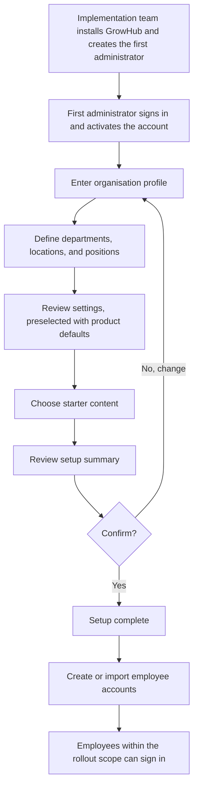
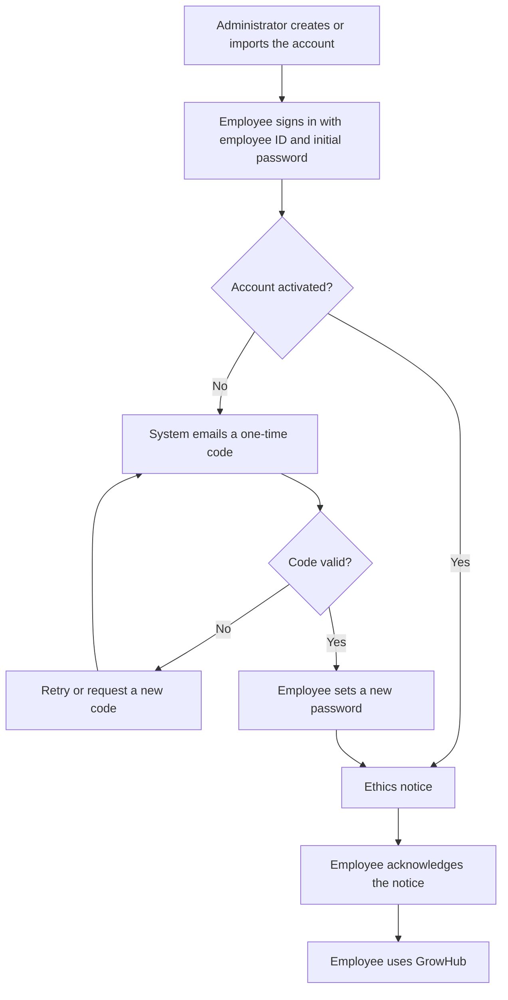
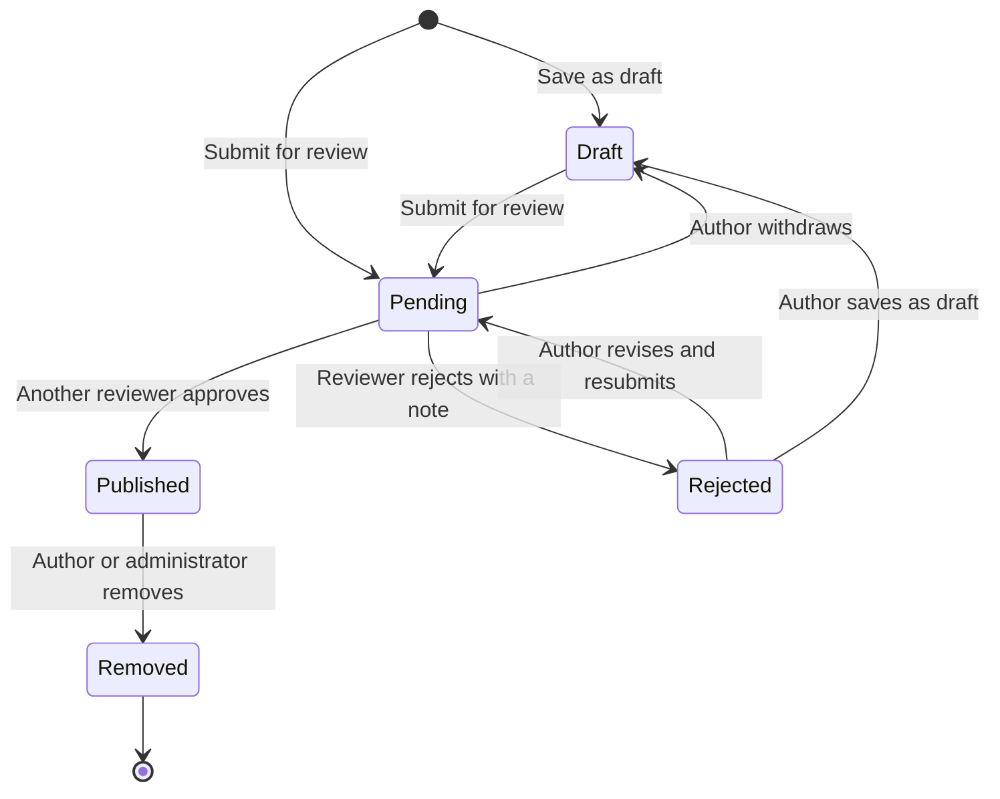

# GrowHub Business Requirements Document (BRD)

| Item | Detail |
| :--- | :--- |
| Product | GrowHub, a configurable knowledge-sharing and gamification platform for organisations |
| Tagline | "Grow Together, Share Knowledge" |
| Document version | 3.1 (draft for product owner review) |
| Document date | 19 November 2026 |
| Document status | Awaiting product owner approval |

## How to read this document

This BRD defines what GrowHub must do before solution design and development begin. GrowHub is a product that any organisation can adopt. The document therefore describes no specific company. Each organisation supplies its own data and makes its own policy choices during first-time setup.

- **Organisation** means the company or institution that deploys and uses GrowHub.
- **Product default** means the value GrowHub proposes during setup. The organisation can accept or change it.
- **Setting** means a value the organisation chooses during first-time setup. Settings are identified as SET-xx in [Section 9](#9-organisation-setup-and-configuration).
- Requirements use **shall** to state a business need.
- Priorities use MoSCoW: **Must** (needed for launch), **Should** (important, but launch could proceed with an agreed workaround), and **Could** (desirable).
- Priorities, product defaults, and objectives are proposals until the product owner approves them.

## Contents

1. [Executive summary](#1-executive-summary)
2. [Business context](#2-business-context)
3. [Business objectives and success measures](#3-business-objectives-and-success-measures)
4. [Stakeholders and user roles](#4-stakeholders-and-user-roles)
5. [Scope](#5-scope)
6. [Target business processes](#6-target-business-processes)
7. [Business requirements](#7-business-requirements)
8. [Business rules](#8-business-rules)
9. [Organisation setup and configuration](#9-organisation-setup-and-configuration)
10. [Non-functional requirements](#10-non-functional-requirements)
11. [Data, privacy, and compliance](#11-data-privacy-and-compliance)
12. [Reporting requirements](#12-reporting-requirements)
13. [Acceptance criteria and launch readiness](#13-acceptance-criteria-and-launch-readiness)
14. [Assumptions, dependencies, and constraints](#14-assumptions-dependencies-and-constraints)
15. [Business risks](#15-business-risks)
16. [Glossary](#16-glossary)

---

## 1. Executive summary

Organisations with distributed workforces need one trusted place where employees at work sites, in the field, and in offices can share practical knowledge, find approved procedures, complete short learning modules, and connect with colleagues who do similar work.

GrowHub will meet this need through five connected capabilities:

1. **Knowledge sharing:** employees contribute tips, best practices, documents, photos, and videos.
2. **Content governance:** reviewers approve content before it reaches all employees.
3. **Learning:** employees complete short, self-paced modules.
4. **Community:** employees discuss topics and join groups across locations.
5. **Gamification:** points, streaks, levels, badges, and leaderboards recognise useful participation.

GrowHub is designed for any organisation. An organisation adopts it through a guided first-time setup in which it enters its own profile and structure and chooses its policies. No code changes are needed. After launch, administrators manage users, learning content, incentives, rankings, and communication ethics without developer involvement. Employees use GrowHub on web and mobile. Specialist roles carry out their work on web.

## 2. Business context

### 2.1 Target organisations

GrowHub targets organisations in sectors such as retail, manufacturing, logistics, services, and the public sector. Typical traits of these organisations:

- Employees work across several sites, departments, or regions.
- A large share of employees are frontline staff who work in shifts and have little time away from their duties.
- Some employees share devices at their work site.
- Working procedures change often and must reach everyone consistently.

Organisations differ in their employee ID formats, structure, language, working calendar, conduct rules, and incentive preferences. GrowHub must accommodate these differences through configuration.

### 2.2 Business problems

| ID | Problem | Business consequence |
| :--- | :--- | :--- |
| P-01 | Proven field solutions stay within individual sites or teams. | The same problems are solved repeatedly |
| P-02 | Employees lack one trusted place to find procedures and working standards. | Work is performed inconsistently |
| P-03 | Employee contributions are not consistently visible or recognised. | Motivation to share knowledge is low |
| P-04 | Informally shared information is not checked for accuracy or confidentiality. | Incorrect or sensitive information can spread |
| P-05 | Frontline staff need training that fits around their work. | Skills development is difficult to sustain |
| P-06 | Employees in different locations have few ways to learn from each other. | Good practice spreads slowly |
| P-07 | Off-the-shelf tools often need custom development to fit each organisation's policies. | Adoption is slow and costly |

### 2.3 Value proposition

| Audience | Value |
| :--- | :--- |
| Employees | Faster answers, recognition, self-paced learning, and peer connection |
| Reviewers | A clear queue and a consistent way to give feedback |
| Administrators | Direct control over users, learning content, incentives, rankings, and conduct rules |
| Adopting organisations | A growing knowledge base, stronger capability, measurable engagement, and a launch that needs configuration rather than development |
| Product owner | One product that serves many organisations without customer-specific code |

## 3. Business objectives and success measures

Each organisation sets its own targets for BO-1 to BO-5 during setup (SET-01) and measures its baselines during its pilot. BO-6 and BO-7 are product targets set by the product owner. Product support tracks them by recording every change request from organisations and the launch date of each installation.

| ID | Objective | Success measure | Target |
| :--- | :--- | :--- | :--- |
| BO-1 | Capture and spread internal knowledge | Published items per month; active contributors as a share of employees | Set by each organisation |
| BO-2 | Keep published knowledge accurate and appropriate | Median review time against the organisation's target (SET-13); approval rate; ethics violations per 1,000 comments | Set by each organisation |
| BO-3 | Increase sustained employee engagement | Daily and monthly active users; share of users reaching a 7-day streak | Set by each organisation |
| BO-4 | Build capability through self-paced learning | Module completions per employee; share of employees completing at least one module | Set by each organisation |
| BO-5 | Connect employees across departments and locations | Community membership rate; engagement across organisation units | Set by each organisation |
| BO-6 | Let each organisation run its programme without developer effort | Share of configuration and content changes completed by business users | 100%; no change request to developers for settings, gamification, ethics policies, categories, modules, or users |
| BO-7 | Let any organisation adopt GrowHub through configuration alone | Time to complete first-time setup; time from installation to pilot launch; share of organisations launched without custom code | Setup within 60 minutes using product defaults, excluding data gathering; pilot within 10 working days of installation; 100% without custom code |

## 4. Stakeholders and user roles

### 4.1 Product stakeholders

| Stakeholder | Responsibility or interest |
| :--- | :--- |
| Product owner | Owns the product vision, roadmap, product defaults, and this BRD |
| Delivery team | Designs, builds, tests, and maintains the product |
| Implementation team | Installs GrowHub for each organisation and supports first-time setup |
| Product support | Handles product defects and questions raised by organisations |

### 4.2 Organisation stakeholders

The names below are typical. Each organisation maps them to its own structure.

| Stakeholder | Responsibility or interest |
| :--- | :--- |
| Executive sponsor | Funds the programme and owns business outcomes |
| Programme owner (often HR or Learning & Development) | Owns the programme, its settings, learning content, and employee adoption |
| IT operations | Supports sign-in, email delivery, devices, and security |
| Legal / compliance | Reviews confidentiality, personal data, retention, and conduct enforcement |
| Supervisors and site managers | Encourage participation and direct password requests to administrators |
| Employees | Consume and contribute knowledge |
| Reviewers | Validate submitted content |
| Administrators | Configure and operate the platform |
| Support Agents or administrators | Respond to employee support tickets |
| Learning Authors or administrators | Create and maintain learning modules |

### 4.3 User roles

| Role | Typical users | Responsibilities | Availability |
| :--- | :--- | :--- | :--- |
| Employee | All staff | Read, contribute, engage, learn, join communities, earn points, and request support | Always |
| Reviewer | Supervisors, site heads, and appointed curators | All Employee activities, plus approving or rejecting content submitted by others | Always |
| Administrator | Programme owner team, IT, and the system PIC | All Reviewer activities, plus setup, users, learning content, gamification, ethics policies, moderation, support tickets, and reports | Always |
| Support Agent | Help desk or HR service staff | All Employee activities, plus handling support tickets | When enabled by SET-05 |
| Learning Author | Learning & Development staff | All Employee activities, plus managing learning modules | When enabled by SET-06 |

### 4.4 Access by role

| Capability | Employee | Reviewer | Administrator | Support Agent | Learning Author |
| :--- | :---: | :---: | :---: | :---: | :---: |
| Home, feed, dashboard, leaderboard | Yes | Yes | Yes | Yes | Yes |
| Learning, communities, saved items, reading history | Yes | Yes | Yes | Yes | Yes |
| Create and manage own content | Yes | Yes | Yes | Yes | Yes |
| Notifications, help, profile | Yes | Yes | Yes | Yes | Yes |
| Validate content submitted by others | No | Yes | Yes | No | No |
| Remove another user's content or comment | No | No | Yes | No | No |
| Manage users and organisation units | No | No | Yes | No | No |
| Manage learning modules | No | No | Yes | No | Yes |
| Manage content categories | No | No | Yes | No | No |
| Configure points, levels, and leaderboards | No | No | Yes | No | No |
| Configure ethics policies | No | No | Yes | No | No |
| Change organisation settings | No | No | Yes | No | No |
| Respond to support tickets | No | No | Yes | Yes | No |
| View management reports | No | No | Yes | No | No |

## 5. Scope

### 5.1 In scope

| Capability | Summary |
| :--- | :--- |
| Organisation setup | Guided first-time setup, organisation profile, organisation units, settings, and starter content |
| Identity and access | Employee ID sign-in, role-based access, email-verified activation, and administrator-led password reset |
| User onboarding | Individual account creation and bulk import from a spreadsheet template |
| Knowledge management | Drafts, submissions, attachments, categories, tags, search, filters, and sorting |
| Content governance | Review queue, approval, rejection with feedback, and resubmission |
| Social engagement | Likes, saves, shares, threaded comments, and reading history |
| Communities | Create, browse, join, leave, and link content to a community |
| Learning | Module management, study, completion records, and rewards |
| Gamification | Points, daily limits, streaks, levels, badges, leaderboards, and leaderboard resets |
| Conduct | Ethics notice, recorded acknowledgement, moderation, deductions, violation notices, and optional escalation |
| Communication | In-app notifications and transactional email branded for the organisation |
| Support | FAQs and end-to-end support ticket handling |
| Administration | Users, organisation units, categories, gamification settings, ethics policies, organisation settings, and audit history |
| Localisation | Indonesian and English interfaces, organisation time zone, and working calendar |
| Reporting | Management reports on adoption, content, learning, conduct, support, and KPI targets |

### 5.2 Out of scope for the first release

| Item | Treatment |
| :--- | :--- |
| Several organisations in one installation | Each installation serves one organisation. Consider for a later release |
| Single sign-on | Consider for a later release |
| HR system integration | Consider for a later release. Bulk import covers initial onboarding |
| Quizzes, assessments, and certificates | Consider for a later release |
| Reward redemption | Points have recognition value only |
| Mobile push notifications | Notifications appear within the application |
| Multi-stage content approval | One review decision is enough to publish |
| Content version history | Consider for a later release |
| Self-service password recovery | Intentionally excluded because work-site devices may be shared |
| Interface languages other than Indonesian and English | Consider for a later release |

### 5.3 Platform scope

| Capability | Web | Mobile |
| :--- | :---: | :---: |
| Sign-in, activation, and ethics notice | Yes | Yes |
| Home, feed, content detail, and engagement | Yes | Yes |
| Create, edit, and remove own content | Yes | Yes |
| My Contributions, saved items, and reading history | Yes | Yes |
| Learning | Yes | Yes |
| Communities, including creating a community | Yes | Yes |
| Dashboard, leaderboard, notifications, and profile | Yes | Yes |
| FAQs, ticket submission, and ticket history | Yes | Yes |
| Content validation | Yes | No |
| Support ticket handling and learning module management | Yes | No |
| Organisation setup, administration, and reports | Yes | No |

## 6. Target business processes

### 6.1 Organisation setup

The first administrator can save the setup and resume it later. Until setup is complete, no other user can sign in.

### 6.2 Account activation

Until activation is complete, the account can only perform the activation steps. If an employee forgets a password, an administrator resets it and the employee repeats this process.

### 6.3 Content lifecycle

| Stage | Actor | Outcome |
| :--- | :--- | :--- |
| Submit | Author | Status becomes Pending, the author earns submission points once, and reviewers are notified |
| Approve | Reviewer or administrator, other than the author | Content is published, author and reviewer earn points, and the author is notified |
| Reject | Reviewer or administrator, other than the author | The note is saved, the reviewer earns points, and the author is notified |
| Resubmit | Author | The item returns to the queue without additional submission points |

### 6.4 Comment moderation

1. An administrator selects another user's comment for removal.
2. The administrator must choose the ethics policy that was violated.
3. The comment and its replies are removed, and the configured points are deducted from the comment owner.
4. The comment owner receives an in-app notification and an email stating the reason and consequence.
5. The action is recorded in the audit history.
6. If escalation is enabled (SET-08) and the owner reaches a threshold, administrators are alerted. Any suspension requires an administrator's confirmation.

### 6.5 Learning completion

1. An administrator or Learning Author publishes a learning module.
2. An employee opens and studies the module.
3. The employee marks the module as complete.
4. The completion is recorded once, and points are awarded according to the module reward setting (SET-07).

### 6.6 Support ticket handling

1. An employee submits a ticket with a subject, category, and description.
2. The ticket handlers chosen in SET-05 see the ticket in a shared queue.
3. A handler updates its status and responds within the first-response target.
4. The employee is notified and can read the response in ticket history.
5. The handler marks the ticket as resolved.

### 6.7 Leaderboard cycle

1. An administrator selects a reset schedule or starts a manual reset.
2. Rankings count points earned since the start of the competition cycle, using the organisation's time zone.
3. Lifetime points, levels, and badges remain unchanged.

## 7. Business requirements

### 7.1 Identity and access

| ID | Requirement | Priority | Objective |
| :--- | :--- | :---: | :--- |
| BR-01 | Only registered and active employees shall access GrowHub. | Must | BO-2 |
| BR-02 | Employees shall sign in with a unique employee ID and a password. The employee ID format configured in SET-02 shall apply when accounts are created or imported. | Must | BO-2, BO-7 |
| BR-03 | Access shall be controlled by the roles in [Section 4.3](#43-user-roles). | Must | BO-2 |
| BR-04 | Users shall verify a code sent to their registered email and replace the initial password before performing any other activity. | Must | BO-2 |
| BR-05 | Forgotten passwords shall be reset only by an administrator. | Must | BO-2 |
| BR-06 | Users shall be able to sign out, ending access on that device. | Must | BO-2 |
| BR-07 | Deactivating an account shall immediately end all of that user's access. | Must | BO-2 |
| BR-08 | Inactive sessions shall expire according to the session setting (SET-11). | Must | BO-2 |
| BR-09 | A change to a user's email address shall take effect only after the new address is verified. | Must | BO-2 |
| BR-10 | Every password chosen by a user or custom-set by an administrator shall follow the password policy (SET-15). The initial password is valid only until activation. | Must | BO-2 |

### 7.2 Knowledge contribution

| ID | Requirement | Priority | Objective |
| :--- | :--- | :---: | :--- |
| BR-11 | Employees shall be able to save drafts and submit knowledge for review. | Must | BO-1 |
| BR-12 | Contributions shall support images, video, and business documents. | Must | BO-1 |
| BR-13 | Contributions shall have one category and may have tags and a linked community. | Must | BO-1 |
| BR-14 | Authors shall be able to track the status of their contributions and the engagement they receive. | Must | BO-1 |
| BR-15 | Authors shall be able to revise rejected work without starting again. | Must | BO-2 |
| BR-16 | Authors shall be able to remove their own content. | Should | BO-2 |
| BR-17 | Drafts shall be visible only to their author. | Must | BO-2 |
| BR-18 | Attachments shall be available only to signed-in users who are allowed to view the related content. | Must | BO-2 |

### 7.3 Content governance

| ID | Requirement | Priority | Objective |
| :--- | :--- | :---: | :--- |
| BR-19 | Content shall be approved before it is published to employees. | Must | BO-2 |
| BR-20 | Reviewers shall work from a queue that presents the oldest submissions first. | Must | BO-2 |
| BR-21 | Every rejection shall include feedback for the author. | Must | BO-2 |
| BR-22 | A reviewer or administrator shall not approve or reject their own submission. | Must | BO-2 |
| BR-23 | Review turnaround shall be measured in working days against the organisation's target (SET-13). | Should | BO-2 |
| BR-24 | Administrators shall be able to remove published content, with a reason recorded and the author notified. | Should | BO-2 |

### 7.4 Knowledge discovery and engagement

| ID | Requirement | Priority | Objective |
| :--- | :--- | :---: | :--- |
| BR-25 | Employees shall be able to search published content by title, body, and tag. | Must | BO-1 |
| BR-26 | Employees shall be able to filter content by category, community, author, and media type. | Must | BO-1 |
| BR-27 | Employees shall be able to view the latest, most popular, and trending content. | Should | BO-1 |
| BR-28 | Employees shall be able to like, save, share, and comment on published content. | Should | BO-3 |
| BR-29 | Comments and replies shall be available only on published content. | Must | BO-2 |
| BR-30 | Employees shall be able to return to content they saved or opened. | Should | BO-1 |
| BR-31 | Users shall have a personal home page showing highlights, recommendations, and progress. | Should | BO-3 |

### 7.5 Communities

| ID | Requirement | Priority | Objective |
| :--- | :--- | :---: | :--- |
| BR-32 | Employees shall be able to browse, join, and leave communities. | Should | BO-5 |
| BR-33 | Employees shall be able to create communities. Administrators shall be able to edit and archive any community. | Should | BO-5 |
| BR-34 | Contributions shall be linkable to a community. | Should | BO-5 |
| BR-35 | Visibility of community-linked content shall follow SET-03, and authors shall be told who can see it. | Should | BO-5 |

### 7.6 Learning

| ID | Requirement | Priority | Objective |
| :--- | :--- | :---: | :--- |
| BR-36 | Employees shall be able to browse and study published learning modules. | Should | BO-4 |
| BR-37 | Each module completion shall be recorded once per employee and rewarded according to SET-07. | Should | BO-4 |
| BR-38 | Administrators, and Learning Authors when enabled, shall be able to create, update, publish, and retire learning modules. | Must | BO-4, BO-6 |
| BR-39 | Employees shall be able to see their learning progress. | Should | BO-4 |

### 7.7 Gamification

| ID | Requirement | Priority | Objective |
| :--- | :--- | :---: | :--- |
| BR-40 | Positive activity shall earn points according to configurable rules. | Must | BO-3 |
| BR-41 | Every point change, including manual adjustments and deductions, shall be recorded with its reason. | Must | BO-3 |
| BR-42 | Consecutive activity shall be recognised through streaks and bonuses, counted according to SET-04. | Should | BO-3 |
| BR-43 | Total points shall determine a level and show progress to the next level. | Must | BO-3 |
| BR-44 | Users shall earn achievement badges for defined milestones and keep them permanently. | Could | BO-3 |
| BR-45 | Leaderboards shall rank active users by week, month, competition cycle, and organisation unit. | Should | BO-3, BO-5 |
| BR-46 | Leaderboard resets shall never reduce lifetime points or levels. | Must | BO-3 |
| BR-47 | Rankings shall use the same scoring rules wherever they are displayed. | Should | BO-3 |
| BR-48 | Reward rules shall limit self-rewarding, repetition, and collusion. | Must | BO-3 |

### 7.8 Ethics and moderation

| ID | Requirement | Priority | Objective |
| :--- | :--- | :---: | :--- |
| BR-49 | Users shall be shown the organisation's communication ethics rules after each sign-in. | Must | BO-2 |
| BR-50 | Each acknowledgement shall be recorded with the user, policy version, and time. | Should | BO-2 |
| BR-51 | Administrators shall be able to remove violating comments and shall select a policy reason. | Must | BO-2 |
| BR-52 | Violators shall be told the reason and the point consequence. | Must | BO-2 |
| BR-53 | Administrators shall be able to maintain the list of ethics policies. | Must | BO-2, BO-6 |
| BR-54 | When escalation is enabled (SET-08), repeat violations shall alert administrators, and any suspension shall require an administrator's confirmation. | Should | BO-2 |

### 7.9 Communication and support

| ID | Requirement | Priority | Objective |
| :--- | :--- | :---: | :--- |
| BR-55 | Users shall receive in-app notifications for events relevant to them. | Should | BO-3 |
| BR-56 | Users shall have access to FAQs on accounts, content, and gamification, and to the organisation's support contact. | Should | BO-3 |
| BR-57 | Users shall be able to submit support tickets and follow their progress. | Should | BO-3 |
| BR-58 | The ticket handlers chosen in SET-05 shall be able to view, respond to, and resolve all tickets. | Must | BO-3 |
| BR-59 | Users shall be notified when their ticket receives a response or changes status. | Should | BO-3 |
| BR-60 | Emails shall carry the organisation's name, logo, and sender details. | Should | BO-7 |

### 7.10 Administration

| ID | Requirement | Priority | Objective |
| :--- | :--- | :---: | :--- |
| BR-61 | Administrators shall be able to create, edit, deactivate, and search user accounts. | Must | BO-6 |
| BR-62 | Administrators shall be able to import user accounts from a spreadsheet template, with each row validated and errors reported before any account is created. | Should | BO-6, BO-7 |
| BR-63 | Published knowledge shall be retained when its author leaves the organisation, unless the retention setting (SET-14) requires removal. | Must | BO-1 |
| BR-64 | Administrators shall be able to configure point values, daily limits, and active states. | Must | BO-6 |
| BR-65 | Administrators shall be able to configure levels and badges, with thresholds that remain in a valid ascending order. | Should | BO-6 |
| BR-66 | Administrators shall be able to configure leaderboard limits, display options, and resets. | Should | BO-6 |
| BR-67 | Administrators shall be able to manage content categories. | Should | BO-6 |
| BR-68 | Sensitive administrative actions, including setting changes, shall be recorded in an audit history. | Must | BO-2 |
| BR-69 | The platform shall always retain at least one active administrator. | Must | BO-6 |

### 7.11 Organisation setup and configuration

| ID | Requirement | Priority | Objective |
| :--- | :--- | :---: | :--- |
| BR-70 | A new installation shall guide the first administrator through setup before any other user can sign in. | Must | BO-7 |
| BR-71 | Setup shall capture the organisation profile and organisation units listed in [Section 9.2](#92-organisation-profile). | Must | BO-7 |
| BR-72 | Setup shall present every setting in [Section 9.3](#93-organisation-settings), preselected with its product default. | Must | BO-7 |
| BR-73 | Setup shall let the organisation accept, edit, or skip each set of starter content in [Section 9.4](#94-product-defaults-and-starter-content). | Must | BO-7 |
| BR-74 | The first administrator shall be able to save setup progress, resume it later, and review a summary before confirming. | Should | BO-7 |
| BR-75 | Administrators shall be able to change settings after launch. A change that would make existing data invalid shall be refused with an explanation. | Must | BO-6 |
| BR-76 | Organisation-specific values, including terms, formats, policies, and branding, shall be configurable without code changes. | Must | BO-7 |
| BR-77 | Time-based rules shall use the organisation's time zone and working calendar. | Must | BO-7 |
| BR-78 | Administrators shall be able to limit sign-in to the organisation units in the rollout scope (SET-12). | Should | BO-7 |
| BR-79 | Administrators shall be able to maintain departments, locations, and positions after launch. | Must | BO-5, BO-6 |

### 7.12 Platform and operations

| ID | Requirement | Priority | Objective |
| :--- | :--- | :---: | :--- |
| BR-80 | All Employee functions shall be available on web and mobile. | Should | BO-3 |
| BR-81 | Reviewer, Administrator, Support Agent, and Learning Author functions shall be available on web. | Must | BO-2, BO-6 |
| BR-82 | Demo accounts and sample data shall never be available in production. Starter content that the organisation chooses at setup is not sample data. | Must | BO-2 |
| BR-83 | The product shall contain no data belonging to a specific organisation. | Must | BO-7 |
| BR-84 | Administrators shall have the management reports listed in [Section 12](#12-reporting-requirements). | Should | BO-1 to BO-5 |

## 8. Business rules

Values in this section that come from a setting are shown with the product default.

### 8.1 Accounts and security

| ID | Rule |
| :--- | :--- |
| RUL-01 | The employee ID is the username. It must be unique, must match the format in SET-02, and cannot be changed after account creation. |
| RUL-02 | The initial password is the employee ID unless an administrator sets a different password. |
| RUL-03 | Activation is required for new accounts, after an administrator resets a password, and after an administrator sets a password. |
| RUL-04 | A password chosen by a user or custom-set by an administrator must meet the minimum length in SET-15 (default 8 characters) and must differ from the employee ID. |
| RUL-05 | Every account must have a unique, valid email address. If SET-16 lists allowed email domains, the address must use one of them. |
| RUL-06 | A one-time code has 6 digits and can be used once. Its validity, attempt limit, and resend wait follow SET-09 (defaults: 5 minutes, 5 attempts, 60 seconds). |
| RUL-07 | After activation, users other than administrators cannot reset their own password. |
| RUL-08 | Administrators can change their own password after verifying a one-time code and their current password. |
| RUL-09 | An administrator password reset ends all of that user's active sessions. |
| RUL-10 | A password change ends the user's sessions on other devices. |
| RUL-11 | Administrators cannot deactivate or demote the last active administrator. |
| RUL-12 | Users whose organisation unit is outside the rollout scope (SET-12) cannot sign in. |

### 8.2 Content

| ID | Rule |
| :--- | :--- |
| RUL-13 | Title is required and limited to 200 characters. |
| RUL-14 | Body is required and must have at least 20 characters. |
| RUL-15 | Each item has one category, one optional community, and up to 8 tags. |
| RUL-16 | Each content item can have up to 10 attachments of up to 50 MB each. |
| RUL-17 | Published content cannot be edited. Only the author can edit unpublished content. |
| RUL-18 | Only the author or an administrator can remove content. |
| RUL-19 | A rejection note is mandatory and limited to 1,000 characters. An approval note is optional and has the same limit. |
| RUL-20 | Only pending content can be approved or rejected. |
| RUL-21 | A comment is limited to 2,000 characters. A reply must belong to the same content item as its parent comment, and replies are one level deep. |
| RUL-22 | When SET-03 is set to members only, community-linked content is visible only to that community's members, its author, reviewers, and administrators. |

### 8.3 Points

| ID | Rule |
| :--- | :--- |
| RUL-23 | A disabled point rule awards no points. |
| RUL-24 | A daily limit restricts how many times a user can earn from that rule per day. |
| RUL-25 | Users earn no engagement points from their own content. |
| RUL-26 | Submission and publication points are awarded once per content item. |
| RUL-27 | A like or save rewards the author once per user and content item, even if it is undone and repeated. |
| RUL-28 | Comment-received points are awarded once per commenter and content item. |
| RUL-29 | Share points are awarded once per sharer, content item, and day. |
| RUL-30 | Reading points, when enabled, are awarded once per content item per day. |
| RUL-31 | Reviewers earn review points for each approval or rejection of another user's content. |
| RUL-32 | Each learning module can earn points once per employee. The amount follows SET-07. |
| RUL-33 | A point balance cannot fall below 0, and the record shows the number of points actually deducted. |
| RUL-34 | A manual point adjustment requires a reason and is recorded in the point history. |
| RUL-35 | A "day" for point limits and streaks runs from 00:00 to 24:00 in the organisation's time zone. |

### 8.4 Streaks, levels, and rankings

| ID | Rule |
| :--- | :--- |
| RUL-36 | A streak counts consecutive active days, using calendar days or working days as set in SET-04. A missed day restarts it at 1, unless a grace day from SET-04 covers it. |
| RUL-37 | Every 7th consecutive day earns the streak bonus (default 15 points). |
| RUL-38 | A user's level is the highest active level whose minimum points they have reached with their current total. A level can go down when deductions reduce the total. |
| RUL-39 | Level numbers and point thresholds must be unique, and at least one level must remain active. |
| RUL-40 | Only active users appear in rankings. |
| RUL-41 | Leaderboard resets can run never, weekly (Monday 00:00), monthly (day 1), quarterly (January, April, July, October), or yearly (1 January), in the organisation's time zone. |
| RUL-42 | A manual reset starts a new competition cycle immediately and can be cancelled. |

### 8.5 Moderation

| ID | Rule |
| :--- | :--- |
| RUL-43 | Only administrators can remove another user's comment. |
| RUL-44 | A policy reason is mandatory when an administrator removes another user's comment. |
| RUL-45 | Each violation deducts the points set in the ethics violation rule (default 1 point). |
| RUL-46 | Removing one's own comment carries no penalty. |
| RUL-47 | At least one ethics policy must remain configured. |
| RUL-48 | Escalation thresholds count violations within a rolling period (SET-08). The system never suspends an account without an administrator's confirmation. |

### 8.6 Support tickets

| ID | Rule |
| :--- | :--- |
| RUL-49 | A ticket requires a subject of up to 150 characters, a category, and a message of up to 3,000 characters. |
| RUL-50 | A ticket moves through Open, In Progress, and Resolved. A ticket handler can reopen a resolved ticket. |
| RUL-51 | Employees can see only their own tickets. |

### 8.7 Setup and settings

| ID | Rule |
| :--- | :--- |
| RUL-52 | Setup cannot be completed until the organisation has a name, a time zone, a working week, at least one department, at least one content category, at least one ethics policy, and at least one active level. |
| RUL-53 | The employee ID format can change only if every existing employee ID matches the new format. |
| RUL-54 | A setting change takes effect from the time it is saved and does not recalculate past points, streaks, or completions. |
| RUL-55 | Every setting change records the administrator, the old and new values, and the time. |

## 9. Organisation setup and configuration

### 9.1 Setup approach

Each installation serves one organisation. The implementation team installs GrowHub and creates the first administrator account. That administrator then completes the guided setup described in [Section 6.1](#61-organisation-setup). Setup has three parts:

1. **Organisation profile:** the organisation's own data ([Section 9.2](#92-organisation-profile)).
2. **Organisation settings:** policy choices, each preselected with a product default ([Section 9.3](#93-organisation-settings)).
3. **Starter content:** default categories, levels, badges, point rules, communities, ethics policies, and other lists that the organisation can accept, edit, or skip ([Section 9.4](#94-product-defaults-and-starter-content)).

Administrators can change all of these after launch, subject to RUL-53 and RUL-54.

### 9.2 Organisation profile

| Item | Description | Required |
| :--- | :--- | :---: |
| Organisation name | Shown in the application, emails, and reports | Yes |
| Logo | Shown in the application and emails | No |
| Country | Sets locale defaults and the default public holiday calendar | Yes |
| Time zone | Used for days, streaks, leaderboard resets, and reports | Yes |
| Working week and public holidays | Used for review targets, ticket targets, and working-day streaks | Yes |
| Departments | Used in profiles, filters, leaderboards, reports, and rollout scope | Yes, at least one |
| Locations (sites, branches, or regions) | Used in profiles, filters, reports, and rollout scope | No |
| Positions | Used in profiles and reports | No |
| Email sender name and reply-to address | Used for activation, violation, and notification emails | Yes |
| Support contact | Shown on the help page | Yes |
| Programme owner | Name and contact of the person accountable for the programme | Yes |

### 9.3 Organisation settings

| ID | Setting | Options | Product default | Change after launch |
| :--- | :--- | :--- | :--- | :--- |
| SET-01 | KPI targets | A target for each success measure in [Section 3](#3-business-objectives-and-success-measures), or none | None. Reports show actual values only | Yes |
| SET-02 | Employee ID | Display label; digits only, or letters and digits; minimum and maximum length | Label "NIP", digits only, 9–10 characters | Only under RUL-53 |
| SET-03 | Community content visibility | All employees, or community members only | All employees | Yes, after confirming the effect on existing content |
| SET-04 | Streak counting | Calendar days or working days; 0–2 grace days per 7-day period | Calendar days, no grace days | Yes |
| SET-05 | Support ticket handling | Administrators only, or Support Agents and administrators; first-response target of 1–10 working days | Administrators only; 2 working days | Yes |
| SET-06 | Learning module authoring | Administrators only, or Learning Authors and administrators | Administrators only | Yes |
| SET-07 | Module completion reward | One flat amount, or an amount per difficulty level | Flat 15 points. Per difficulty: Beginner 10, Intermediate 15, Advanced 20 | Yes, for future completions |
| SET-08 | Ethics escalation | Off, or on with an alert threshold and a suspension-proposal threshold within a rolling period | Off. When turned on: alert at 3 violations and suspension proposal at 5 violations within 90 days | Yes |
| SET-09 | One-time code | Validity of 1–10 minutes; 3–10 attempts; resend wait of 30–300 seconds | 5 minutes; 5 attempts; 60 seconds | Yes |
| SET-10 | Interface language | Default language: Indonesian or English; users may or may not choose their own | Indonesian; users may choose | Yes |
| SET-11 | Sessions | Web idle timeout of 5–480 minutes; mobile sign-in validity of 1–90 days | 30 minutes; 30 days | Yes, for new sessions |
| SET-12 | Rollout scope | All organisation units, or selected departments and locations | All organisation units | Yes |
| SET-13 | Review turnaround target | 1–10 working days | 2 working days | Yes |
| SET-14 | Data retention | Retention periods for reading history, notifications, conduct records, and audit records; whether a departed employee's published content is retained or removed | Reading history 12 months; notifications 12 months; conduct records 24 months; audit records 5 years; content retained. The organisation's legal team must confirm these values | Yes |
| SET-15 | Password policy | Minimum length of 8–32 characters | 8 characters | Yes, for new passwords |
| SET-16 | Allowed email domains | None, or a list of domains that employee emails must use | None | Yes, for new or changed emails |

### 9.4 Product defaults and starter content

The tables below show what GrowHub offers by default. During setup the organisation can accept each list, edit it, or start empty, subject to RUL-52.

#### 9.4.1 Point rules

| Activity | Points | Recipient | Daily limit | Initial state |
| :--- | :---: | :--- | :---: | :--- |
| Daily sign-in | +2 | User | 1 | On |
| Content submitted | +5 | Author | None | On |
| Content published | +25 | Author | None | On |
| Content read | +1 | Reader | 10 | Off |
| Like received | +2 | Author | None | On |
| Comment given | +1 | Commenter | 10 | On |
| Comment received | +3 | Author | None | On |
| Share given | +1 | Sharer | 10 | On |
| Share received | +2 | Author | None | On |
| Save received | +2 | Author | None | On |
| Review completed | +3 | Reviewer | None | On |
| Module completed | As set in SET-07 | Learner | None | On |
| 7-day streak bonus | +15 | User | Automatic | On |
| Ethics violation | −1 | Comment owner | None | On |

#### 9.4.2 Levels

| Level | Name | Points | Meaning |
| :---: | :--- | :--- | :--- |
| 1 | Seedling | 0–99 | Beginning the knowledge journey |
| 2 | Sprout | 100–249 | Starting to read and share ideas |
| 3 | Sapling | 250–499 | Building a habit of sharing and discussion |
| 4 | Grower | 500–899 | Consistently sharing quality insights |
| 5 | Cultivator | 900–1,399 | Driving the knowledge community |
| 6 | Harvester | 1,400–1,999 | Recognised for widely valued expertise |
| 7 | Mentor | 2,000–2,999 | Inspiring and guiding colleagues |
| 8 | Evergreen | 3,000+ | Highest mastery and a pillar of the community |

#### 9.4.3 Badges

| Badge | Requirement |
| :--- | :--- |
| First Seed | Publish 1 content item |
| Knowledge Sharer | Publish 5 content items |
| Crowd Favorite | Receive 25 likes |
| On Fire | Reach a 7-day streak |
| Unstoppable | Reach a 30-day streak |
| Conversation Starter | Write 20 comments |
| Lifelong Learner | Complete 3 modules |
| Mentor | Reach Level 7 |

#### 9.4.4 Content categories

| Category | Purpose |
| :--- | :--- |
| Best Practice | Practices proven in the field |
| Tips & Tricks | Practical ways to work faster or more easily |
| Lesson Learned | Lessons from problems or failures |
| Innovation & Ideas | New ideas and improvement proposals |
| Document / SOP | Official procedures and documents |
| Success Story | Stories of work achievements and career journeys |
| Group Discussion | Topics for gathering colleagues' opinions |
| Video & Photo | Knowledge and moments shared visually |

#### 9.4.5 Supported attachments

These formats are fixed product capabilities and are not part of starter content.

| Type | Formats |
| :--- | :--- |
| Images | JPG, JPEG, PNG, GIF, WEBP |
| Video | MP4, MOV, WEBM, AVI |
| Documents | PDF, DOC, DOCX, XLS, XLSX, PPT, PPTX, TXT, CSV |

#### 9.4.6 Starter communities

| Community | Focus |
| :--- | :--- |
| Operational Excellence | Day-to-day operations and working standards |
| Customer Experience | Service quality at every touchpoint |
| Digital & Innovation | Digitalisation, automation, and process innovation |
| Leadership Circle | Learning for team leaders and future leaders |
| Wellness & Life | Health, work-life balance, and employee activities |

#### 9.4.7 Learning modules

GrowHub provides no default learning modules. Each organisation loads its own modules after setup.

#### 9.4.8 Communication ethics policies

| No. | Violation | Description | Severity |
| :---: | :--- | :--- | :--- |
| 1 | Leakage of confidential organisation or customer data | Sharing payment details, access codes, personal data, or confidential financial information | High |
| 2 | Hate speech, discrimination, and harassment | Abusive language, demeaning colleagues or teams, or content targeting ethnicity, religion, race, or other groups | High |
| 3 | Spamming and point manipulation | Meaningless repeated content, spam comments, or fictitious activity to gain points | Medium |
| 4 | Personal promotion or advertising | Personal sales, third-party promotion, or links unrelated to the organisation's work | Medium |
| 5 | Misleading information and inauthentic documentation | False procedures, internal hoaxes, or invalid photos and videos | Low |

#### 9.4.9 Leaderboard settings

| Setting | Default | Allowed values |
| :--- | :--- | :--- |
| Reset schedule | Never | Never, weekly, monthly, quarterly, yearly |
| Leaderboard size | Top 50 | 3–500 |
| Home page widget size | Top 5 | 1–20 |
| Top 3 podium | Shown | Shown or hidden |
| Own rank outside the leaderboard size | Shown | Shown or hidden |

#### 9.4.10 Support ticket categories

General, account, content, technical, and suggestion.

#### 9.4.11 FAQs

Default questions and answers on accounts, content, and gamification. The answers refer to the organisation's own settings, such as point values and the support contact.

#### 9.4.12 Notification events

These events are fixed product behaviour and are not part of starter content.

| Recipient | Events |
| :--- | :--- |
| Author | Content liked, saved, shared, commented on, approved, rejected, or removed |
| Commenter | Reply received; comment removed for an ethics violation |
| Reviewers and administrators | New content awaiting review |
| Administrators | Escalation threshold reached, when SET-08 is on |
| Ticket handlers | New support ticket |
| Any user | Welcome message, level-up, streak bonus, and support ticket update |

## 10. Non-functional requirements

The targets below are approved by the product owner and apply to the reference load in NFR-07.

| ID | Area | Requirement | Target |
| :--- | :--- | :--- | :--- |
| NFR-01 | Security | Passwords and one-time codes shall never be stored or displayed in readable form. | Mandatory |
| NFR-02 | Security | Role and permission checks shall be enforced by the service, not only by the user interface. | Mandatory |
| NFR-03 | Security | Repeated sign-in and one-time code attempts shall be limited. | 5 failed sign-ins per employee ID in 15 minutes; 50 sign-in attempts per network address in 15 minutes; 5 one-time codes per user per hour |
| NFR-04 | Security | All data shall be encrypted in transit and at rest, including files and backups. | Mandatory; OWASP ASVS Level 2 before release |
| NFR-05 | Session control | Sessions shall expire according to SET-11. | Mandatory |
| NFR-06 | Performance | Common pages shall remain responsive during peak use. | 95% of requests within 1 second; pages usable within 3 seconds; search within 2 seconds |
| NFR-07 | Capacity | One installation shall support the employee and file volumes of a large organisation. | 20,000 users, 2,000 concurrent users, 100,000 content items, and 2 TB of files |
| NFR-08 | Availability | The service shall be available during the organisation's operating hours across all shifts. | 99.5% monthly, excluding announced maintenance |
| NFR-09 | Recovery | Data and attachments shall be backed up and recoverable. | Daily backup; RPO 24 hours or less; RTO 8 hours or less |
| NFR-10 | Usability | Frontline employees shall be able to complete core tasks with minimal training. | Validated in user acceptance testing |
| NFR-11 | Usability | A first administrator shall be able to complete setup without help from the delivery team. | Within 60 minutes using product defaults, excluding data gathering |
| NFR-12 | Compatibility | The web application shall support current versions of Chrome, Edge, and Safari on iOS. The mobile application shall support Android and iOS. | Two most recent major browser versions; Android 10 or later; iOS 15 or later |
| NFR-13 | Responsiveness | The web application shall be usable on shared work-site computers, laptops, and phones. | Mandatory |
| NFR-14 | Localisation | The interface shall be available in Indonesian and English. Dates, times, and numbers shall follow the organisation's locale and time zone. | Mandatory |
| NFR-15 | Auditability | Audit records shall identify the actor, action, affected record, and time. | Retention per SET-14 |
| NFR-16 | Configurability | Every organisation-specific value in this BRD shall be changeable through administration screens, without code changes or redeployment. | Mandatory |
| NFR-17 | Data isolation | Data from one organisation's installation shall never be accessible from another installation. | Mandatory |
| NFR-18 | Maintainability | Core user journeys and setup shall be covered by automated tests before each release. | Every Must requirement and every use case main flow |
| NFR-19 | Usability | The mobile application shall show the last loaded feed page when the device is offline, marked as offline. | Mandatory |

## 11. Data, privacy, and compliance

### 11.1 Data handled

| Data | Examples | Classification |
| :--- | :--- | :--- |
| Organisation profile | Name, logo, structure, settings | Internal |
| Employee identity | Employee ID, name, email, department, position, location, photo | Personal |
| Credentials | Passwords, one-time codes, access sessions | Restricted |
| Activity | Points, streaks, reading history, comments | Personal |
| Conduct records | Violations, deductions, policy reasons, acknowledgements, escalations | Personal and sensitive |
| Knowledge assets | Procedures, internal documents, photos, videos | Internal or confidential |
| Audit records | Administrative actions and setting changes | Restricted |

### 11.2 Compliance requirements

| ID | Requirement |
| :--- | :--- |
| CMP-01 | The product shall support compliance with the personal data protection laws that apply to the organisation, for example Indonesia's UU No. 27 Tahun 2022. Each organisation's legal team assesses its own deployment before launch. |
| CMP-02 | Retention of employee data, reading history, conduct records, audit records, and departed employees' content shall follow SET-14. |
| CMP-03 | Employee ID and email shall be visible only to the account owner and to authorised administrators. |
| CMP-04 | Each organisation shall review point deductions, escalation, and public rankings against its HR policy before launch. |
| CMP-05 | Employees shall be told how their activity data is used. The notice text shall be editable by the organisation. |
| CMP-06 | Reviewers shall be briefed to reject content containing confidential or personal data. |
| CMP-07 | Administrators shall be able to export a user's personal data and anonymise a departed user's personal data on a valid request, while keeping retained content. |

## 12. Reporting requirements

| ID | Report | Audience | Priority | Objective |
| :--- | :--- | :--- | :---: | :--- |
| RPT-01 | Adoption by department and location | Programme owner | Should | BO-3, BO-5 |
| RPT-02 | Content published, pending, and rejected | Programme owner, reviewers | Should | BO-1, BO-2 |
| RPT-03 | Review turnaround against the target in SET-13 | Reviewer leads | Should | BO-2 |
| RPT-04 | Module completion by department | Learning & Development | Should | BO-4 |
| RPT-05 | Ethics violations by policy and department | Programme owner, compliance | Should | BO-2 |
| RPT-06 | Points awarded by rule, with unusual patterns | Programme owner | Could | BO-3 |
| RPT-07 | Open and overdue support tickets against the target in SET-05 | Ticket handlers | Should | BO-3 |
| RPT-08 | Success measures against the KPI targets in SET-01 | Executive sponsor | Should | BO-1 to BO-5 |

Reports should support filtering by date range, department, and location, and export to a spreadsheet format.

## 13. Acceptance criteria and launch readiness

### 13.1 Business acceptance criteria

| ID | Scenario | Expected result | Requirements |
| :--- | :--- | :--- | :--- |
| AC-01 | A new employee signs in with the initial password | The employee cannot use any feature until email verification and password change are complete | BR-02, BR-04 |
| AC-02 | An administrator deactivates a signed-in user | That user loses access immediately on all devices | BR-07 |
| AC-03 | An employee submits content | The item enters the review queue and is not visible in the feed | BR-11, BR-19 |
| AC-04 | A reviewer opens their own submission | The reviewer cannot approve or reject it | BR-22 |
| AC-05 | A reviewer rejects content without a note | The rejection is refused until a note is provided | BR-21 |
| AC-06 | An author revises rejected content | The item returns to the queue with no duplicate submission points | BR-15, RUL-26 |
| AC-07 | Someone opens an attachment link without signing in | Access is denied | BR-18 |
| AC-08 | A user repeatedly likes and unlikes one item | The author is rewarded only once for that user | BR-48, RUL-27 |
| AC-09 | A user reaches a daily point limit | Further activity is allowed but earns no points from that rule | RUL-24 |
| AC-10 | An employee completes the same module twice | Points are awarded only once | BR-37 |
| AC-11 | An administrator resets the leaderboard | Rankings restart, while total points and levels stay unchanged | BR-46 |
| AC-12 | An administrator removes a violating comment | A reason is required, points are deducted, the owner is notified, and the action is audited | BR-51, BR-52, BR-68 |
| AC-13 | An employee submits a support ticket | A ticket handler can respond, and the employee is notified | BR-57 to BR-59 |
| AC-14 | An administrator publishes a new module | Employees can study it without developer involvement | BR-38 |
| AC-15 | An administrator tries to deactivate the last active administrator | The action is refused | BR-69 |
| AC-16 | An employee account is deactivated after the employee leaves | The employee's published knowledge remains available, unless SET-14 says otherwise | BR-63 |
| AC-17 | A user signs in to production | No demo accounts or sample data are shown | BR-82 |
| AC-18 | An employee tries to sign in before setup is complete | Sign-in is refused | BR-70 |
| AC-19 | Setup sets the employee ID to 8 letters and digits | Accounts with other formats are refused at creation and import | BR-02, RUL-01 |
| AC-20 | An administrator changes the employee ID format so that existing IDs no longer match | The change is refused with an explanation | BR-75, RUL-53 |
| AC-21 | Community visibility is set to members only | A non-member cannot see that community's content in the feed or search | BR-35, RUL-22 |
| AC-22 | Streak counting uses working days | An employee active Monday to Friday keeps the streak over the weekend | BR-42, RUL-36 |
| AC-23 | The Support Agent role is enabled | A Support Agent can handle tickets but cannot reach other administration functions | BR-58, SET-05 |
| AC-24 | Rollout scope covers two locations | Employees from other locations cannot sign in | BR-78, RUL-12 |
| AC-25 | A user reaches the escalation suspension threshold | Administrators receive a suspension proposal, and the account stays active until an administrator confirms | BR-54, RUL-48 |
| AC-26 | The organisation's time zone is UTC+9 and the reset is weekly | The leaderboard resets at Monday 00:00 UTC+9 | BR-77, RUL-41 |
| AC-27 | An administrator changes a setting after launch | The change is recorded with the old value, new value, actor, and time | BR-68, RUL-55 |
| AC-28 | A bulk import file contains invalid rows | No account is created until the errors are fixed, and each error is reported | BR-62 |

### 13.2 Product release readiness

| Item | Owner |
| :--- | :--- |
| All Must requirements accepted | Product owner |
| Acceptance testing completed for each role on web and mobile | Product owner |
| Setup tested with at least two different organisation profiles and setting combinations | Product owner |
| Security testing completed and critical findings resolved | Delivery team |
| Backup and recovery tested | Delivery team |
| Administrator guide, setup guide, and user guide published | Product owner |
| Product defaults and starter content approved | Product owner |

### 13.3 Organisation go-live checklist

| Item | Owner |
| :--- | :--- |
| Organisation profile and settings completed and reviewed | Programme owner |
| Legal and privacy review completed, including retention settings | Legal / compliance |
| Point deductions, escalation, and rankings reviewed against HR policy | Programme owner |
| Organisation email sender tested | IT operations |
| Employee data validated, including employee ID and email | Programme owner |
| Learning modules and key procedures loaded | Learning & Development |
| Reviewers, administrators, and ticket handlers trained | Programme owner |
| Pilot rollout scope agreed | Executive sponsor |
| KPI targets set or scheduled after the pilot baseline | Executive sponsor |

## 14. Assumptions, dependencies, and constraints

### 14.1 Assumptions

- Each installation serves one organisation.
- Every employee has a unique employee ID that fits one format for the whole organisation.
- Every employee has a working email address that they can access during activation.
- Each organisation appoints enough reviewers and ticket handlers to meet its own targets.
- Each organisation provides its own learning content and procedures.
- Administrators maintain accounts when staff join, move, or leave.

### 14.2 Dependencies

| Dependency | Why it matters |
| :--- | :--- |
| Email service | Activation, violation notices, and ticket updates depend on email delivery |
| Accurate employee data from the organisation | Sign-in, organisation units, leaderboards, and reports depend on it |
| File storage capacity | Attachments can reach 50 MB each |
| Organisation's reviewer and support capacity | Review and ticket targets depend on available staff |
| Mobile app store or distribution channel | Employees need a way to install the mobile app |

### 14.3 Constraints

- Self-service password recovery is excluded because work-site devices may be shared.
- Integration with HR systems is excluded from the first release. Accounts are created individually or by spreadsheet import.
- Reviewer, Administrator, Support Agent, and Learning Author functions are web-only in the first release.
- The first release supports Indonesian and English only.

## 15. Business risks

| ID | Risk | Likelihood | Impact | Response |
| :--- | :--- | :---: | :---: | :--- |
| R-01 | Confidential information is shared through the platform | Medium | High | Restrict attachment access, review content, and train employees |
| R-02 | An account is misused before activation | Medium | High | Limit unactivated accounts to the activation steps |
| R-03 | Employees cannot activate because email is missing, wrong, or slow | Medium | High | Validate employee data at import and let organisations tune the code validity |
| R-04 | Review backlog delays publication | Medium | Medium | Report turnaround against each organisation's target |
| R-05 | Points are farmed, which undermines leaderboards | Medium | Medium | Apply reward limits and report unusual patterns |
| R-06 | Employee adoption fades after launch | Medium | High | Support pilots, engage supervisors, and let organisations refresh incentives |
| R-07 | Learning content becomes outdated | Medium | Medium | Support module retirement and content owner assignment |
| R-08 | Support tickets are not answered on time | Medium | Medium | Report overdue tickets against the organisation's target |
| R-09 | Knowledge is lost when employees leave | Low | High | Deactivate accounts and retain published knowledge by default |
| R-10 | An organisation chooses settings that do not suit its workforce | Medium | Medium | Offer tested product defaults, explain each setting during setup, and allow changes after launch |
| R-11 | Changing incentives mid-cycle is seen as unfair | Medium | Low | Apply changes going forward only, audit them, and recommend announcing them |
| R-12 | Conduct enforcement is challenged | Low | Medium | Record acknowledgements, audit moderation, and require confirmation before suspension |
| R-13 | Public rankings discourage some employees | Low | Medium | Use cycle resets and organisation-unit views |
| R-14 | Organisation-specific requests lead to custom code | Medium | High | Turn recurring requests into settings and keep one product codebase |
| R-15 | Different privacy laws apply to different organisations | Medium | High | Provide configurable retention, data export, and anonymisation, and require each organisation's legal review |

## 16. Glossary

| Term | Meaning |
| :--- | :--- |
| Activation | First-time account setup using a one-time code and a new password |
| BRD | Business Requirements Document |
| Competition cycle | The period between two leaderboard resets |
| Daily limit | Maximum number of times per day a user can earn points from one rule |
| Employee ID | The organisation's unique identifier for an employee, used as the username. Its label and format are set in SET-02 |
| First-time setup | The guided process in which the first administrator configures an installation for the organisation |
| Installation | One deployment of GrowHub serving one organisation |
| Knowledge Feed | The list of all published content |
| Level | A title based on total points |
| Micro-learning | Short self-paced learning modules |
| MoSCoW | A prioritisation method using Must, Should, Could, and Won't |
| NIP | Nomor Induk Pegawai, the Indonesian term for employee ID and the default label in SET-02 |
| OTP / one-time code | A single-use code sent by email |
| Organisation | The company or institution that deploys and uses GrowHub |
| Organisation unit | A department or location defined by the organisation |
| PIC | Person in charge |
| Product default | The value GrowHub proposes during setup, which the organisation can accept or change |
| Rollout scope | The organisation units whose employees can sign in |
| RPO / RTO | Recovery Point Objective / Recovery Time Objective |
| Setting | An organisation's policy choice, identified as SET-xx |
| SOP | Standard Operating Procedure |
| Starter content | Default lists that the organisation can accept, edit, or skip during setup |
| Streak | Number of consecutive days a user is active |
