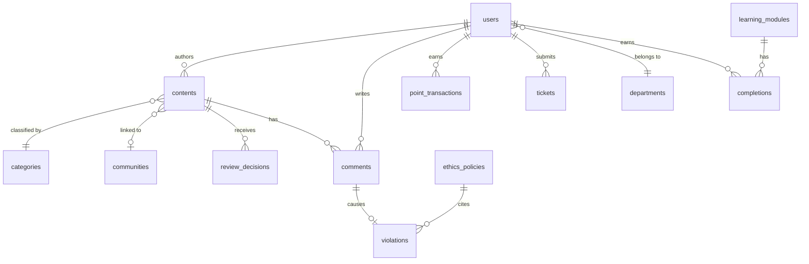
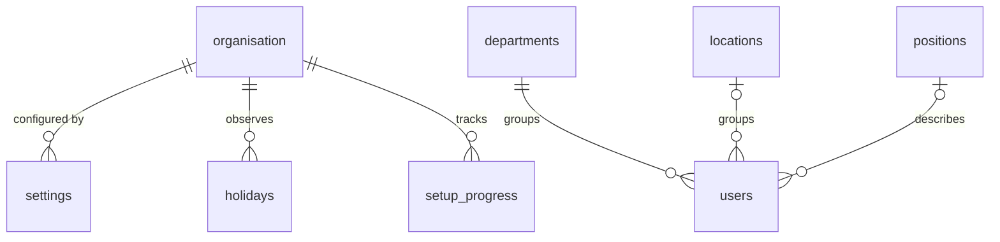
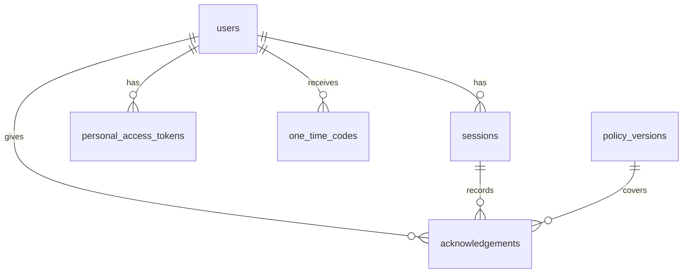
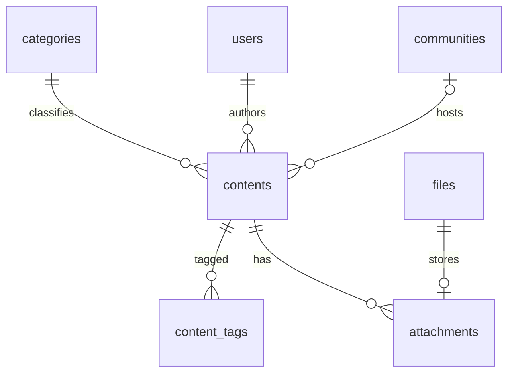
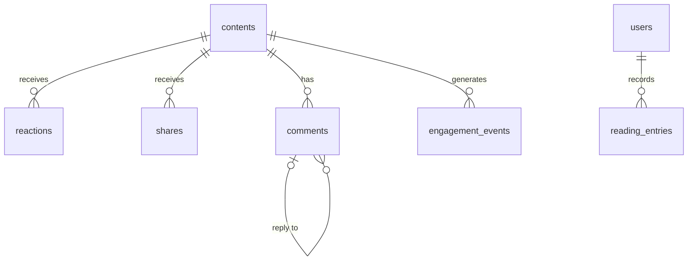
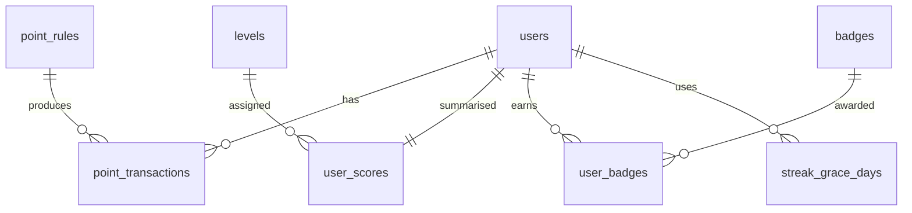
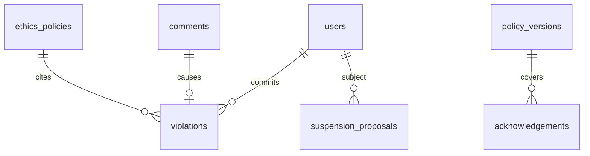

# GrowHub Database Design Document

| Item | Detail |
| :--- | :--- |
| Product | GrowHub, a configurable knowledge-sharing and gamification platform for organisations |
| Document version | 1.0 (draft for architecture review) |
| Document date | 19 November 2026 |
| Document status | Awaiting technical lead approval |
| Database | PostgreSQL 17 |
| Sources | [SRS v1.2](SRS.md), [System Architecture Document v1.0](ARCHITECTURE.md), [BRD v3.1](BRD.md) |

## How to read this document

This document defines the physical database design for one GrowHub installation. It refines the logical model in SRS Section 4 and follows the data architecture in Section 6 of the architecture document.

- Section 1 sets conventions that apply to every table. Table definitions do not repeat them.
- Sections 3 to 13 define every table, grouped by the module that owns it.
- Section 14 onwards covers access control, partitioning, retention, key queries, sizing, and migrations.
- IDs such as FR-xx and QR-xx refer to the SRS. SET-xx refers to the BRD. ADR-xx and AP-xx refer to the architecture document.

## Contents

1. [Conventions](#1-conventions)
2. [Schemas and overview](#2-schemas-and-overview)
3. [Schema setup](#3-schema-setup)
4. [Schema users](#4-schema-users)
5. [Schema identity](#5-schema-identity)
6. [Schema content](#6-schema-content)
7. [Schema review](#7-schema-review)
8. [Schema engagement](#8-schema-engagement)
9. [Schema communities](#9-schema-communities)
10. [Schema learning](#10-schema-learning)
11. [Schema gamification](#11-schema-gamification)
12. [Schema moderation](#12-schema-moderation)
13. [Schemas notifications, support, audit, reporting, privacy, and platform](#13-schemas-notifications-support-audit-reporting-privacy-and-platform)
14. [Roles and privileges](#14-roles-and-privileges)
15. [Partitioning](#15-partitioning)
16. [Retention](#16-retention)
17. [Key queries](#17-key-queries)
18. [Sizing](#18-sizing)
19. [Migrations](#19-migrations)
20. [Backup and recovery](#20-backup-and-recovery)

---

## 1. Conventions

### 1.1 Naming

| Item | Convention | Example |
| :--- | :--- | :--- |
| Schema | Module name, singular, lowercase | `content`, `gamification` |
| Table | Plural noun, snake_case | `content.contents`, `gamification.point_transactions` |
| Column | snake_case; foreign keys end in `_id`; times end in `_at`; dates end in `_on`; booleans start with `is_` | `author_id`, `published_at`, `last_active_on`, `is_active` |
| Primary key | `pk_<table>` | `pk_contents` |
| Foreign key | `fk_<table>_<column>` | `fk_contents_author_id` |
| Unique | `uq_<table>_<columns>` | `uq_users_employee_id` |
| Check | `ck_<table>_<rule>` | `ck_contents_status` |
| Index | `ix_<table>_<columns>` | `ix_contents_status_published_at` |

### 1.2 Column types

| Kind | Type | Rule |
| :--- | :--- | :--- |
| Identifiers | `uuid` | UUIDv7, generated by the application (architecture Section 6.1) |
| Timestamps | `timestamptz` | Always stored in UTC (AP-07) |
| Organisation dates | `date` | A calendar day in the organisation's time zone, for example a holiday or an active day |
| Text | `text` with a `CHECK (char_length(...) BETWEEN …)` | No `varchar(n)`; limits come from SRS Section 4.3 |
| Enumerations | `text` with a `CHECK (... IN (...))` | Easier to extend in migrations than PostgreSQL enum types |
| Flexible structured values | `jsonb` | Only for settings, snapshots, audit values, and parameters |
| Counts and points | `integer` | `bigint` where noted |
| Case-insensitive uniqueness | Unique index on `lower(column)` | For names and emails |

A `CHECK` that evaluates to NULL passes in PostgreSQL. Every conditional check on a nullable column therefore tests `IS NOT NULL` explicitly, for example `(reason IS NOT NULL AND char_length(reason) > 0)`.

### 1.3 Standard columns

Unless a table definition says otherwise, every table has:

| Column | Type | Null | Default |
| :--- | :--- | :---: | :--- |
| `id` | `uuid` | No | Generated by the application |
| `created_at` | `timestamptz` | No | `now()` |
| `updated_at` | `timestamptz` | No | `now()`, set by the application on update |

Insert-only tables have no `updated_at`. Tables marked **insert-only** never receive `UPDATE` or `DELETE` from the application role ([Section 14](#14-roles-and-privileges)).

### 1.4 Foreign keys and deletion

- Foreign keys default to `ON DELETE RESTRICT`.
- Child rows that have no meaning without their parent use `ON DELETE CASCADE`, for example content tags. This applies only when the parent is deleted by retention.
- User rows are never deleted. They are deactivated and, on request, anonymised (FR-DPR-02).
- Content is never deleted by users. Removal sets `status = 'removed'`. Retention deletes removed content later.
- Polymorphic references (`related_type`, `related_id`) have no foreign key. They are used only where a row can point to several tables, such as notifications and audit records.

### 1.5 Extensions

| Extension | Use |
| :--- | :--- |
| `pg_trgm` | Trigram indexes for content search (ADR-03) |
| `btree_gin` | Composite GIN indexes where needed |

## 2. Schemas and overview

### 2.1 Schemas

| Schema | Owning module | Tables |
| :--- | :--- | ---: |
| `setup` | Setup | 7 |
| `users` | Users | 2 |
| `identity` | Identity | 4 |
| `content` | Content | 4 |
| `review` | Review | 1 |
| `engagement` | Engagement | 5 |
| `communities` | Communities | 2 |
| `learning` | Learning | 3 |
| `gamification` | Gamification | 8 |
| `moderation` | Moderation | 4 |
| `notifications` | Notifications | 2 |
| `support` | Support | 4 |
| `audit` | Audit | 1 |
| `reporting` | Reporting | 1 |
| `privacy` | Privacy | 1 |
| `platform` | Platform | 3 |
| `public` | Framework | Laravel `migrations` and `failed_jobs` |

A module writes only to its own schema (AP-04). Other modules read through the owning module's services. The Reporting module is the exception: it reads all schemas through the read-only reporting role.

### 2.2 Domain overview



Detailed diagrams appear at the start of each schema section.

## 3. Schema `setup`



### 3.1 `setup.organisation`

Exactly one row per installation.

| Column | Type | Null | Default | Notes |
| :--- | :--- | :---: | :--- | :--- |
| `id` | `smallint` | No | `1` | `CHECK (id = 1)` keeps one row |
| `name` | `text` | Yes* | | 1–120 characters |
| `logo_file_id` | `uuid` | Yes | | FK `platform.files` |
| `country_code` | `char(2)` | Yes* | | ISO 3166-1 alpha-2 |
| `time_zone` | `text` | Yes* | | IANA name, for example `Asia/Jakarta`; validated by the application |
| `working_days` | `smallint[]` | No | `'{1,2,3,4,5}'` | ISO weekdays 1–7; at least one |
| `sender_name` | `text` | Yes* | | 1–120 characters |
| `reply_to_email` | `text` | Yes* | | Valid email |
| `support_contact` | `text` | Yes* | | 1–500 characters |
| `programme_owner_name` | `text` | Yes* | | 1–120 characters |
| `programme_owner_contact` | `text` | Yes* | | 1–254 characters |
| `data_use_notice` | `text` | Yes* | | Markdown; FR-SET-17 |
| `setup_status` | `text` | No | `'not_started'` | `not_started`, `in_progress`, `complete` |
| `setup_started_at` | `timestamptz` | Yes | | FR-SET-09 |
| `setup_completed_at` | `timestamptz` | Yes | | |
| `created_at`, `updated_at` | `timestamptz` | No | `now()` | |

Constraints:

- `ck_organisation_working_days`: `cardinality(working_days) BETWEEN 1 AND 7 AND working_days <@ '{1,2,3,4,5,6,7}'`
- `ck_organisation_setup_complete`: when `setup_status = 'complete'`, `setup_completed_at` and every column marked Yes* must be not null, and the length checks must pass (RUL-52).

Columns marked Yes* may be null while setup is in progress, because the row is created at the first wizard save (FR-SET-04). For example, the name check is:

```sql
CHECK (setup_status <> 'complete' OR (name IS NOT NULL AND char_length(name) BETWEEN 1 AND 120))
```

### 3.2 `setup.settings`

One row per setting key. Covers SET-01 to SET-16, leaderboard settings, and other administrator options.

| Column | Type | Null | Default | Notes |
| :--- | :--- | :---: | :--- | :--- |
| `key` | `text` | No | | Primary key, for example `employee_id.format`, `otp.validity_minutes` |
| `value` | `jsonb` | No | | Validated against a typed schema in the application (FR-SET-16) |
| `updated_by` | `uuid` | Yes | | FK `users.users` |
| `updated_at` | `timestamptz` | No | `now()` | |

Key list:

| Key | Setting | Example value |
| :--- | :--- | :--- |
| `kpi.targets` | SET-01 | `{"BO-1.published_per_month": 200}` |
| `employee_id.format` | SET-02 | `{"label": "NIP", "charset": "digits", "min": 9, "max": 10}` |
| `community.visibility` | SET-03 | `"all"` or `"members"` |
| `streak.policy` | SET-04 | `{"basis": "calendar", "grace_days": 0}` |
| `support.handling` | SET-05 | `{"handlers": "admins", "first_response_days": 2}` |
| `learning.authoring` | SET-06 | `"admins"` or `"authors"` |
| `learning.reward` | SET-07 | `{"mode": "flat", "flat": 15, "beginner": 10, "intermediate": 15, "advanced": 20}` |
| `ethics.escalation` | SET-08 | `{"enabled": false, "alert": 3, "suspend": 5, "period_days": 90}` |
| `otp.policy` | SET-09 | `{"validity_minutes": 5, "attempts": 5, "resend_seconds": 60}` |
| `language.policy` | SET-10 | `{"default": "id", "user_choice": true}` |
| `session.policy` | SET-11 | `{"web_idle_minutes": 30, "mobile_days": 30}` |
| `rollout.scope` | SET-12 | `{"mode": "all", "department_ids": [], "location_ids": []}` |
| `review.target_days` | SET-13 | `2` |
| `retention.policy` | SET-14 | `{"reading_months": 12, "notification_months": 12, "conduct_months": 24, "audit_months": 60, "departed_content": "retain"}` |
| `password.min_length` | SET-15 | `8` |
| `email.allowed_domains` | SET-16 | `[]` |
| `leaderboard.settings` | BRD 9.4.9 | `{"reset": "never", "size": 50, "widget_size": 5, "podium": true, "own_rank": true}` |

### 3.3 `setup.setup_progress`

| Column | Type | Null | Default | Notes |
| :--- | :--- | :---: | :--- | :--- |
| `step` | `text` | No | | Primary key: `profile`, `units`, `settings`, `starter_content`, `notice`, `summary` |
| `saved_at` | `timestamptz` | No | `now()` | |
| `saved_by` | `uuid` | No | | FK `users.users` |
| `state` | `jsonb` | Yes | | Draft choices, for example starter content selections (FR-SET-04) |

### 3.4 `setup.holidays`

| Column | Type | Null | Default | Notes |
| :--- | :--- | :---: | :--- | :--- |
| `id`, `created_at`, `updated_at` | | | | Standard |
| `holiday_on` | `date` | No | | Unique |
| `name` | `text` | No | | 1–120 characters |

### 3.5 `setup.departments`, `setup.locations`, `setup.positions`

Three tables with the same structure.

| Column | Type | Null | Default | Notes |
| :--- | :--- | :---: | :--- | :--- |
| `id`, `created_at`, `updated_at` | | | | Standard |
| `name` | `text` | No | | 1–120 characters |
| `is_active` | `boolean` | No | `true` | Retired units keep `false` (FR-ORG-03) |

Index: `uq_<table>_name` unique on `lower(name)` (FR-ORG-01).

## 4. Schema `users`

### 4.1 `users.users`

| Column | Type | Null | Default | Notes |
| :--- | :--- | :---: | :--- | :--- |
| `id`, `created_at`, `updated_at` | | | | Standard |
| `employee_id` | `text` | No | | Format from SET-02, checked by the application; immutable (FR-USR-02) |
| `name` | `text` | No | | 1–120 characters |
| `email` | `text` | No | | 3–254 characters |
| `role` | `text` | No | `'employee'` | `employee`, `reviewer`, `administrator`, `support_agent`, `learning_author` |
| `department_id` | `uuid` | No | | FK `setup.departments` |
| `location_id` | `uuid` | Yes | | FK `setup.locations` |
| `position_id` | `uuid` | Yes | | FK `setup.positions` |
| `photo_file_id` | `uuid` | Yes | | FK `platform.files` |
| `language` | `text` | Yes | | `id` or `en`; null means the SET-10 default |
| `status` | `text` | No | `'active'` | `active`, `deactivated` |
| `requires_activation` | `boolean` | No | `true` | FR-OTP-01 |
| `password_hash` | `text` | No | | Argon2id |
| `password_changed_at` | `timestamptz` | Yes | | |
| `activated_at` | `timestamptz` | Yes | | Last activation |
| `deactivated_at` | `timestamptz` | Yes | | |
| `anonymised_at` | `timestamptz` | Yes | | Final state (FR-DPR-02) |
| `created_by` | `uuid` | Yes | | FK `users.users`; null for the first administrator |

Constraints and indexes:

| Name | Definition | Purpose |
| :--- | :--- | :--- |
| `uq_users_employee_id` | `UNIQUE (employee_id)` | RUL-01 |
| `uq_users_email` | `UNIQUE INDEX ON (lower(email))` | RUL-05 |
| `ck_users_role` | `role IN (...)` | |
| `ck_users_status` | `status IN ('active','deactivated')` | |
| `ck_users_anonymised` | `anonymised_at IS NULL OR status = 'deactivated'` | FR-DPR-03 |
| `ix_users_department_id` | `(department_id)` | Leaderboard and report filters |
| `ix_users_location_id` | `(location_id)` | |
| `ix_users_role_status` | `(role, status)` | Reviewer and handler fan-out, last-administrator check |
| `ix_users_name_trgm` | `GIN (name gin_trgm_ops)` | Administrator search (FR-USR-06) |

Trigger `tr_users_employee_id_immutable` raises an error when `employee_id` changes, except when `anonymised_at` changes from null in the same statement.

Anonymisation sets `name = 'Former employee'`, `email = 'anon-' || id || '@invalid.local'`, `employee_id = 'anon:' || <HMAC of the old ID>`, and `photo_file_id = NULL`.

### 4.2 `users.imports`

| Column | Type | Null | Default | Notes |
| :--- | :--- | :---: | :--- | :--- |
| `id`, `created_at`, `updated_at` | | | | Standard |
| `administrator_id` | `uuid` | No | | FK `users.users` |
| `file_id` | `uuid` | No | | FK `platform.files` |
| `file_name` | `text` | No | | Original name |
| `status` | `text` | No | `'validating'` | `validating`, `invalid`, `ready`, `importing`, `completed`, `failed` |
| `row_count` | `integer` | Yes | | At most 5,000 (FR-IMP-02) |
| `created_count` | `integer` | Yes | | |
| `errors` | `jsonb` | Yes | | `[{"row": 12, "column": "email", "code": "duplicate"}]` (FR-IMP-04) |
| `completed_at` | `timestamptz` | Yes | | |

## 5. Schema `identity`



### 5.1 `identity.sessions`

One row per web session or mobile token. Used for revocation and for the per-session acknowledgement (FR-AUTH-12).

| Column | Type | Null | Default | Notes |
| :--- | :--- | :---: | :--- | :--- |
| `id`, `created_at` | | | | Standard; no `updated_at` |
| `user_id` | `uuid` | No | | FK `users.users` |
| `client` | `text` | No | | `web` or `mobile` |
| `web_session_hash` | `text` | Yes | | SHA-256 of the Redis session ID, for web |
| `token_id` | `bigint` | Yes | | FK `identity.personal_access_tokens`, for mobile |
| `last_used_at` | `timestamptz` | No | `now()` | Updated at most once per minute |
| `expires_at` | `timestamptz` | Yes | | Absolute expiry for mobile (SET-11) |
| `revoked_at` | `timestamptz` | Yes | | FR-AUTH-09, FR-AUTH-10 |
| `acknowledged_at` | `timestamptz` | Yes | | Set when the ethics notice is acknowledged |
| `ip_address` | `inet` | Yes | | |
| `user_agent` | `text` | Yes | | Truncated to 500 characters |

Constraints and indexes:

- `ck_sessions_client_ref`: `(client = 'web' AND web_session_hash IS NOT NULL) OR (client = 'mobile' AND token_id IS NOT NULL)`
- `ix_sessions_user_active`: `(user_id) WHERE revoked_at IS NULL`. Used to revoke all sessions of a user.
- `uq_sessions_web_session_hash`: unique on `web_session_hash` where not null.

### 5.2 `identity.personal_access_tokens`

The standard Laravel Sanctum table, with `tokenable_id` as `uuid`. Only the SHA-256 hash of the token is stored (QR-06).

### 5.3 `identity.one_time_codes`

| Column | Type | Null | Default | Notes |
| :--- | :--- | :---: | :--- | :--- |
| `id`, `created_at` | | | | Standard; `created_at` is the issue time |
| `user_id` | `uuid` | No | | FK `users.users` |
| `purpose` | `text` | No | | `activation`, `email_change`, `admin_password_change` (FR-OTP-03) |
| `code_hash` | `text` | No | | HMAC-SHA256 of the code |
| `target_email` | `text` | No | | Address the code was sent to |
| `expires_at` | `timestamptz` | No | | From SET-09 |
| `max_attempts` | `smallint` | No | | Copied from SET-09 at issue time |
| `attempts` | `smallint` | No | `0` | |
| `used_at` | `timestamptz` | Yes | | |
| `superseded_at` | `timestamptz` | Yes | | Set when a newer code is issued |

Indexes:

- `ix_one_time_codes_user_purpose_created`: `(user_id, purpose, created_at DESC)`. Finds the current code and enforces the resend wait.
- `uq_one_time_codes_live`: unique `(user_id, purpose) WHERE used_at IS NULL AND superseded_at IS NULL`. Guarantees one live code per purpose.

Verification uses a single statement so that attempts cannot race:

```sql
UPDATE identity.one_time_codes
SET attempts = attempts + 1,
    used_at  = CASE WHEN code_hash = :hash THEN now() END
WHERE id = :id
  AND used_at IS NULL AND superseded_at IS NULL
  AND expires_at > now() AND attempts < max_attempts
RETURNING used_at IS NOT NULL AS valid, max_attempts - attempts AS remaining;
```

### 5.4 `identity.acknowledgements`

**Insert-only.**

| Column | Type | Null | Default | Notes |
| :--- | :--- | :---: | :--- | :--- |
| `id`, `created_at` | | | | Standard; `created_at` is the acknowledgement time |
| `user_id` | `uuid` | No | | FK `users.users` |
| `policy_version_id` | `uuid` | No | | FK `moderation.policy_versions` |
| `session_id` | `uuid` | Yes | | FK `identity.sessions` `ON DELETE SET NULL`, so that old sessions can be deleted |

Index: `ix_acknowledgements_user_created` on `(user_id, created_at DESC)`.

## 6. Schema `content`



### 6.1 `content.categories`

| Column | Type | Null | Default | Notes |
| :--- | :--- | :---: | :--- | :--- |
| `id`, `created_at`, `updated_at` | | | | Standard |
| `name` | `text` | No | | 1–80 characters; unique on `lower(name)` |
| `purpose` | `text` | Yes | | Up to 500 characters |
| `is_active` | `boolean` | No | `true` | FR-CAT-02 |
| `sort_order` | `integer` | No | `0` | |

### 6.2 `content.contents`

| Column | Type | Null | Default | Notes |
| :--- | :--- | :---: | :--- | :--- |
| `id`, `created_at`, `updated_at` | | | | Standard |
| `author_id` | `uuid` | No | | FK `users.users` |
| `category_id` | `uuid` | Yes | | FK `content.categories`; required unless status is `draft` |
| `community_id` | `uuid` | Yes | | FK `communities.communities` |
| `title` | `text` | No | | 1–200 characters |
| `body` | `text` | No | `''` | Markdown; at most 50,000 characters |
| `status` | `text` | No | `'draft'` | `draft`, `pending`, `published`, `rejected`, `removed` |
| `media_types` | `text[]` | No | `'{}'` | Subset of `image`, `video`, `document`; empty means text only (FR-DSC-03) |
| `search_text` | `text` | No | `''` | Title, body, and tags, maintained by the application in the same transaction |
| `first_submitted_at` | `timestamptz` | Yes | | Set once; drives FR-CNT-07 |
| `last_submitted_at` | `timestamptz` | Yes | | Start of review turnaround |
| `published_at` | `timestamptz` | Yes | | |
| `removed_at` | `timestamptz` | Yes | | |
| `removed_by` | `uuid` | Yes | | FK `users.users` |
| `removal_reason` | `text` | Yes | | 1–1,000 characters; required when removed by an administrator |
| `views_count` | `integer` | No | `0` | |
| `likes_count` | `integer` | No | `0` | Active likes |
| `saves_count` | `integer` | No | `0` | Active saves |
| `shares_count` | `integer` | No | `0` | |
| `comments_count` | `integer` | No | `0` | Visible comments and replies |

Constraints:

| Name | Definition |
| :--- | :--- |
| `ck_contents_status` | `status IN ('draft','pending','published','rejected','removed')` |
| `ck_contents_submittable` | `status = 'draft' OR status = 'removed' OR (category_id IS NOT NULL AND char_length(btrim(body)) >= 20)` (FR-CNT-03) |
| `ck_contents_published` | `status <> 'published' OR published_at IS NOT NULL` |
| `ck_contents_removed` | `(status = 'removed') = (removed_at IS NOT NULL)` |
| `ck_contents_counts` | All counters `>= 0` |

Indexes:

| Name | Definition | Use |
| :--- | :--- | :--- |
| `ix_contents_feed` | `(published_at DESC) WHERE status = 'published'` | Latest feed |
| `ix_contents_review_queue` | `(last_submitted_at) WHERE status = 'pending'` | Review queue, oldest first (FR-REV-01) |
| `ix_contents_author_status` | `(author_id, status, updated_at DESC)` | My Contributions |
| `ix_contents_category` | `(category_id) WHERE status = 'published'` | Filter |
| `ix_contents_community` | `(community_id) WHERE status = 'published'` | Filter and visibility |
| `ix_contents_popular` | `((likes_count + saves_count + shares_count + comments_count) DESC, published_at DESC) WHERE status = 'published'` | Most popular (SRS 7.5) |
| `ix_contents_search` | `GIN (search_text gin_trgm_ops) WHERE status = 'published'` | Search (FR-DSC-02) |
| `ix_contents_media_types` | `GIN (media_types)` | Media filter |

### 6.3 `content.content_tags`

| Column | Type | Null | Default | Notes |
| :--- | :--- | :---: | :--- | :--- |
| `content_id` | `uuid` | No | | FK `content.contents` `ON DELETE CASCADE` |
| `tag` | `text` | No | | 1–30 characters, stored in lowercase |

Primary key `(content_id, tag)`. Index `ix_content_tags_tag` on `(tag)`. The limit of 8 tags is enforced by the application (FR-CNT-04).

### 6.4 `content.attachments`

| Column | Type | Null | Default | Notes |
| :--- | :--- | :---: | :--- | :--- |
| `id`, `created_at` | | | | Standard |
| `content_id` | `uuid` | No | | FK `content.contents` `ON DELETE CASCADE` |
| `file_id` | `uuid` | No | | FK `platform.files`; unique |
| `media_type` | `text` | No | | `image`, `video`, `document` |
| `sort_order` | `smallint` | No | `0` | |

The limit of 10 attachments per item is enforced by the application, with a lock on the content row (FR-ATT-01).

## 7. Schema `review`

### 7.1 `review.review_decisions`

**Insert-only.**

| Column | Type | Null | Default | Notes |
| :--- | :--- | :---: | :--- | :--- |
| `id`, `created_at` | | | | Standard; `created_at` is the decision time |
| `content_id` | `uuid` | No | | FK `content.contents` `ON DELETE CASCADE` |
| `reviewer_id` | `uuid` | No | | FK `users.users` |
| `decision` | `text` | No | | `approved` or `rejected` |
| `note` | `text` | Yes | | Up to 1,000 characters |
| `submitted_at` | `timestamptz` | No | | Copy of `last_submitted_at` at decision time |

Constraints:

- `ck_review_decisions_note`: `decision = 'approved' OR (note IS NOT NULL AND char_length(btrim(note)) BETWEEN 1 AND 1000)` (FR-REV-03)

Indexes: `(content_id, created_at DESC)` for the latest rejection note, and `(created_at)` for turnaround reports.

Self-review (FR-REV-04) and the Pending check (FR-REV-05) are enforced by the application inside a transaction that locks the content row with `SELECT … FOR UPDATE`. Trigger `tr_review_decisions_not_author` adds a second safeguard by raising an error when `reviewer_id` equals the content's `author_id`.

## 8. Schema `engagement`



### 8.1 `engagement.reactions`

Likes and saves.

| Column | Type | Null | Default | Notes |
| :--- | :--- | :---: | :--- | :--- |
| `id`, `created_at` | | | | Standard |
| `content_id` | `uuid` | No | | FK `content.contents` `ON DELETE CASCADE` |
| `user_id` | `uuid` | No | | FK `users.users` |
| `type` | `text` | No | | `like` or `save` |
| `removed_at` | `timestamptz` | Yes | | Set on unlike or unsave |

Indexes:

- `uq_reactions_active`: unique `(content_id, user_id, type) WHERE removed_at IS NULL` (FR-ENG-01)
- `ix_reactions_user_saved`: `(user_id, created_at DESC) WHERE type = 'save' AND removed_at IS NULL` for saved items

### 8.2 `engagement.shares`

**Insert-only.** Columns: standard `id` and `created_at`, `content_id` (FK, cascade), and `user_id` (FK). Index `(content_id)`.

### 8.3 `engagement.comments`

| Column | Type | Null | Default | Notes |
| :--- | :--- | :---: | :--- | :--- |
| `id`, `created_at`, `updated_at` | | | | Standard |
| `content_id` | `uuid` | No | | FK `content.contents` `ON DELETE CASCADE` |
| `author_id` | `uuid` | No | | FK `users.users` |
| `parent_id` | `uuid` | Yes | | Parent comment |
| `body` | `text` | No | | 1–2,000 characters |
| `removed_at` | `timestamptz` | Yes | | |
| `removed_by` | `uuid` | Yes | | FK `users.users` |
| `removal_type` | `text` | Yes | | `author`, `violation`, or `cascade` (removed with its parent) |

Constraints and indexes:

- `uq_comments_id_content`: `UNIQUE (id, content_id)`, so that the next constraint can refer to it.
- `fk_comments_parent`: `FOREIGN KEY (parent_id, content_id) REFERENCES engagement.comments (id, content_id)`. This guarantees that a reply belongs to the same content item as its parent (RUL-21).
- Replies to replies are refused by trigger `tr_comments_one_level`, which raises an error when the parent itself has a `parent_id` (FR-ENG-04).
- `ix_comments_content_created`: `(content_id, created_at) WHERE removed_at IS NULL`

### 8.4 `engagement.reading_entries`

| Column | Type | Null | Default | Notes |
| :--- | :--- | :---: | :--- | :--- |
| `user_id` | `uuid` | No | | FK `users.users` |
| `content_id` | `uuid` | No | | FK `content.contents` `ON DELETE CASCADE` |
| `first_opened_at` | `timestamptz` | No | `now()` | |
| `last_opened_at` | `timestamptz` | No | `now()` | |

Primary key `(user_id, content_id)`. Index `(user_id, last_opened_at DESC)` for reading history. Written with `INSERT … ON CONFLICT (user_id, content_id) DO UPDATE SET last_opened_at = now()` (FR-DSC-07).

### 8.5 `engagement.engagement_events`

**Insert-only, partitioned by month.** Feeds the 7-day trending score (SRS 7.5).

| Column | Type | Null | Default | Notes |
| :--- | :--- | :---: | :--- | :--- |
| `content_id` | `uuid` | No | | No foreign key, so that partitions can be dropped freely |
| `user_id` | `uuid` | No | | |
| `type` | `text` | No | | `like`, `save`, `share`, `comment` |
| `occurred_at` | `timestamptz` | No | `now()` | Partition key |

Index `(occurred_at, content_id)`. Partitions older than 2 months are dropped.

## 9. Schema `communities`

### 9.1 `communities.communities`

| Column | Type | Null | Default | Notes |
| :--- | :--- | :---: | :--- | :--- |
| `id`, `created_at`, `updated_at` | | | | Standard |
| `name` | `text` | No | | 3–80 characters; unique on `lower(name)` (FR-COM-03) |
| `focus` | `text` | Yes | | Up to 500 characters |
| `created_by` | `uuid` | Yes | | FK `users.users`; null for starter communities |
| `archived_at` | `timestamptz` | Yes | | FR-COM-04 |
| `member_count` | `integer` | No | `0` | Maintained in the same transaction as membership changes |

### 9.2 `communities.memberships`

| Column | Type | Null | Default | Notes |
| :--- | :--- | :---: | :--- | :--- |
| `community_id` | `uuid` | No | | FK `communities.communities` `ON DELETE CASCADE` |
| `user_id` | `uuid` | No | | FK `users.users` |
| `joined_at` | `timestamptz` | No | `now()` | |

Primary key `(community_id, user_id)`. Index `(user_id)` for visibility checks and the user's community list.

## 10. Schema `learning`

### 10.1 `learning.modules`

| Column | Type | Null | Default | Notes |
| :--- | :--- | :---: | :--- | :--- |
| `id`, `created_at`, `updated_at` | | | | Standard |
| `title` | `text` | No | | 1–200 characters |
| `field` | `text` | No | | 1–80 characters |
| `difficulty` | `text` | No | | `beginner`, `intermediate`, `advanced` |
| `duration_minutes` | `smallint` | No | | 1–600 |
| `description` | `text` | Yes | | Up to 1,000 characters |
| `body` | `text` | No | `''` | Markdown |
| `status` | `text` | No | `'draft'` | `draft`, `published`, `retired` |
| `published_at` | `timestamptz` | Yes | | |
| `retired_at` | `timestamptz` | Yes | | |
| `created_by`, `updated_by` | `uuid` | No | | FK `users.users` |

Index `(status, published_at DESC)`.

### 10.2 `learning.module_media`

Columns: standard `id` and `created_at`, `module_id` (FK, cascade), `file_id` (FK `platform.files`, unique), and `sort_order`.

### 10.3 `learning.completions`

**Insert-only.**

| Column | Type | Null | Default | Notes |
| :--- | :--- | :---: | :--- | :--- |
| `user_id` | `uuid` | No | | FK `users.users` |
| `module_id` | `uuid` | No | | FK `learning.modules` |
| `completed_at` | `timestamptz` | No | `now()` | |

Primary key `(user_id, module_id)` enforces one completion per user and module (FR-LRN-05). Index `(module_id)` for reports.

## 11. Schema `gamification`



### 11.1 `gamification.point_rules`

| Column | Type | Null | Default | Notes |
| :--- | :--- | :---: | :--- | :--- |
| `key` | `text` | No | | Primary key; see list below |
| `points` | `integer` | No | | Negative only for `ethics_violation` |
| `recipient` | `text` | No | | Display only, for example `author` |
| `daily_limit` | `integer` | Yes | | Null means no limit |
| `is_active` | `boolean` | No | `true` | |
| `sort_order` | `smallint` | No | `0` | |
| `updated_by` | `uuid` | Yes | | FK `users.users` |
| `updated_at` | `timestamptz` | No | `now()` | |

Rule keys and deduplication keys (SRS 7.1):

| Key | Dedup key pattern | Notes |
| :--- | :--- | :--- |
| `daily_sign_in` | `day:{date}` | Date in the organisation's time zone |
| `content_submitted` | `content:{content_id}` | |
| `content_published` | `content:{content_id}` | |
| `content_read` | `content:{content_id}:day:{date}` | |
| `like_received` | `liker:{user_id}:content:{content_id}` | |
| `save_received` | `saver:{user_id}:content:{content_id}` | |
| `comment_given` | Null | Daily limit only |
| `comment_received` | `commenter:{user_id}:content:{content_id}` | |
| `share_given` | `content:{content_id}:day:{date}` | |
| `share_received` | `sharer:{user_id}:content:{content_id}:day:{date}` | |
| `review_completed` | `decision:{decision_id}` | |
| `module_completed` | `module:{module_id}` | Amount comes from SET-07, not from `points` |
| `streak_bonus` | `streak:{streak_started_on}:{length}` | |
| `ethics_violation` | `violation:{violation_id}` | |

### 11.2 `gamification.point_transactions`

**Insert-only.** The point ledger (ADR-04).

| Column | Type | Null | Default | Notes |
| :--- | :--- | :---: | :--- | :--- |
| `id`, `created_at` | | | | Standard |
| `user_id` | `uuid` | No | | FK `users.users` |
| `rule_key` | `text` | Yes | | FK `gamification.point_rules`; null for manual adjustments |
| `amount` | `integer` | No | | `CHECK (amount <> 0)` |
| `dedup_key` | `text` | Yes | | Pattern from Section 11.1 |
| `related_type` | `text` | Yes | | For example `content`, `comment`, `module` |
| `related_id` | `uuid` | Yes | | |
| `actor_id` | `uuid` | Yes | | Administrator for manual adjustments and violations |
| `reason` | `text` | Yes | | 1–500 characters; required when `rule_key` is null |

Constraints and indexes:

| Name | Definition | Purpose |
| :--- | :--- | :--- |
| `ck_point_transactions_manual` | `rule_key IS NOT NULL OR (reason IS NOT NULL AND char_length(btrim(reason)) BETWEEN 1 AND 500)` | FR-PTS-05 |
| `uq_point_transactions_dedup` | unique `(rule_key, user_id, dedup_key) WHERE dedup_key IS NOT NULL` | Once-only rules |
| `ix_point_transactions_user_created` | `(user_id, created_at DESC)` | Point history, daily limits |
| `ix_point_transactions_user_rule_created` | `(user_id, rule_key, created_at)` | Daily limit counts |
| `ix_point_transactions_created_user` | `(created_at, user_id) INCLUDE (amount)` | Leaderboard periods |

### 11.3 `gamification.user_scores`

One row per user, created with the account.

| Column | Type | Null | Default | Notes |
| :--- | :--- | :---: | :--- | :--- |
| `user_id` | `uuid` | No | | Primary key; FK `users.users` |
| `total_points` | `integer` | No | `0` | `CHECK (total_points >= 0)` (FR-PTS-03) |
| `level_id` | `uuid` | Yes | | FK `gamification.levels` |
| `current_streak` | `integer` | No | `0` | |
| `longest_streak` | `integer` | No | `0` | |
| `streak_started_on` | `date` | Yes | | First day of the current streak |
| `last_active_on` | `date` | Yes | | Last active day |
| `last_required_active_on` | `date` | Yes | | Last active day that counted for the streak |
| `updated_at` | `timestamptz` | No | `now()` | |

Index `(level_id)` for reports. This row is locked with `SELECT … FOR UPDATE` for every point change (Section 17.1).

### 11.4 `gamification.streak_grace_days`

| Column | Type | Null | Default | Notes |
| :--- | :--- | :---: | :--- | :--- |
| `user_id` | `uuid` | No | | FK `users.users` |
| `grace_on` | `date` | No | | A missed required day covered by grace |

Primary key `(user_id, grace_on)`. Rows older than 14 days are deleted daily. The streak calculation counts rows in the last 7 days (SRS 7.2).

### 11.5 `gamification.levels`

| Column | Type | Null | Default | Notes |
| :--- | :--- | :---: | :--- | :--- |
| `id`, `created_at`, `updated_at` | | | | Standard |
| `number` | `smallint` | No | | Unique |
| `name` | `text` | No | | 1–60 characters |
| `description` | `text` | Yes | | Up to 300 characters |
| `min_points` | `integer` | No | | Unique, `>= 0` |
| `is_active` | `boolean` | No | `true` | |

The ascending order between `number` and `min_points`, and the last-active-level rule, are checked by the application in a transaction that locks the table (FR-GAM-04).

### 11.6 `gamification.badges` and `gamification.user_badges`

`gamification.badges`:

| Column | Type | Null | Default | Notes |
| :--- | :--- | :---: | :--- | :--- |
| `id`, `created_at`, `updated_at` | | | | Standard |
| `name` | `text` | No | | 1–60 characters; unique on `lower(name)` |
| `description` | `text` | Yes | | Up to 300 characters |
| `criterion` | `text` | No | | `items_published`, `likes_received`, `streak_reached`, `comments_written`, `modules_completed`, `level_reached` |
| `threshold` | `integer` | No | | `> 0` |
| `is_active` | `boolean` | No | `true` | |

`gamification.user_badges` is **insert-only**: `user_id`, `badge_id`, and `awarded_at`, with primary key `(user_id, badge_id)` (FR-GAM-06).

### 11.7 `gamification.competition_cycles`

| Column | Type | Null | Default | Notes |
| :--- | :--- | :---: | :--- | :--- |
| `id`, `created_at` | | | | Standard |
| `started_at` | `timestamptz` | No | | Start of the cycle |
| `type` | `text` | No | | `scheduled` or `manual` |
| `schedule_key` | `text` | Yes | | For example `weekly:2026-11-23`; unique where not null, so a retried reset creates one cycle only |
| `started_by` | `uuid` | Yes | | FK `users.users` for manual resets |
| `cancelled_at` | `timestamptz` | Yes | | FR-LDB-07 |

Index `(started_at DESC) WHERE cancelled_at IS NULL`. The current cycle is the latest row that is not cancelled. With no rows, the cycle starts at `setup.organisation.setup_completed_at`.

## 12. Schema `moderation`



### 12.1 `moderation.ethics_policies`

| Column | Type | Null | Default | Notes |
| :--- | :--- | :---: | :--- | :--- |
| `id`, `created_at`, `updated_at` | | | | Standard |
| `name` | `text` | No | | 1–120 characters |
| `description` | `text` | No | | 1–1,000 characters |
| `severity` | `text` | No | | `high`, `medium`, `low` |
| `sort_order` | `smallint` | No | `0` | |
| `removed_at` | `timestamptz` | Yes | | Removed policies stay for existing violations |

The rule that at least one policy remains (RUL-47) is checked by the application in a transaction that locks the table.

### 12.2 `moderation.policy_versions`

**Insert-only.**

| Column | Type | Null | Default | Notes |
| :--- | :--- | :---: | :--- | :--- |
| `id`, `created_at` | | | | Standard |
| `number` | `integer` | No | | Unique, increasing |
| `snapshot` | `jsonb` | No | | Full list of active policies at that time |
| `created_by` | `uuid` | Yes | | FK `users.users` |

### 12.3 `moderation.violations`

**Insert-only.**

| Column | Type | Null | Default | Notes |
| :--- | :--- | :---: | :--- | :--- |
| `id`, `created_at` | | | | Standard |
| `comment_id` | `uuid` | Yes | | FK `engagement.comments` `ON DELETE SET NULL`, so that conduct records survive when removed content is deleted; unique |
| `owner_id` | `uuid` | No | | FK `users.users` |
| `policy_id` | `uuid` | No | | FK `moderation.ethics_policies` |
| `administrator_id` | `uuid` | No | | FK `users.users` |
| `points_deducted` | `integer` | No | | Actual amount deducted, `>= 0` |
| `comment_excerpt` | `text` | No | | First 300 characters, kept for the notice and appeals |

Index `(owner_id, created_at DESC)` for the escalation count (FR-MOD-05).

### 12.4 `moderation.suspension_proposals`

| Column | Type | Null | Default | Notes |
| :--- | :--- | :---: | :--- | :--- |
| `id`, `created_at`, `updated_at` | | | | Standard |
| `user_id` | `uuid` | No | | FK `users.users` |
| `violation_count` | `integer` | No | | Count when created |
| `status` | `text` | No | `'open'` | `open`, `confirmed`, `dismissed` |
| `decided_by` | `uuid` | Yes | | FK `users.users` |
| `decided_at` | `timestamptz` | Yes | | |
| `reason` | `text` | Yes | | 1–1,000 characters; required when decided |

Index `uq_suspension_proposals_open`: unique `(user_id) WHERE status = 'open'` (FR-MOD-05).

## 13. Schemas `notifications`, `support`, `audit`, `reporting`, `privacy`, and `platform`

### 13.1 `notifications.notifications`

**Partitioned by month** on `created_at`.

| Column | Type | Null | Default | Notes |
| :--- | :--- | :---: | :--- | :--- |
| `id`, `created_at` | | | | Standard; primary key `(id, created_at)` because of partitioning |
| `user_id` | `uuid` | No | | No foreign key (partitioned table) |
| `type` | `text` | No | | Event code from SRS Section 8.3, for example `content_approved` |
| `related_type`, `related_id` | `text`, `uuid` | Yes | | |
| `params` | `jsonb` | No | `'{}'` | Values for the localised message |
| `read_at` | `timestamptz` | Yes | | |

Indexes: `(user_id, created_at DESC)` and `(user_id) WHERE read_at IS NULL` for the unread count.

### 13.2 `notifications.email_deliveries`

| Column | Type | Null | Default | Notes |
| :--- | :--- | :---: | :--- | :--- |
| `id`, `created_at`, `updated_at` | | | | Standard |
| `user_id` | `uuid` | Yes | | FK `users.users` |
| `template` | `text` | No | | Template code from SRS Section 8.4 |
| `to_email` | `text` | No | | |
| `status` | `text` | No | `'queued'` | `queued`, `sent`, `failed` |
| `attempts` | `smallint` | No | `0` | |
| `last_error` | `text` | Yes | | Up to 1,000 characters; never includes the email body |
| `sent_at` | `timestamptz` | Yes | | |

Index `(status, created_at)` for the delivery failure alert (FR-NTF-05).

### 13.3 Support tables

`support.ticket_categories`: standard columns, `name` (1–80 characters, unique on `lower(name)`), `is_active`, and `sort_order`.

`support.faqs`:

| Column | Type | Null | Default | Notes |
| :--- | :--- | :---: | :--- | :--- |
| `id`, `created_at`, `updated_at` | | | | Standard |
| `topic` | `text` | No | | `account`, `content`, `gamification`, or a custom topic |
| `language` | `text` | No | | `id` or `en` |
| `question` | `text` | No | | 1–300 characters |
| `answer` | `text` | No | | Markdown with placeholders such as `{points.content_published}` (FR-SUP-01) |
| `sort_order` | `smallint` | No | `0` | |

`support.tickets`:

| Column | Type | Null | Default | Notes |
| :--- | :--- | :---: | :--- | :--- |
| `id`, `created_at`, `updated_at` | | | | Standard |
| `user_id` | `uuid` | No | | FK `users.users` |
| `category_id` | `uuid` | No | | FK `support.ticket_categories` |
| `subject` | `text` | No | | 1–150 characters |
| `message` | `text` | No | | 1–3,000 characters |
| `status` | `text` | No | `'open'` | `open`, `in_progress`, `resolved` |
| `first_response_at` | `timestamptz` | Yes | | FR-SUP-09 |
| `resolved_at` | `timestamptz` | Yes | | Latest resolution |
| `reopened_count` | `smallint` | No | `0` | |

Indexes: `(user_id, created_at DESC)` for the employee's history, and `(status, created_at)` for the handler queue.

`support.ticket_responses` is **insert-only**: standard `id` and `created_at`, `ticket_id` (FK), `handler_id` (FK `users.users`), and `message` (1–3,000 characters). Index `(ticket_id, created_at)`.

### 13.4 `audit.records`

**Insert-only, partitioned by month** on `created_at`.

| Column | Type | Null | Default | Notes |
| :--- | :--- | :---: | :--- | :--- |
| `id`, `created_at` | | | | Standard; primary key `(id, created_at)` |
| `actor_id` | `uuid` | Yes | | Null for system tasks |
| `action` | `text` | No | | Event code from SRS Section 8.5, for example `setting.changed` |
| `record_type` | `text` | No | | For example `user`, `setting`, `content` |
| `record_id` | `text` | No | | UUID or key |
| `old_values` | `jsonb` | Yes | | Sensitive fields removed |
| `new_values` | `jsonb` | Yes | | Sensitive fields removed |
| `request_id` | `text` | Yes | | Correlates with logs |
| `ip_address` | `inet` | Yes | | |

Indexes: `(created_at)`, `(actor_id, created_at)`, `(record_type, record_id, created_at)`, and `(action, created_at)` (FR-AUD-03).

### 13.5 `reporting.exports`

| Column | Type | Null | Default | Notes |
| :--- | :--- | :---: | :--- | :--- |
| `id`, `created_at`, `updated_at` | | | | Standard |
| `report` | `text` | No | | `RPT-01` to `RPT-08` |
| `filters` | `jsonb` | No | | Date range, department, and location |
| `format` | `text` | No | | `xlsx` or `csv` |
| `status` | `text` | No | `'queued'` | `queued`, `running`, `ready`, `failed` |
| `file_id` | `uuid` | Yes | | FK `platform.files` |
| `requested_by` | `uuid` | No | | FK `users.users` |
| `expires_at` | `timestamptz` | Yes | | 7 days after ready |

### 13.6 `privacy.data_exports`

Same structure as `reporting.exports`, with `subject_user_id` (FK `users.users`) in place of `report`, `filters`, and `format`.

### 13.7 Platform tables

`platform.files`:

| Column | Type | Null | Default | Notes |
| :--- | :--- | :---: | :--- | :--- |
| `id`, `created_at` | | | | Standard |
| `storage_key` | `text` | No | | Random key in object storage; unique; never sent to clients |
| `original_name` | `text` | No | | Up to 255 characters |
| `mime_type` | `text` | No | | Detected type |
| `size_bytes` | `bigint` | No | | At most 52,428,800 for attachments |
| `kind` | `text` | No | | `attachment`, `module_media`, `photo`, `logo`, `import`, `export` |
| `scan_status` | `text` | No | `'pending'` | `pending`, `clean`, `infected` (FR-ATT-06) |
| `uploaded_by` | `uuid` | Yes | | FK `users.users` |
| `deleted_at` | `timestamptz` | Yes | | |

`platform.job_runs`: standard `id`, `task`, `started_at`, `finished_at`, `status` (`running`, `succeeded`, `failed`), and `details` (`jsonb`). Index `(task, started_at DESC)` (FR-JOB-02).

`platform.idempotency_keys`: `user_id`, `key`, `request_hash`, `response_status`, `response_body` (`jsonb`), and `created_at`. Primary key `(user_id, key)`. Rows older than 24 hours are deleted hourly.

`platform.scheduler_locks` is not needed, because scheduler locks are held in Redis (architecture Section 10.2).

## 14. Roles and privileges

| Role | Login | Purpose | Privileges |
| :--- | :---: | :--- | :--- |
| `growhub_owner` | Yes, migrations only | Owns all schemas and objects | All |
| `growhub_app` | Yes | API, workers, and scheduler | `USAGE` on all schemas; `SELECT`, `INSERT`, `UPDATE`, `DELETE` on all tables except those below |
| `growhub_retention` | Yes | Retention job only | `SELECT`, `DELETE` on retention-managed tables; `EXECUTE` on partition maintenance functions |
| `growhub_reporting` | Yes | Reports and exports | `SELECT` on all tables; connects to a read replica when one exists |

Insert-only tables, where `growhub_app` has only `SELECT` and `INSERT`:

| Table | Reason |
| :--- | :--- |
| `gamification.point_transactions` | Ledger (FR-PTS-02) |
| `gamification.user_badges` | Permanent badges (FR-GAM-06) |
| `review.review_decisions` | Decision history |
| `moderation.violations` | Conduct records |
| `moderation.policy_versions` | Version history |
| `identity.acknowledgements` | Acknowledgement records (BR-50) |
| `learning.completions` | One-time completion records |
| `engagement.shares` | Share events |
| `support.ticket_responses` | Ticket history |
| `audit.records` | Audit trail (FR-AUD-02) |

Foreign key actions such as `ON DELETE SET NULL` and `ON DELETE CASCADE` still apply to insert-only tables, because PostgreSQL runs them as part of the parent row's deletion, not as application updates.

Retention deletions on `moderation.violations`, `identity.acknowledgements`, and `audit.records` are performed only by `growhub_retention`. Partition drops are performed by `SECURITY DEFINER` functions owned by `growhub_owner`, for example `audit.drop_partitions_before(date)`, which `growhub_retention` may execute.

Anonymisation updates `users.users` only and is performed by `growhub_app` through the Privacy module.

## 15. Partitioning

| Table | Method | Partition | Created ahead | Dropped |
| :--- | :--- | :--- | :--- | :--- |
| `audit.records` | Range on `created_at` | Monthly | 3 months | After SET-14 audit period [60 months] |
| `notifications.notifications` | Range on `created_at` | Monthly | 3 months | After SET-14 notification period [12 months] |
| `engagement.engagement_events` | Range on `created_at` | Monthly | 3 months | After 2 months |

- A monthly maintenance task creates future partitions and drops expired ones. A default partition catches rows outside known ranges and raises an alert when not empty.
- `gamification.point_transactions` is **not** partitioned. Its once-only guarantee depends on a unique index without the partition key. If the ledger exceeds 50 million rows (AR-02), the deduplication keys will move to a separate unpartitioned table `gamification.point_dedup_keys (rule_key, user_id, dedup_key)` with the unique index, and the ledger will then be partitioned by month.

## 16. Retention

| Data | Table | Rule | Setting | Mechanism |
| :--- | :--- | :--- | :--- | :--- |
| Reading history | `engagement.reading_entries` | `last_opened_at` older than the period | SET-14 [12 months] | Batched delete |
| Notifications | `notifications.notifications` | Partition older than the period | SET-14 [12 months] | Partition drop |
| Conduct records | `moderation.violations`, `moderation.suspension_proposals`, `identity.acknowledgements` | `created_at` older than the period | SET-14 [24 months] | Batched delete |
| Audit records | `audit.records` | Partition older than the period | SET-14 [60 months] | Partition drop |
| Departed employees' content | `content.contents` and children | On deactivation, when SET-14 says remove | SET-14 [retain], FR-DPR-05 | Status `removed`, then batched delete after 30 days |
| Removed content | `content.contents` and children | `removed_at` older than 12 months | FR-CNT-11 | Batched delete with cascade; files deleted |
| One-time codes | `identity.one_time_codes` | `expires_at` older than 7 days | Product rule | Batched delete |
| Revoked or expired sessions | `identity.sessions` | Ended more than 30 days ago | Product rule | Batched delete; acknowledgements keep their record with a null session |
| Email deliveries | `notifications.email_deliveries` | Older than 90 days | Product rule | Batched delete |
| Job runs | `platform.job_runs` | Older than 90 days | Product rule | Batched delete |
| Exports | `reporting.exports`, `privacy.data_exports` | `expires_at` passed | Product rule | Delete row and file |
| Trending events | `engagement.engagement_events` | Older than 2 months | Product rule | Partition drop |

Batched deletes remove 1,000 rows per statement and commit between batches. Ledger rows are never deleted, because user totals and history depend on them.

## 17. Key queries

### 17.1 Award points

```sql
BEGIN;

-- 1. Lock the recipient's score row.
SELECT total_points
FROM gamification.user_scores
WHERE user_id = :user_id
FOR UPDATE;

-- 2. Daily limit, when the rule has one. Day bounds are computed in the
--    organisation's time zone and passed in UTC.
SELECT count(*)
FROM gamification.point_transactions
WHERE user_id = :user_id
  AND rule_key = :rule_key
  AND created_at >= :day_start AND created_at < :day_end;

-- 3. Insert. A duplicate dedup key inserts nothing.
INSERT INTO gamification.point_transactions
  (id, user_id, rule_key, amount, dedup_key, related_type, related_id, created_at)
VALUES
  (:id, :user_id, :rule_key, :amount, :dedup_key, :related_type, :related_id, now())
ON CONFLICT (rule_key, user_id, dedup_key) WHERE dedup_key IS NOT NULL
DO NOTHING
RETURNING amount;

-- 4. Only when a row was returned.
UPDATE gamification.user_scores
SET total_points = total_points + :amount, updated_at = now()
WHERE user_id = :user_id;

COMMIT;
```

For a deduction, `:amount` is set to `-least(:penalty, total_points)` from step 1, and no row is inserted when the result is 0 (FR-PTS-03).

### 17.2 Leaderboard

```sql
WITH totals AS (
  SELECT t.user_id,
         sum(t.amount)     AS points,
         max(t.created_at) AS reached_at
  FROM gamification.point_transactions t
  WHERE t.created_at >= :period_start
  GROUP BY t.user_id
)
SELECT rank() OVER (ORDER BY tot.points DESC) AS rank,
       u.id, u.name, tot.points
FROM totals tot
JOIN users.users u ON u.id = tot.user_id
WHERE u.status = 'active'
  AND tot.points > 0
  AND (:department_id::uuid IS NULL OR u.department_id = :department_id)
  AND (:location_id::uuid IS NULL OR u.location_id = :location_id)
ORDER BY tot.points DESC, tot.reached_at ASC
LIMIT :size;
```

`rank()` gives tied users the same rank and skips the next rank (SRS 7.4). The result is cached for 60 seconds per view.

### 17.3 Search with visibility

```sql
SELECT c.id, c.title, c.published_at
FROM content.contents c
WHERE c.status = 'published'
  AND c.search_text ILIKE :word1    -- '%word%', with % and _ escaped
  AND c.search_text ILIKE :word2
  AND (:category_id::uuid IS NULL OR c.category_id = :category_id)
  AND (
        :members_only = false
     OR c.community_id IS NULL
     OR c.author_id = :user_id
     OR :is_reviewer_or_admin
     OR EXISTS (SELECT 1 FROM communities.memberships m
                WHERE m.community_id = c.community_id AND m.user_id = :user_id)
  )
ORDER BY c.published_at DESC
LIMIT 20 OFFSET :offset;
```

Each word is a separate `ILIKE` condition, so that the trigram index is used for every word. The same visibility clause is applied as a query scope in feeds, counts, and direct reads (architecture Section 8.3).

### 17.4 Working days between two times

Used by review turnaround and ticket reports (SRS 7.7).

```sql
CREATE FUNCTION setup.working_days_between(p_start timestamptz, p_end timestamptz)
RETURNS integer
LANGUAGE sql STABLE AS $$
  SELECT count(*)::integer
  FROM setup.organisation o,
       generate_series(
         (p_start AT TIME ZONE o.time_zone)::date + 1,
         (p_end   AT TIME ZONE o.time_zone)::date,
         interval '1 day') AS d(day)
  WHERE extract(isodow FROM d.day)::smallint = ANY (o.working_days)
    AND NOT EXISTS (
      SELECT 1 FROM setup.holidays h WHERE h.holiday_on = d.day::date)
$$;
```

### 17.5 Trending score

```sql
SELECT e.content_id, count(*) AS score
FROM engagement.engagement_events e
WHERE e.occurred_at >= now() - interval '7 days'
GROUP BY e.content_id
ORDER BY score DESC
LIMIT 500;
```

The result is joined to published, visible content and cached for 5 minutes.

## 18. Sizing

Estimates at the reference load in QR-03: 20,000 users, of whom about 50% are active on a given day.

| Table | Rows after 1 year | Growth assumption | Approximate size with indexes |
| :--- | ---: | :--- | ---: |
| `users.users` | 20,000 | Workforce size | 20 MB |
| `content.contents` | 100,000 | QR-03 reference | 1.5 GB |
| `engagement.comments` | 1,000,000 | 10 per item | 600 MB |
| `engagement.reactions` | 3,000,000 | 30 per item | 600 MB |
| `engagement.reading_entries` | 10,000,000 | 500 per user | 1.5 GB |
| `gamification.point_transactions` | 30,000,000 | 8 per active user per day | 8 GB |
| `notifications.notifications` | 25,000,000 (12-month window) | 3–4 per user per day | 6 GB |
| `audit.records` | 500,000 | Administrative actions | 500 MB |
| Other tables | Small | | Under 500 MB |
| **Total** | | | **About 19 GB after 1 year** |

The 200 GB database storage in the Standard profile (architecture Section 12.3) covers several years of growth. The ledger reaches the 50-million-row threshold in about 20 months at this rate. That is when Section 15's ledger partitioning plan is applied.

## 19. Migrations

### 19.1 Organisation

- Migrations are Laravel migrations stored in each module's `Database/` folder and run by `growhub_owner`.
- Each module's first migration creates its schema.
- Migration names include the date and the module, for example `2026_11_20_000100_content_create_contents_table`.

### 19.2 Zero-downtime rules

Every release must run against the previous release's code (architecture Section 14.3).

| Change | Safe approach |
| :--- | :--- |
| Add a column | Add as nullable or with a constant default |
| Make a column required | Add `CHECK (col IS NOT NULL) NOT VALID`, backfill in batches, `VALIDATE CONSTRAINT`, then set `NOT NULL` in a later release |
| Add an index | `CREATE INDEX CONCURRENTLY`, in a migration without a transaction |
| Rename a column or table | Add the new one, write to both, backfill, switch reads, and drop the old one in a later release |
| Drop a column | Stop using it in release N, drop it in release N+1 |
| Change an enumerated check | Widen the `CHECK` first, narrow it in a later release |
| Large backfill | Queued job in batches of 1,000 rows, not inside the migration |

### 19.3 Data loaded by migrations

Migrations load only product data that every installation needs, such as the `gamification.point_rules` keys with their default values. Organisation data, starter content, and demo data are never loaded by migrations (DC-05, architecture Section 11.2).

## 20. Backup and recovery

| Item | Design | Target |
| :--- | :--- | :--- |
| Full backup | Daily, encrypted, stored in a second location | QR-13 |
| WAL archiving | Continuous, for point-in-time recovery | RPO well under 24 hours |
| Retention of backups | 35 days | |
| Restore test | Before each major release, into staging, with row counts and ledger verification compared | QR-14 |
| Ledger verification after restore | `SELECT user_id FROM gamification.user_scores s WHERE total_points <> (SELECT greatest(coalesce(sum(amount),0),0) FROM gamification.point_transactions t WHERE t.user_id = s.user_id)` returns no rows | Data integrity |
