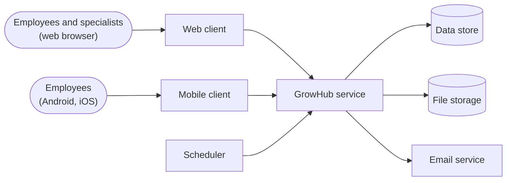
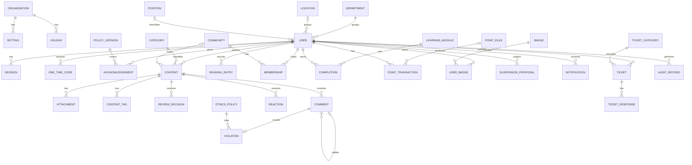

# GrowHub Software Requirements Specification (SRS)

| Item | Detail |
| :--- | :--- |
| Product | GrowHub, a configurable knowledge-sharing and gamification platform for organisations |
| Document version | 1.1 (draft for product owner review) |
| Document date | 19 November 2026 |
| Document status | Awaiting product owner approval |
| Sources | [BRD v3.1](BRD.md), [Use Case Specification and User Stories v1.1](USE_CASES.md) |

## Contents

1. [Introduction](#1-introduction)
2. [Overall description](#2-overall-description)
3. [Functional requirements](#3-functional-requirements)
4. [Data requirements](#4-data-requirements)
5. [External interface requirements](#5-external-interface-requirements)
6. [Quality attribute requirements](#6-quality-attribute-requirements)
7. [Calculations and algorithms](#7-calculations-and-algorithms)
8. [Catalogues](#8-catalogues)
9. [Traceability and verification](#9-traceability-and-verification)

---

## 1. Introduction

### 1.1 Purpose

This SRS states what the GrowHub software must do and how well it must do it, in enough detail for solution design, development, and testing. It refines the business requirements in the BRD and the behaviour in the use case specification. It is written before the system is built and describes no specific organisation.

### 1.2 Scope

GrowHub consists of:

- a **web client** for all roles;
- a **mobile client** for Android and iOS, covering Employee functions;
- a **service** that holds all data and business rules and serves both clients;
- connections to an **email service**, **file storage**, and a **scheduler**.

Each installation serves one organisation. Organisation-specific values come from first-time setup and administration screens, never from code.

### 1.3 Conventions

| Convention | Meaning |
| :--- | :--- |
| **shall** | Mandatory requirement |
| **should** | Recommended requirement; omission must be justified |
| FR-*AREA*-*nn* | Functional requirement in [Section 3](#3-functional-requirements) |
| QR-*nn* | Quality attribute requirement in [Section 6](#6-quality-attribute-requirements) |
| IR-*nn* | External interface requirement in [Section 5](#5-external-interface-requirements) |
| BR, RUL, SET, NFR, CMP, RPT, R | IDs defined in the BRD |
| UC, US, CC | IDs defined in the use case specification |
| Verification | **T** test, **D** demonstration, **I** inspection, **A** analysis |

Terms follow the BRD glossary. Additional terms:

| Term | Meaning |
| :--- | :--- |
| Active day | A day, in the organisation's time zone, on which the user made at least one authenticated request |
| Authenticated request | A request from a signed-in, activated user who has acknowledged the ethics notice in the current session |
| Point transaction | One recorded change to a user's points, positive or negative |
| Working day | A day in the organisation's working week that is not a public holiday in its calendar |

### 1.4 References

| Document | Use |
| :--- | :--- |
| [BRD v3.1](BRD.md) | Business requirements, rules, settings, and product defaults |
| [Use Case Specification v1.1](USE_CASES.md) | Actors, flows, and user stories |
| WCAG 2.1 | Accessibility guideline referenced in QR-20 |
| OWASP Application Security Verification Standard | Security baseline referenced in QR-08 |

## 2. Overall description

### 2.1 Product context

The clients hold no business rules that the service does not also enforce. The service is the single source of truth.

### 2.2 User classes

| User class | Clients | Frequency | Key needs |
| :--- | :--- | :--- | :--- |
| Employee | Web, mobile | Daily to weekly, often short sessions on shared devices | Speed, simplicity, low data use |
| Reviewer | Web | Daily | Efficient queue, clear decisions |
| Administrator | Web | Daily | Complete control, audit trail, reports |
| First administrator | Web | Once, at setup | Guidance, explanations, ability to resume |
| Support Agent | Web | Daily | Ticket queue and targets |
| Learning Author | Web | Weekly | Module editing |

### 2.3 Operating environment

| Item | Requirement |
| :--- | :--- |
| Web browsers | The two most recent major versions of Chrome and Edge on desktop and Android, and Safari on iOS |
| Mobile platforms | Android 10 or later and iOS 15 or later |
| Networks | Must remain usable on mobile networks with high latency and limited bandwidth |
| Devices | Shared work-site computers, personal laptops, and phones |

### 2.4 Design and implementation constraints

| ID | Constraint |
| :--- | :--- |
| DC-01 | Technology choices are left to solution design, subject to this SRS. |
| DC-02 | All client functions shall use one versioned service interface (IR-08). |
| DC-03 | No organisation-specific value shall be hard-coded. Every value in [Section 8.1](#81-settings-catalogue) and every starter list shall be stored as data. |
| DC-04 | One installation shall hold one organisation's data only (BRD NFR-17). |
| DC-05 | Production builds shall contain no demo accounts or sample data (BR-82). |
| DC-06 | Interface text shall be held in translation resources, not in code, for Indonesian and English. |

### 2.5 Assumptions and dependencies

The assumptions and dependencies in BRD Section 14 apply. In addition:

- The email service accepts mail from the installation's sending domain and delivers within 60 seconds in normal conditions.
- The scheduler can run tasks at least once per minute.
- File storage keeps files private and serves them only through the service.

### 2.6 Release apportioning

All requirements in this SRS belong to the first release unless marked **Later**. Items excluded by BRD Section 5.2 are not specified.

## 3. Functional requirements

Each table lists the requirement, its source, and its verification method. Values from settings show the product default in brackets.

### 3.1 Setup and settings (FR-SET)

| ID | Requirement | Source | Ver. |
| :--- | :--- | :--- | :---: |
| FR-SET-01 | The system shall have a setup status of Not started, In progress, or Complete. A new installation starts as Not started. | BR-70, UC-01 | T |
| FR-SET-02 | While the setup status is not Complete, the service shall refuse sign-in to every account except administrators, and shall route administrators to the setup wizard. | BR-70 | T |
| FR-SET-03 | The setup wizard shall have these steps in order: organisation profile, organisation units, settings, starter content, data-use notice, and summary. | BR-71 to BR-73, UC-01 | D |
| FR-SET-04 | The wizard shall save each step when the administrator leaves it, and shall reopen at the first unfinished step. | BR-74 | T |
| FR-SET-05 | The settings step shall show every setting in [Section 8.1](#81-settings-catalogue) with its default value, allowed values, and a description of its effect. | BR-72 | I |
| FR-SET-06 | For each starter list in [Section 8.2](#82-starter-content-catalogue), the wizard shall offer Accept, Edit, and Start empty. | BR-73 | T |
| FR-SET-07 | The wizard shall propose the public holidays for the selected country and year when a holiday source is available, and shall allow manual entry in all cases. | UC-01 | D |
| FR-SET-08 | Completing setup shall fail, with a list of missing items, unless the organisation has a name, a time zone, a working week of at least one day, an email sender, a support contact, a programme owner, at least one department, at least one active content category, at least one ethics policy, and at least one active level. | RUL-52 | T |
| FR-SET-09 | The system shall record the time setup moved to In progress. On completion it shall set the setup status to Complete and record an audit event with the setup duration. | BR-70, BR-68 | T |
| FR-SET-10 | Administrators shall be able to view and change the organisation profile and every setting after setup. | BR-75, UC-02 | T |
| FR-SET-11 | Before saving a setting change, the system shall show its effect. For SET-03, it shall show the number of community-linked items affected. For SET-05 and SET-06, when a role is turned off, it shall show the number of users holding that role. | UC-02 | D |
| FR-SET-12 | The system shall refuse a change to SET-02 if any existing employee ID would not match the new format, and shall list up to 50 conflicting IDs. | RUL-53 | T |
| FR-SET-13 | When SET-05 or SET-06 turns a role off, users holding that role shall keep Employee permissions only. Their role value shall be kept so that turning the role on again restores it. | UC-02 | T |
| FR-SET-14 | A setting change shall apply from the time it is saved. It shall not recalculate past point transactions, streaks, completions, or levels. | RUL-54 | T |
| FR-SET-15 | Every change to the profile or a setting shall record the administrator, setting, old value, new value, and time. | RUL-55 | T |
| FR-SET-16 | The system shall validate every setting against the type and range in [Section 8.1](#81-settings-catalogue), and shall refuse invalid values with the allowed range. | UC-01, UC-02 | T |
| FR-SET-17 | The data-use notice text shall be editable by administrators and shown to users from the profile and the help page. | CMP-05 | D |

### 3.2 Organisation units (FR-ORG)

| ID | Requirement | Source | Ver. |
| :--- | :--- | :--- | :---: |
| FR-ORG-01 | Administrators shall be able to create, rename, and retire departments, locations, and positions. Names shall be unique within their type. | BR-79, UC-03 | T |
| FR-ORG-02 | Retiring a unit that is assigned to active users shall require the administrator either to move those users to another unit or to confirm that the unit remains on existing records only. | UC-03 | T |
| FR-ORG-03 | A retired unit shall not be selectable for new or edited accounts. | UC-03 | T |
| FR-ORG-04 | The system shall refuse to retire the last active department. | RUL-52 | T |
| FR-ORG-05 | When SET-12 is set to selected units, sign-in shall be allowed only for users whose department or location is selected. Administrators are always allowed. | BR-78, RUL-12 | T |

### 3.3 Authentication and sessions (FR-AUTH)

| ID | Requirement | Source | Ver. |
| :--- | :--- | :--- | :---: |
| FR-AUTH-01 | The sign-in form shall label the identifier field with the SET-02 label ["NIP"]. | BR-02, UC-04 | D |
| FR-AUTH-02 | The service shall check the identifier against the SET-02 format before checking credentials, and shall return a format error that states the expected format. | BR-02, RUL-01 | T |
| FR-AUTH-03 | The service shall return the same error message for an unknown employee ID and a wrong password. | UC-04 | T |
| FR-AUTH-04 | The service shall refuse sign-in to deactivated accounts and to users outside the rollout scope, with distinct messages. | BR-01, RUL-12 | T |
| FR-AUTH-05 | After 5 consecutive failed sign-in attempts for one employee ID within 15 minutes, the service shall refuse further attempts for that ID for 15 minutes. | NFR-03 | T |
| FR-AUTH-06 | The service shall limit sign-in attempts from one network address to 50 within 15 minutes. | NFR-03 | T |
| FR-AUTH-07 | A successful sign-in shall create a session with a unique, unguessable token. | BR-06 | I |
| FR-AUTH-08 | A web session shall expire after the SET-11 idle timeout [30 minutes] without requests. A mobile session shall expire at the SET-11 validity [30 days] after creation. | BR-08 | T |
| FR-AUTH-09 | Signing out shall revoke the current session immediately. | BR-06, UC-07 | T |
| FR-AUTH-10 | Deactivating an account shall revoke all of its sessions immediately. Requests with a revoked session shall be refused. | BR-07 | T |
| FR-AUTH-11 | For an account that requires activation, the service shall allow only the activation functions and sign-out. | BR-04 | T |
| FR-AUTH-12 | For an activated account, the service shall allow only the ethics acknowledgement and sign-out until the acknowledgement for the current session is recorded. | BR-49 | T |

### 3.4 Activation and one-time codes (FR-OTP)

| ID | Requirement | Source | Ver. |
| :--- | :--- | :--- | :---: |
| FR-OTP-01 | An account shall require activation when it is created, when an administrator resets its password, and when an administrator sets its password. | RUL-03 | T |
| FR-OTP-02 | A one-time code shall be 6 random digits, generated with a cryptographically secure generator. | RUL-06 | I |
| FR-OTP-03 | A one-time code shall have a purpose: activation, email change, or administrator password change. A code shall be valid only for its purpose and user. | UC-05, UC-08, UC-09 | T |
| FR-OTP-04 | A code shall expire after the SET-09 validity [5 minutes], after one successful use, after the SET-09 attempt limit [5] of wrong entries, or when a newer code with the same purpose is issued. | RUL-06 | T |
| FR-OTP-05 | A new code shall not be issued before the SET-09 resend wait [60 seconds] has passed since the previous code. No more than 5 codes per user shall be issued within one hour. | RUL-06, NFR-03 | T |
| FR-OTP-06 | The activation screen shall show the registered email with its local part masked, except the first and last characters. | UC-05 | D |
| FR-OTP-07 | After a valid activation code, the user shall set a new password that meets FR-USR-08. The system shall then mark the account as activated, and the previous password shall stop working. | BR-04, BR-10 | T |
| FR-OTP-08 | The activation screen shall show remaining attempts after a wrong code and a countdown until a new code can be requested. | UC-05 | D |

### 3.5 Ethics acknowledgement (FR-ETH)

| ID | Requirement | Source | Ver. |
| :--- | :--- | :--- | :---: |
| FR-ETH-01 | After each sign-in, the system shall show the active ethics policies, the current policy version, and the point consequence of a violation. | BR-49, UC-06 | D |
| FR-ETH-02 | Acknowledging shall record the user, policy version, session, and time. | BR-50 | T |
| FR-ETH-03 | Declining shall offer sign-out and shall not grant access. | UC-06 | T |
| FR-ETH-04 | Any change to the ethics policy list shall create a new policy version. | UC-26 | T |

### 3.6 User management (FR-USR)

| ID | Requirement | Source | Ver. |
| :--- | :--- | :--- | :---: |
| FR-USR-01 | Administrators shall be able to create an account with employee ID, name, email, role, department, and optional location and position. | BR-61, UC-10 | T |
| FR-USR-02 | The employee ID shall match SET-02, be unique, and be immutable after creation. | RUL-01 | T |
| FR-USR-03 | The email shall be a valid address, unique case-insensitively, and in an allowed domain when SET-16 lists domains. | RUL-05 | T |
| FR-USR-04 | The initial password shall be the employee ID unless the administrator enters a custom password that meets FR-USR-08. | RUL-02, BR-10 | T |
| FR-USR-05 | Role options shall include Support Agent only when SET-05 enables it, and Learning Author only when SET-06 enables it. Each user has exactly one role. | BR-03 | T |
| FR-USR-06 | Administrators shall be able to search accounts by employee ID, name, email, role, unit, and status, with paged results. | BR-61 | T |
| FR-USR-07 | Administrators shall be able to edit name, email, role, and units. For an account that requires activation, a new email applies immediately because activation verifies it. For an activated account, a new email entered by an administrator takes effect only after the user verifies it with an email-change code at the next sign-in. | BR-09, UC-10 | T |
| FR-USR-08 | A password chosen by a user or custom-set by an administrator shall have at least the SET-15 minimum length [8] and at most 128 characters, and shall differ from the employee ID. | RUL-04 | T |
| FR-USR-09 | Administrators shall be able to deactivate and reactivate accounts. Deactivation shall revoke all sessions (FR-AUTH-10). | BR-07, UC-10 | T |
| FR-USR-10 | The system shall refuse to deactivate the last active administrator or to change that administrator's role. | BR-69, RUL-11 | T |
| FR-USR-11 | Administrators shall be able to reset a password to the employee ID or a custom value. The reset shall revoke all of the user's sessions and require activation. | BR-05, RUL-09, UC-11 | T |
| FR-USR-12 | An administrator shall be able to change their own password after entering a valid administrator-password-change code and the current password. Other sessions of that administrator shall be revoked. | RUL-08, RUL-10, UC-08 | T |
| FR-USR-13 | No function shall let a non-administrator change or reset their own password after activation. | RUL-07 | T |
| FR-USR-14 | A deactivated user's published content shall remain visible with the author shown as a former employee, unless SET-14 is set to remove it. | BR-63 | T |
| FR-USR-15 | Account creation shall create a welcome notification. | BRD 9.4.12 | T |

### 3.7 User import (FR-IMP)

| ID | Requirement | Source | Ver. |
| :--- | :--- | :--- | :---: |
| FR-IMP-01 | Administrators shall be able to download an import template in the format defined in IR-18. | BR-62, UC-12 | I |
| FR-IMP-02 | The system shall accept files of up to 5,000 rows. | BR-62 | T |
| FR-IMP-03 | The system shall validate every row against FR-USR-02 to FR-USR-05 and FR-USR-08, check uniqueness within the file and against existing accounts, and check that each unit exists and is active. | BR-62 | T |
| FR-IMP-04 | If any row is invalid, the system shall create no account and shall report every error with its row number, column, and reason. | BR-62 | T |
| FR-IMP-05 | If all rows are valid, the system shall show the number of accounts to be created and create them only after the administrator confirms. | UC-12 | T |
| FR-IMP-06 | Imported accounts shall start as requiring activation. The import shall be recorded as one audit event with the row count. | UC-12 | T |

### 3.8 Profile (FR-PRF)

| ID | Requirement | Source | Ver. |
| :--- | :--- | :--- | :---: |
| FR-PRF-01 | The profile shall show name, employee ID, email, role, department, location, position, photo, level, and points. | UC-09 | D |
| FR-PRF-02 | A user shall be able to change only their own photo and email. All other profile fields shall be maintained by administrators. | UC-09 | T |
| FR-PRF-03 | A photo shall be JPG, PNG, or WEBP and no larger than 5 MB. | UC-09 | T |
| FR-PRF-04 | An email change requested by the user shall take effect only after the user enters a valid email-change code sent to the new address. Until then the old email remains in use. | BR-09 | T |
| FR-PRF-05 | A user shall be able to choose the interface language when SET-10 allows it. | SET-10 | T |
| FR-PRF-06 | Employee ID and email shall be visible only to the account owner and administrators. Other users shall see name, photo, department, location, position, level, and badges. | CMP-03 | T |

### 3.9 Content (FR-CNT)

| ID | Requirement | Source | Ver. |
| :--- | :--- | :--- | :---: |
| FR-CNT-01 | A content item shall have a title, body, one category, an optional community, up to 8 tags, attachments, an author, a status, and timestamps. | BR-13, RUL-15 | I |
| FR-CNT-02 | Status shall follow the state machine in [Section 4.4.1](#441-content-status). Any other transition shall be refused. | UC-13, UC-14 | T |
| FR-CNT-03 | Saving a draft shall require only a title. Submitting shall require a title of 1–200 characters, a body of at least 20 characters after trimming, and an active category. | RUL-13, RUL-14 | T |
| FR-CNT-04 | Tags shall be 1–30 characters each, case-insensitive, and unique within an item. | RUL-15 | T |
| FR-CNT-05 | The selected category shall be active. The selected community, if any, shall be one the author is a member of. | BR-13, BR-34 | T |
| FR-CNT-06 | When a community is selected, the form shall state who can see the item, based on SET-03. | BR-35 | D |
| FR-CNT-07 | The first transition of an item into Pending shall award submission points. Later transitions into Pending shall not. | RUL-26 | T |
| FR-CNT-08 | Only the author shall be able to edit an item, and only in Draft or Rejected status. An item in Pending status shall be withdrawn to Draft before editing. | RUL-17, BR-15 | T |
| FR-CNT-09 | A Rejected item shall show the latest rejection note to its author. | BR-15 | T |
| FR-CNT-10 | Only the author or an administrator shall be able to remove an item. Removal by an administrator shall require a reason of 1–1,000 characters. | RUL-18, BR-24 | T |
| FR-CNT-11 | A removed item shall be hidden from everyone, including its comments, attachments, likes, saves, and shares. It shall be kept for audit and deleted according to SET-14. | BR-16, BR-24 | T |
| FR-CNT-12 | Points already awarded for an item shall not be reversed when the item is removed. | UC-15 | T |
| FR-CNT-13 | Drafts shall be visible only to their author. Pending and Rejected items shall be visible only to their author, reviewers, and administrators. | BR-17 | T |
| FR-CNT-14 | My Contributions shall list the author's items with status, dates, and counts of views, likes, comments, saves, and shares, filterable by status. | BR-14, UC-16 | T |

### 3.10 Attachments (FR-ATT)

| ID | Requirement | Source | Ver. |
| :--- | :--- | :--- | :---: |
| FR-ATT-01 | An item shall have at most 10 attachments, each at most 50 MB. | RUL-16 | T |
| FR-ATT-02 | Only the formats in BRD Section 9.4.5 shall be accepted. The service shall check both the file extension and the detected file type. | BR-12 | T |
| FR-ATT-03 | Files shall be stored privately. Every download shall pass through the service, which shall check that the requester is signed in and may view the item. | BR-18 | T |
| FR-ATT-04 | A download link shall not grant access on its own. A link copied to an unauthenticated browser shall be refused. | BR-18 | T |
| FR-ATT-05 | Images and videos shall be shown inline. Documents shall offer download. | UC-18 | D |
| FR-ATT-06 | Uploaded files should be scanned for malware before they become available. Infected files shall be refused. | R-01 | T |

### 3.11 Review (FR-REV)

| ID | Requirement | Source | Ver. |
| :--- | :--- | :--- | :---: |
| FR-REV-01 | The review queue shall list Pending items ordered by the time they last entered Pending, oldest first. | BR-20 | T |
| FR-REV-02 | Each queue entry shall show the working days waited ([Section 7.7](#77-working-day-calculations)) and mark entries past the SET-13 target [2 working days]. | BR-23 | T |
| FR-REV-03 | Reviewers and administrators shall be able to approve or reject a Pending item, with a note of up to 1,000 characters. The note is mandatory for rejection. | BR-21, RUL-19 | T |
| FR-REV-04 | The service shall refuse a decision on an item whose author is the deciding user. The interface shall hide the decision actions for such items. | BR-22 | T |
| FR-REV-05 | The service shall refuse a decision on an item that is no longer Pending, including when two reviewers act at the same time. | RUL-20 | T |
| FR-REV-06 | Approval shall set the status to Published, record the publish time, award publication points to the author on the first publication only, award review points to the reviewer, and notify the author. | BR-19, RUL-26, RUL-31 | T |
| FR-REV-07 | Rejection shall set the status to Rejected, store the note, award review points to the reviewer, and notify the author with the note. | BR-21, RUL-31 | T |
| FR-REV-08 | Each decision shall record the reviewer, decision, note, submission time, and decision time. | BR-23 | T |
| FR-REV-09 | A new submission shall notify all reviewers and administrators. | UC-22 | T |

### 3.12 Discovery (FR-DSC)

| ID | Requirement | Source | Ver. |
| :--- | :--- | :--- | :---: |
| FR-DSC-01 | The Knowledge Feed shall list Published items that the user may see, in pages of 20. | BR-25, UC-17 | T |
| FR-DSC-02 | Search shall be case-insensitive and shall return items whose title, body, or tags contain every entered word. A search term shall have at least 2 characters. | BR-25 | T |
| FR-DSC-03 | Filters for category, community, author, and media type shall be combinable with each other and with search. Media type values shall be image, video, document, and text only. | BR-26 | T |
| FR-DSC-04 | Sort options shall be latest, most popular, and trending, as defined in [Section 7.5](#75-popularity-and-trending). | BR-27 | T |
| FR-DSC-05 | When SET-03 is members only, community-linked items shall be visible only to members of that community, the author, reviewers, and administrators, in every list, search, and direct link. | RUL-22 | T |
| FR-DSC-06 | The home page shall show the user's points, level, and streak, up to 10 recommendations ([Section 7.6](#76-recommendations)), the latest published items, and the leaderboard widget. | BR-31 | D |
| FR-DSC-07 | Opening an item shall create or update a reading history entry with the time last opened. | BR-30 | T |
| FR-DSC-08 | Saved items and reading history shall each list the user's entries, newest first, excluding items the user can no longer see. | BR-30, UC-21 | T |

### 3.13 Engagement (FR-ENG)

| ID | Requirement | Source | Ver. |
| :--- | :--- | :--- | :---: |
| FR-ENG-01 | A user shall be able to like and unlike, and save and unsave, a Published item. Each user can have at most one like and one save per item. | BR-28 | T |
| FR-ENG-02 | Sharing shall provide a link to the item that works only for signed-in users allowed to see it, and shall record a share event. | BR-28 | T |
| FR-ENG-03 | Undoing a like or save shall not deduct points. | UC-19 | T |
| FR-ENG-04 | A user shall be able to comment on a Published item and reply to a comment on the same item, up to 2,000 characters. Replies shall be one level deep. | BR-29, RUL-21 | T |
| FR-ENG-05 | Commenting shall be refused on items that are not Published. | BR-29 | T |
| FR-ENG-06 | A user shall be able to remove their own comment. Its replies shall also be removed, and no penalty shall apply. | RUL-46 | T |
| FR-ENG-07 | Likes, saves, shares, comments, and replies shall notify the author, or the parent commenter for a reply, unless the actor is that person. | BR-55 | T |

### 3.14 Moderation (FR-MOD)

| ID | Requirement | Source | Ver. |
| :--- | :--- | :--- | :---: |
| FR-MOD-01 | Only administrators shall be able to remove another user's comment. | RUL-43 | T |
| FR-MOD-02 | Removing another user's comment shall require selecting one active ethics policy. | RUL-44 | T |
| FR-MOD-03 | The removal shall remove the comment and its replies, create a violation record, apply the ethics violation point rule [−1], notify the owner in the application, send the violation email, and record an audit event. | BR-51, BR-52, RUL-45 | T |
| FR-MOD-04 | Administrators shall be able to create, edit, and remove ethics policies with a name, description, and severity of High, Medium, or Low. The last policy shall not be removable. | BR-53, RUL-47 | T |
| FR-MOD-05 | When SET-08 is on, after each violation the system shall count the owner's violations within the rolling period. Reaching the alert threshold [3 in 90 days] shall notify all administrators. Reaching the suspension threshold [5 in 90 days] shall create one suspension proposal if none is open for that user. | BR-54, RUL-48 | T |
| FR-MOD-06 | The system shall never suspend an account automatically. | RUL-48 | T |
| FR-MOD-07 | An administrator shall be able to confirm or dismiss a suspension proposal with a reason of 1–1,000 characters. Confirming shall deactivate the account (FR-USR-09) and send the suspension email. Both outcomes shall be audited. | UC-25 | T |

### 3.15 Communities (FR-COM)

| ID | Requirement | Source | Ver. |
| :--- | :--- | :--- | :---: |
| FR-COM-01 | The community list shall show name, focus, member count, and whether the user is a member. | BR-32 | D |
| FR-COM-02 | A user shall be able to join and leave a community. Membership changes shall take effect immediately. | BR-32 | T |
| FR-COM-03 | A user shall be able to create a community with a unique name of 3–80 characters and a focus of up to 500 characters. The creator becomes its first member. | BR-33, UC-28 | T |
| FR-COM-04 | Administrators shall be able to edit and archive communities. Archived communities accept no new members or content, and existing content keeps its link. | BR-33 | T |

### 3.16 Learning (FR-LRN)

| ID | Requirement | Source | Ver. |
| :--- | :--- | :--- | :---: |
| FR-LRN-01 | A learning module shall have a title, field, difficulty of Beginner, Intermediate, or Advanced, duration in minutes, description, content, and status of Draft, Published, or Retired. | BR-38, UC-30 | I |
| FR-LRN-02 | Module content shall support formatted text, images, video, and documents, using the attachment formats and limits in FR-ATT-01 to FR-ATT-03. | BR-38 | T |
| FR-LRN-03 | Administrators, and Learning Authors when SET-06 enables them, shall be able to create, edit, publish, and retire modules. | BR-38 | T |
| FR-LRN-04 | Employees shall see only Published modules, with their own completion status. | BR-36 | T |
| FR-LRN-05 | Marking a module complete shall create one completion record per user and module, and award the module completion points from SET-07 [flat 15]. A repeat shall be refused with the earlier completion date. | BR-37, RUL-32 | T |
| FR-LRN-06 | Retiring a module shall hide it from employees and keep its completion records. | UC-30 | T |
| FR-LRN-07 | Learning progress shall show completed modules and the share of Published modules completed. | BR-39 | T |

### 3.17 Points (FR-PTS)

| ID | Requirement | Source | Ver. |
| :--- | :--- | :--- | :---: |
| FR-PTS-01 | The system shall process every point event using the procedure in [Section 7.1](#71-point-processing). | BR-40 | T |
| FR-PTS-02 | Every point change shall be stored as a point transaction with user, rule or reason, amount, related record, and time. Transactions shall not be edited or deleted. | BR-41 | T |
| FR-PTS-03 | A user's total points shall equal the sum of their transactions and shall never be negative. | RUL-33 | T |
| FR-PTS-04 | Administrators shall be able to change each point rule's points, daily limit, and on or off state. | BR-64 | T |
| FR-PTS-05 | Administrators shall be able to add a manual adjustment of any non-zero amount with a reason of 1–500 characters. | RUL-34, UC-36 | T |
| FR-PTS-06 | Points already awarded shall not be reversed when content is removed or a like, save, or comment is undone. | UC-15, UC-19 | T |
| FR-PTS-07 | The point history shall list the user's transactions, newest first, with date, rule or reason, and amount. | BR-41, UC-31 | T |

### 3.18 Streaks, levels, and badges (FR-GAM)

| ID | Requirement | Source | Ver. |
| :--- | :--- | :--- | :---: |
| FR-GAM-01 | The system shall maintain each user's current streak and longest streak using [Section 7.2](#72-streaks). | BR-42, RUL-36 | T |
| FR-GAM-02 | When the current streak reaches a multiple of 7, the system shall apply the streak bonus rule [+15] and notify the user. | RUL-37 | T |
| FR-GAM-03 | The user's level shall be computed from total points using [Section 7.3](#73-levels). A level increase shall notify the user. | BR-43, RUL-38 | T |
| FR-GAM-04 | Administrators shall be able to edit level names, descriptions, minimum points, and states. The service shall refuse duplicate level numbers or thresholds, thresholds out of ascending order, and deactivating the last active level. | BR-65, RUL-39 | T |
| FR-GAM-05 | Badges shall be defined by a criterion type and a threshold. Supported criterion types are items published, likes received, streak reached, comments written, modules completed, and level reached. | BR-44 | T |
| FR-GAM-06 | A badge shall be awarded once, when its criterion is first met, and kept permanently. | BR-44 | T |
| FR-GAM-07 | Administrators shall be able to create, edit, and deactivate badges. Deactivated badges are no longer awarded but remain on users who earned them. | BR-65 | T |

### 3.19 Leaderboard (FR-LDB)

| ID | Requirement | Source | Ver. |
| :--- | :--- | :--- | :---: |
| FR-LDB-01 | The leaderboard shall offer the week, month, competition cycle, and organisation-unit views defined in [Section 7.4](#74-leaderboard). | BR-45 | T |
| FR-LDB-02 | Every leaderboard and widget shall use the same calculation. | BR-47 | T |
| FR-LDB-03 | Deactivated users shall not appear. | RUL-40 | T |
| FR-LDB-04 | Administrators shall be able to set the reset schedule, leaderboard size [50, range 3–500], widget size [5, range 1–20], podium display, and own-rank display. | BR-66 | T |
| FR-LDB-05 | A reset, scheduled or manual, shall start a new competition cycle and shall not change any point transaction, total, level, or badge. | BR-46 | T |
| FR-LDB-06 | Scheduled resets shall run at the times in RUL-41 in the organisation's time zone. | RUL-41, BR-77 | T |
| FR-LDB-07 | An administrator shall be able to cancel the most recent manual reset until the next reset occurs. Cancelling shall restore the previous cycle start. | RUL-42 | T |

### 3.20 Notifications and email (FR-NTF)

| ID | Requirement | Source | Ver. |
| :--- | :--- | :--- | :---: |
| FR-NTF-01 | The system shall create in-app notifications for the events in [Section 8.3](#83-notification-catalogue). | BR-55 | T |
| FR-NTF-02 | The interface shall show the unread count. Opening a notification shall mark it read and open the related record. Users shall be able to mark all as read. | UC-38 | T |
| FR-NTF-03 | The system shall send the emails in [Section 8.4](#84-email-catalogue), using the organisation's name, logo, sender name, and reply-to address. | BR-60 | T |
| FR-NTF-04 | Emails shall be written in the recipient's interface language. | SET-10 | T |
| FR-NTF-05 | A failed email delivery shall be retried at least 3 times over 10 minutes and recorded if it still fails. | R-03 | T |
| FR-NTF-06 | Notifications older than the SET-14 period [12 months] shall be deleted. | SET-14 | T |

### 3.21 Help and support tickets (FR-SUP)

| ID | Requirement | Source | Ver. |
| :--- | :--- | :--- | :---: |
| FR-SUP-01 | The help page shall show FAQs grouped by topic and the organisation's support contact. FAQ text may include placeholders that are replaced by current setting and point rule values. | BR-56, UC-39 | T |
| FR-SUP-02 | Administrators shall be able to create, edit, reorder, and remove FAQs and ticket categories. | BR-56 | T |
| FR-SUP-03 | A ticket shall require a subject of 1–150 characters, an active category, and a message of 1–3,000 characters. Employees shall be able to submit tickets and view their status and responses. | BR-57, RUL-49 | T |
| FR-SUP-04 | A ticket shall follow the state machine in [Section 4.4.3](#443-ticket-status). | RUL-50 | T |
| FR-SUP-05 | Employees shall see only their own tickets. | RUL-51 | T |
| FR-SUP-06 | Ticket handlers, as set by SET-05, shall see all tickets, oldest first, and tickets without a first response past the SET-05 target [2 working days] shall be marked overdue. | BR-58 | T |
| FR-SUP-07 | Handlers shall be able to respond and change status. Each response and status change shall notify the employee. | BR-58, BR-59 | T |
| FR-SUP-08 | A new ticket shall notify all ticket handlers. | UC-40 | T |
| FR-SUP-09 | The system shall record the time of the first response and of resolution for each ticket. | RPT-07 | T |

### 3.22 Content categories (FR-CAT)

| ID | Requirement | Source | Ver. |
| :--- | :--- | :--- | :---: |
| FR-CAT-01 | Administrators shall be able to create, rename, describe, and retire content categories. Names shall be unique. | BR-67, UC-42 | T |
| FR-CAT-02 | A retired category shall remain on existing items and shall not be selectable for new submissions. | UC-42 | T |
| FR-CAT-03 | The system shall refuse to retire the last active category. | RUL-52 | T |

### 3.23 Audit (FR-AUD)

| ID | Requirement | Source | Ver. |
| :--- | :--- | :--- | :---: |
| FR-AUD-01 | The system shall record the events in [Section 8.5](#85-audit-event-catalogue) with actor, action, affected record, old and new values where relevant, and time. | BR-68, NFR-15 | T |
| FR-AUD-02 | Audit records shall not be editable or deletable through any function, except deletion by the SET-14 retention task. | BR-68 | T |
| FR-AUD-03 | Administrators shall be able to filter audit records by date range, actor, action type, and affected record. | UC-43 | T |

### 3.24 Reports (FR-RPT)

| ID | Requirement | Source | Ver. |
| :--- | :--- | :--- | :---: |
| FR-RPT-01 | The system shall provide reports RPT-01 to RPT-08 using the definitions in [Section 7.8](#78-report-definitions). | BR-84 | T |
| FR-RPT-02 | Every report shall filter by date range, department, and location. | BR-84 | T |
| FR-RPT-03 | Every report shall export to XLSX and CSV with the applied filters. | BR-84 | T |
| FR-RPT-04 | Reports with a target shall show it next to the actual value: SET-01 for KPI measures, SET-13 for review turnaround, and SET-05 for ticket response. | BR-23, RPT-08 | T |

### 3.25 Data protection and retention (FR-DPR)

| ID | Requirement | Source | Ver. |
| :--- | :--- | :--- | :---: |
| FR-DPR-01 | Administrators shall be able to export a user's personal data, including profile, content list, comments, reading history, point history, violations, acknowledgements, and tickets, as a downloadable file. | CMP-07, UC-45 | T |
| FR-DPR-02 | Administrators shall be able to anonymise a deactivated user. Anonymisation shall replace name, email, and photo with neutral values, keep the employee ID only as a one-way reference, and keep retained content attributed to "Former employee". | CMP-07 | T |
| FR-DPR-03 | The system shall refuse to anonymise an active user. | UC-45 | T |
| FR-DPR-04 | A daily task shall delete reading history, notifications, violation records, and audit records older than their SET-14 periods. | CMP-02 | T |
| FR-DPR-05 | When SET-14 is set to remove departed employees' content, deactivating a user shall remove their published items after confirmation by the administrator. | BR-63, CMP-02 | T |

### 3.26 Scheduled tasks (FR-JOB)

| ID | Requirement | Source | Ver. |
| :--- | :--- | :--- | :---: |
| FR-JOB-01 | The scheduler shall trigger leaderboard resets (FR-LDB-06) and the retention task (FR-DPR-04) in the organisation's time zone. | BR-77, UC-37 | T |
| FR-JOB-02 | Each task run shall be logged with start time, end time, and result. A failed task shall be retried on the next run without duplicating its effect. | UC-37 | T |

### 3.27 Authorisation (FR-ACL)

| ID | Requirement | Source | Ver. |
| :--- | :--- | :--- | :---: |
| FR-ACL-01 | The service shall enforce the permission matrix in [Section 8.6](#86-permission-matrix) on every request. | BR-03, NFR-02 | T |
| FR-ACL-02 | A refused request shall not reveal whether the requested record exists, except to users allowed to see it. | NFR-02 | T |
| FR-ACL-03 | Web-only functions shall not be offered in the mobile client. | BR-80, BR-81 | I |
| FR-ACL-04 | The production installation process shall create only the first administrator account and shall offer no option to load demo accounts or sample data. Starter content is loaded only through FR-SET-06. | BR-82, BR-83 | I |

## 4. Data requirements

### 4.1 Logical data model

The model is logical. Physical design is left to solution design.

### 4.2 Entity dictionary

| Entity | Key attributes | Constraints |
| :--- | :--- | :--- |
| Organisation | name, logo, country, time zone, working week, sender name, reply-to, support contact, programme owner, data-use notice, setup status | Exactly one per installation |
| Setting | key, value, updated by, updated at | One per key in [Section 8.1](#81-settings-catalogue) |
| Holiday | date, name | Unique date |
| Department, Location, Position | name, active | Unique name per type |
| User | employee ID, name, email, role, department, location, position, photo, language, status, activated, total points, level, current streak, longest streak, last active day | Employee ID and email unique; status Active or Deactivated |
| Session | token reference, user, client type, created at, last used at, revoked at, acknowledged at | Token stored only as a one-way hash |
| One-time code | user, purpose, code hash, target email, issued at, expires at, attempts, used at | Code stored only as a one-way hash |
| Ethics policy | name, description, severity, active | At least one |
| Policy version | number, policy snapshot, created at | Incremented on every policy change |
| Acknowledgement | user, policy version, session, time | — |
| Category | name, purpose, active | Unique name |
| Community | name, focus, creator, archived | Unique name |
| Membership | user, community, joined at | Unique pair |
| Content | title, body, category, community, author, status, first submitted at, last submitted at, published at, removed at, removed by, removal reason | See FR-CNT |
| Content tag | content, tag | Max 8 per content |
| Attachment | content or module, file name, type, size, storage reference | Max 10 per content |
| Review decision | content, reviewer, decision, note, submitted at, decided at | — |
| Reaction | content, user, type (like, save, share), created at, removed at | One active like and one active save per user and content |
| Comment | content, author, parent, body, created at, removed at, removed by | Parent on same content; one reply level |
| Reading entry | user, content, last opened at | Unique pair |
| Learning module | title, field, difficulty, duration, description, content, status | — |
| Completion | user, module, completed at | Unique pair |
| Point rule | key, activity, points, recipient, daily limit, active | One per activity |
| Point transaction | user, rule or manual, amount, reason, related record, actor, created at | Immutable |
| Level | number, name, description, minimum points, active | Unique number and threshold |
| Badge | name, description, criterion type, threshold, active | — |
| User badge | user, badge, awarded at | Unique pair |
| Competition cycle | started at, started by, type (scheduled or manual), cancelled at | — |
| Violation | comment, owner, policy, administrator, points deducted, created at | — |
| Suspension proposal | user, created at, status (Open, Confirmed, Dismissed), decided by, reason | One open proposal per user |
| Notification | user, event type, related record, text parameters, read at, created at | — |
| Ticket category | name, active | — |
| FAQ | topic, question, answer, order | — |
| Ticket | user, subject, category, message, status, created at, first response at, resolved at | — |
| Ticket response | ticket, handler, message, created at | — |
| Audit record | actor, action, record type, record ID, old value, new value, created at | Immutable |
| Import job | administrator, file name, row count, result, created at | — |

### 4.3 Field validation rules

| Field | Rule |
| :--- | :--- |
| Employee ID | Matches SET-02 character set and length [digits, 9–10]; unique; immutable |
| Name | 1–120 characters |
| Email | Valid address; at most 254 characters; unique case-insensitively; allowed domain when SET-16 is set |
| Password | SET-15 minimum [8] to 128 characters; differs from employee ID |
| Content title | 1–200 characters |
| Content body | At least 20 characters after trimming; at most 50,000 characters |
| Tag | 1–30 characters; at most 8 per item |
| Review note | Up to 1,000 characters; required for rejection |
| Comment | 1–2,000 characters |
| Removal or decision reason | 1–1,000 characters |
| Manual adjustment reason | 1–500 characters |
| Community name | 3–80 characters; unique |
| Ticket subject | 1–150 characters |
| Ticket message | 1–3,000 characters |
| Attachment | Allowed format; at most 50 MB; at most 10 per item |
| Profile photo | JPG, PNG, or WEBP; at most 5 MB |

### 4.4 State machines

#### 4.4.1 Content status

| From | Event | To | Actor |
| :--- | :--- | :--- | :--- |
| (new) | Save draft | Draft | Author |
| (new) | Submit | Pending | Author |
| Draft | Submit | Pending | Author |
| Pending | Withdraw | Draft | Author |
| Pending | Approve | Published | Reviewer or administrator, not the author |
| Pending | Reject | Rejected | Reviewer or administrator, not the author |
| Rejected | Resubmit | Pending | Author |
| Rejected | Save draft | Draft | Author |
| Draft, Pending, Rejected, Published | Remove | Removed | Author or administrator |

#### 4.4.2 Account status

| From | Event | To |
| :--- | :--- | :--- |
| (new) | Create or import | Active, requires activation |
| Active, requires activation | Activate | Active, activated |
| Active, activated | Administrator resets or sets password | Active, requires activation |
| Any Active | Deactivate or confirm suspension | Deactivated |
| Deactivated | Reactivate | Previous activation state |
| Deactivated | Anonymise | Deactivated, anonymised (final) |

#### 4.4.3 Ticket status

| From | Event | To | Actor |
| :--- | :--- | :--- | :--- |
| (new) | Submit | Open | Employee |
| Open | Start work or respond | In Progress | Ticket handler |
| Open, In Progress | Resolve | Resolved | Ticket handler |
| Resolved | Reopen | In Progress | Ticket handler |

#### 4.4.4 Setup status

| From | Event | To |
| :--- | :--- | :--- |
| Not started | First administrator saves any step | In progress |
| In progress | Confirm summary and pass FR-SET-08 | Complete |

## 5. External interface requirements

### 5.1 User interfaces

| ID | Requirement | Ver. |
| :--- | :--- | :---: |
| IR-01 | The web client shall be responsive from 360 px to 1,920 px wide without horizontal scrolling. | T |
| IR-02 | The web and mobile clients shall show the organisation's name and logo. | D |
| IR-03 | All interface text shall be available in Indonesian and English. The language shall follow the user's choice or the SET-10 default [Indonesian]. | T |
| IR-04 | Dates, times, and numbers shall be formatted for the selected language and shown in the organisation's time zone. | T |
| IR-05 | Validation errors shall appear next to the field concerned and shall keep the entered data. | D |
| IR-06 | Destructive actions, including remove, deactivate, reset, and anonymise, shall require confirmation. | D |
| IR-07 | Lists longer than one page shall be paged or loaded progressively. | D |

### 5.2 Service interface

| ID | Requirement | Ver. |
| :--- | :--- | :---: |
| IR-08 | The service shall expose one versioned interface used by both clients. Breaking changes shall require a new version, and the previous version shall be supported for at least 6 months. | I |
| IR-09 | Every request except sign-in, activation, and service health shall require a valid session token. | T |
| IR-10 | Errors shall use one structure with a stable error code, a message in the user's language, and field-level details for validation errors. | T |
| IR-11 | List endpoints shall support paging, and shall return the total count. | T |
| IR-12 | The mobile client shall allow the service address to be configured, so that one app build can serve any installation. | D |

### 5.3 Email interface

| ID | Requirement | Ver. |
| :--- | :--- | :---: |
| IR-13 | The service shall send email through a configurable email service with authenticated sending. | I |
| IR-14 | Emails shall use the templates in [Section 8.4](#84-email-catalogue) in both languages and shall include a plain-text version. | I |
| IR-15 | Emails shall never contain a password. One-time code emails shall state the validity period. | I |

### 5.4 File storage interface

| ID | Requirement | Ver. |
| :--- | :--- | :---: |
| IR-16 | Files shall be stored in storage that is not publicly reachable. | I |
| IR-17 | File names shall be replaced by generated identifiers in storage. The original name shall be kept as data for display. | I |

### 5.5 Import and export formats

| ID | Requirement | Ver. |
| :--- | :--- | :---: |
| IR-18 | The user import template shall be XLSX or CSV with these columns: employee_id, name, email, role, department, location, position, initial_password. Location, position, and initial_password are optional. Role values shall be Employee, Reviewer, Administrator, Support Agent, or Learning Author. | I |
| IR-19 | Report exports shall be XLSX and CSV in UTF-8, with a header row and the applied filters stated. | I |
| IR-20 | Personal data exports shall be a ZIP file containing one JSON file and one human-readable file per data group. | I |

## 6. Quality attribute requirements

The values in this section implement the approved BRD NFR targets.

### 6.1 Performance and capacity

| ID | Requirement | Source | Ver. |
| :--- | :--- | :--- | :---: |
| QR-01 | For the reference load in QR-03, 95% of service requests other than uploads, downloads, imports, and exports shall complete within 1 second. | NFR-06 | T |
| QR-02 | A web page shall become usable within 3 seconds on a 10 Mbps connection. | NFR-06 | T |
| QR-03 | The reference load is 20,000 users, 2,000 concurrent users, 100,000 content items, and 2 TB of files. | NFR-07 | A |
| QR-04 | Search results shall be returned within 2 seconds at the reference load. | NFR-06 | T |
| QR-05 | An import of 5,000 rows shall be validated within 60 seconds. | NFR-07 | T |

### 6.2 Security

| ID | Requirement | Source | Ver. |
| :--- | :--- | :--- | :---: |
| QR-06 | Passwords shall be stored with an adaptive, salted hashing algorithm. One-time codes and session tokens shall be stored only as one-way hashes. | NFR-01 | I |
| QR-07 | All traffic shall use TLS 1.2 or later. | NFR-04 | T |
| QR-08 | The product shall meet OWASP ASVS Level 2 before release. | NFR-04 | A |
| QR-09 | Passwords, one-time codes, and session tokens shall never appear in logs. | NFR-01 | I |
| QR-10 | User-generated text shall be displayed so that it cannot run scripts in other users' browsers. | NFR-02 | T |
| QR-11 | Data at rest, including files and backups, shall be encrypted. | NFR-04, CMP-01 | I |

### 6.3 Availability and recovery

| ID | Requirement | Source | Ver. |
| :--- | :--- | :--- | :---: |
| QR-12 | Monthly availability shall be at least 99.5%, excluding announced maintenance. | NFR-08 | A |
| QR-13 | Data and files shall be backed up at least daily. RPO shall be 24 hours or less and RTO 8 hours or less. | NFR-09 | T |
| QR-14 | Restoring a backup shall be tested before each major release. | NFR-09 | D |

### 6.4 Usability and accessibility

| ID | Requirement | Source | Ver. |
| :--- | :--- | :--- | :---: |
| QR-15 | A new employee shall be able to activate, find an item, and submit content without training in acceptance tests with at least 5 frontline participants. | NFR-10 | D |
| QR-16 | A first administrator shall be able to complete setup with product defaults within 60 minutes, excluding data gathering. | NFR-11 | D |
| QR-17 | Core employee tasks shall need no more than 3 steps from the home page: search, open an item, like, comment, and start a module. | NFR-10 | I |
| QR-18 | Touch targets in the mobile client shall be at least 44 by 44 points. | NFR-10 | I |
| QR-19 | The mobile client shall cache the last loaded feed page and show it when offline, marked as offline. | NFR-19 | D |
| QR-20 | The web client should meet WCAG 2.1 Level AA. | NFR-10 | A |

### 6.5 Maintainability, operability, and portability

| ID | Requirement | Source | Ver. |
| :--- | :--- | :--- | :---: |
| QR-21 | Automated tests shall cover every Must requirement in this SRS and every use case main flow before release. | NFR-18 | I |
| QR-22 | The service shall write structured logs with request ID, user ID, action, result, and duration. | NFR-15 | I |
| QR-23 | The service shall expose a health check for monitoring. | NFR-08 | T |
| QR-24 | A new installation shall be deployable with documented steps and no code changes. | BR-76, NFR-16 | D |
| QR-25 | Every installation of the same release shall run the same code. Differences between installations shall be configuration only. | BR-83, R-14 | I |

## 7. Calculations and algorithms

All times use the organisation's time zone. A day runs from 00:00 to 24:00.

### 7.1 Point processing

For each point event the service shall, in one transaction:

1. Find the point rule for the event. Stop if the rule is off.
2. Determine the recipient. Stop if the recipient is the actor for an engagement rule (like, save, share, or comment received).
3. Apply the once-only check for the rule:

   | Rule | Awarded at most once per |
   | :--- | :--- |
   | Daily sign-in | User and day |
   | Content submitted | Content item |
   | Content published | Content item |
   | Content read | User, content item, and day |
   | Like received | Liker and content item |
   | Save received | Saver and content item |
   | Comment received | Commenter and content item |
   | Share given | Sharer, content item, and day |
   | Share received | Sharer, content item, and day |
   | Review completed | Review decision |
   | Module completed | User and module |
   | 7-day streak bonus | User and streak milestone |

4. If the rule has a daily limit, count the recipient's transactions for that rule today. Stop if the count has reached the limit.
5. For a deduction, limit the amount to the recipient's current total.
6. Store the transaction and update the total.
7. Recalculate the level (Section 7.3) and badges (FR-GAM-05).

Rules not listed in step 3, such as comment given, have no once-only check and are limited only by their daily limit.

A stop in any step means no points are awarded. The user's activity itself still succeeds.

### 7.2 Streaks

1. The **daily sign-in** event fires on the user's first authenticated request of each day. That day becomes an active day.
2. When SET-04 is calendar days, every day is a required day. When SET-04 is working days, only working days are required days, and non-working days are ignored.
3. On a new active day that is a required day:
   - If the previous required day was also an active day, the streak increases by 1.
   - Otherwise, if the missed required days since the last active day are no more than the grace days still available, the streak increases by 1 and the grace days used are counted. Grace days available are the SET-04 value [0] minus grace days used in the last 7 days.
   - Otherwise, the streak restarts at 1.
4. Activity on a day that is not required does not change the streak.
5. The longest streak is updated whenever the current streak exceeds it.
6. The streak bonus applies each time the streak reaches 7, 14, 21, and so on.

### 7.3 Levels

The user's level is the active level with the highest minimum points that is less than or equal to the user's total points. If no active level qualifies, the user has the active level with the lowest minimum points. Because deductions can reduce total points, a level can go down. Only increases create a notification.

### 7.4 Leaderboard

| View | Points counted |
| :--- | :--- |
| Week | Transactions since Monday 00:00 of the current week |
| Month | Transactions since day 1 00:00 of the current month |
| Competition cycle | Transactions since the start of the current competition cycle, or since setup completion if there has been no reset |
| Organisation unit | Competition cycle points, limited to users in the selected department or location |

- Points are the net sum of transactions, including deductions and manual adjustments.
- Only active users with a net sum above 0 are ranked.
- Users with equal points share a rank, and the next rank is skipped. For example: 1, 2, 2, 4.
- Within a shared rank, users are listed by the time they reached their total, earliest first.
- The user's own rank is shown below the list when it is outside the displayed size and the own-rank option is on.

### 7.5 Popularity and trending

- **Engagement score** of an item = active likes + active saves + shares + visible comments and replies.
- **Most popular** sorts by engagement score over the item's lifetime, then by publish time, newest first.
- **Trending** sorts by engagement score from interactions in the last 7 days, then by publish time, newest first. Items with a 7-day score of 0 are listed after all others.

### 7.6 Recommendations

Up to 10 Published items that the user may see, did not author, and has not opened, selected in this order until 10 are found:

1. Published in the last 30 days in communities the user belongs to, by trending order.
2. Published in the last 30 days in the 3 categories the user opened most in the last 90 days, by trending order.
3. Most popular items published in the last 90 days.

### 7.7 Working-day calculations

- **Working days waited** = the number of working days after the start date up to and including the end date, or today if not ended. An item submitted and decided on the same day has waited 0 working days.
- **Review turnaround** uses the last time the item entered Pending as the start and the decision time as the end.
- **Ticket first response** uses the ticket creation time as the start and the first handler response as the end.
- An item or ticket is **overdue** when its working days waited exceed the target.

### 7.8 Report definitions

| Report | Measures |
| :--- | :--- |
| RPT-01 Adoption | Active accounts; activated accounts; daily active users (distinct users with an active day); monthly active users (distinct users with an active day in the last 30 days); grouped by department and location |
| RPT-02 Content | Items submitted, published, rejected, and pending in the period; approval rate = published ÷ (published + rejected); items per category |
| RPT-03 Review turnaround | Median and 90th percentile working days waited; share decided within the SET-13 target; pending items past target |
| RPT-04 Learning | Completions per module; share of active users with at least one completion; completions per employee; grouped by department |
| RPT-05 Conduct | Violations by policy and department; violations per 1,000 comments; escalations and suspensions |
| RPT-06 Points | Points awarded by rule; top 20 users by points from each rule; users exceeding 3 times the median daily points of active users |
| RPT-07 Support | Tickets by status and category; median working days to first response and to resolution; open tickets past the SET-05 target |
| RPT-08 KPI | Each BRD success measure, using the definitions above, against its SET-01 target |

Active contributors (BO-1) are users with at least one item published in the period. Share of users reaching a 7-day streak (BO-3) is the share of active users whose longest streak reached 7 in the period.

BO-6 and BO-7 are product measures. They are tracked outside each installation by product support, using these definitions:

| Measure | Definition | Target |
| :--- | :--- | :--- |
| Changes by business users (BO-6) | 1 − (change requests that needed a developer ÷ all configuration and content change requests), per installation per quarter | 100% |
| Setup duration (BO-7) | Time from setup moving to In progress until Complete, from FR-SET-09 | 60 minutes or less |
| Time to pilot (BO-7) | Working days from installation to the first sign-in by an employee who is not an administrator | 10 working days or less |
| Launch without custom code (BO-7) | Installations running the standard release ÷ all installations | 100% |

## 8. Catalogues

### 8.1 Settings catalogue

| ID | Key values | Type and range | Default |
| :--- | :--- | :--- | :--- |
| SET-01 | Target per success measure | Optional number per measure | None |
| SET-02 | Label; character set; minimum length; maximum length | Text of 1–20 characters; Digits or Letters and digits; integers 1–30, minimum ≤ maximum | "NIP"; Digits; 9; 10 |
| SET-03 | Community content visibility | All employees or Members only | All employees |
| SET-04 | Counting basis; grace days | Calendar or Working; integer 0–2 | Calendar; 0 |
| SET-05 | Ticket handlers; first-response target | Administrators or Support Agents and administrators; integer 1–10 working days | Administrators; 2 |
| SET-06 | Module authors | Administrators or Learning Authors and administrators | Administrators |
| SET-07 | Reward mode; flat amount; amounts per difficulty | Flat or By difficulty; integers 0–1,000 | Flat; 15; 10, 15, 20 |
| SET-08 | Enabled; alert threshold; suspension threshold; rolling period | Yes or No; integers 1–50 with alert < suspension; integer 7–365 days | No; 3; 5; 90 |
| SET-09 | Validity; attempts; resend wait | Integer 1–10 minutes; integer 3–10; integer 30–300 seconds | 5; 5; 60 |
| SET-10 | Default language; user choice | Indonesian or English; Yes or No | Indonesian; Yes |
| SET-11 | Web idle timeout; mobile validity | Integer 5–480 minutes; integer 1–90 days | 30; 30 |
| SET-12 | Scope; selected units | All or Selected; list of departments and locations | All |
| SET-13 | Review target | Integer 1–10 working days | 2 |
| SET-14 | Reading history; notifications; conduct records; audit records; departed employees' content | Integers in months, 1–120; Retain or Remove | 12; 12; 24; 60; Retain |
| SET-15 | Password minimum length | Integer 8–32 | 8 |
| SET-16 | Allowed email domains | List of domain names, may be empty | Empty |

### 8.2 Starter content catalogue

| List | Contents | Minimum to complete setup |
| :--- | :--- | :--- |
| Point rules | BRD Section 9.4.1 | The rule list always exists. Values can be changed |
| Levels | BRD Section 9.4.2 | 1 active level |
| Badges | BRD Section 9.4.3 | None |
| Content categories | BRD Section 9.4.4 | 1 active category |
| Communities | BRD Section 9.4.6 | None |
| Ethics policies | BRD Section 9.4.8 | 1 policy |
| Leaderboard settings | BRD Section 9.4.9 | Always set |
| Ticket categories | BRD Section 9.4.10 | 1 active category |
| FAQs | BRD Section 9.4.11 | None |

### 8.3 Notification catalogue

| Event | Recipient | In-app | Email |
| :--- | :--- | :---: | :---: |
| Account created | New user | Yes | No |
| Content submitted for review | Reviewers and administrators, except the author | Yes | No |
| Content approved | Author | Yes | No |
| Content rejected, with note | Author | Yes | No |
| Content removed by an administrator, with reason | Author | Yes | No |
| Content liked, saved, shared, or commented on | Author, unless the actor | Yes | No |
| Reply to a comment | Parent commenter, unless the actor | Yes | No |
| Comment removed for an ethics violation | Comment owner | Yes | Yes |
| Escalation alert threshold reached | Administrators | Yes | No |
| Suspension proposal created | Administrators | Yes | No |
| Account suspended | Suspended user | No | Yes |
| Level increased | User | Yes | No |
| Streak bonus awarded | User | Yes | No |
| Badge earned | User | Yes | No |
| Ticket submitted | Ticket handlers | Yes | No |
| Ticket response or status change | Ticket owner | Yes | No |

### 8.4 Email catalogue

| Template | Trigger | Content |
| :--- | :--- | :--- |
| Activation code | Activation code requested | Code, validity period, and a warning not to share it |
| Email change code | User changes email | Code and validity, sent to the new address |
| Administrator password change code | Administrator changes own password | Code and validity |
| Ethics violation notice | FR-MOD-03 | Removed comment excerpt, policy, points deducted, and support contact |
| Suspension notice | FR-MOD-07 confirmation | Reason and support contact |

### 8.5 Audit event catalogue

| Area | Events |
| :--- | :--- |
| Setup and settings | Setup completed; profile changed; setting changed; organisation unit created, renamed, or retired |
| Accounts | Account created, edited, deactivated, reactivated, or anonymised; role changed; password reset or set by administrator; administrator password changed; import completed; personal data exported |
| Content | Content removed by an administrator; review decision |
| Conduct | Comment removed for violation; ethics policy created, edited, or removed; suspension proposal confirmed or dismissed |
| Gamification | Point rule, level, or badge changed; manual point adjustment; leaderboard settings changed; manual reset started or cancelled |
| Learning | Module created, edited, published, or retired |
| Configuration lists | Category, community (administrator edit or archive), ticket category, or FAQ changed |

### 8.6 Permission matrix

| Function | Employee | Reviewer | Administrator | Support Agent | Learning Author |
| :--- | :---: | :---: | :---: | :---: | :---: |
| Sign in, activate, acknowledge, sign out | ✓ | ✓ | ✓ | ✓ | ✓ |
| Own profile photo, email, and language | ✓ | ✓ | ✓ | ✓ | ✓ |
| Change own password after activation | — | — | ✓ | — | — |
| Feed, search, content detail, engagement, comments | ✓ | ✓ | ✓ | ✓ | ✓ |
| Create, edit, withdraw, resubmit, remove own content | ✓ | ✓ | ✓ | ✓ | ✓ |
| Communities: join, leave, create | ✓ | ✓ | ✓ | ✓ | ✓ |
| Learning: study and complete | ✓ | ✓ | ✓ | ✓ | ✓ |
| Dashboard, leaderboard, notifications, help, own tickets | ✓ | ✓ | ✓ | ✓ | ✓ |
| Review queue and decisions on others' content | — | ✓ | ✓ | — | — |
| Remove others' content or comments | — | — | ✓ | — | — |
| Suspension decisions | — | — | ✓ | — | — |
| Ethics policies, categories, ticket categories, FAQs | — | — | ✓ | — | — |
| Edit or archive any community | — | — | ✓ | — | — |
| Manage learning modules | — | — | ✓ | — | ✓ |
| Handle all tickets | — | — | ✓ | ✓ | — |
| Users, import, password reset, data export and anonymisation | — | — | ✓ | — | — |
| Point rules, levels, badges, leaderboard, manual adjustments | — | — | ✓ | — | — |
| Setup, organisation profile, units, settings | — | — | ✓ | — | — |
| Audit history and reports | — | — | ✓ | — | — |

## 9. Traceability and verification

### 9.1 Business requirement coverage

| BRD requirements | Functional requirements |
| :--- | :--- |
| BR-01 to BR-10 Identity and access | FR-AUTH, FR-OTP, FR-USR-02 to FR-USR-13, FR-PRF-04 |
| BR-11 to BR-18 Knowledge contribution | FR-CNT, FR-ATT |
| BR-19 to BR-24 Content governance | FR-REV, FR-CNT-10 to FR-CNT-11 |
| BR-25 to BR-31 Discovery and engagement | FR-DSC, FR-ENG |
| BR-32 to BR-35 Communities | FR-COM, FR-CNT-05 to FR-CNT-06, FR-DSC-05 |
| BR-36 to BR-39 Learning | FR-LRN |
| BR-40 to BR-48 Gamification | FR-PTS, FR-GAM, FR-LDB, [Section 7.1](#71-point-processing) to [Section 7.4](#74-leaderboard) |
| BR-49 to BR-54 Ethics and moderation | FR-ETH, FR-MOD |
| BR-55 to BR-60 Communication and support | FR-NTF, FR-SUP |
| BR-61 to BR-69 Administration | FR-USR, FR-IMP, FR-PTS-04, FR-GAM-04, FR-GAM-07, FR-LDB-04, FR-CAT, FR-AUD |
| BR-70 to BR-79 Organisation setup | FR-SET, FR-ORG |
| BR-80 to BR-84 Platform and operations | FR-ACL, FR-RPT, QR-24, QR-25 |
| CMP-01 to CMP-07 | FR-DPR, FR-PRF-06, FR-SET-17, QR-06 to QR-11 |
| NFR-01 to NFR-19 | Section 6 |

The Source column of each table in Section 3 gives the detailed mapping to BR, RUL, SET, CMP, RPT, and UC IDs.

### 9.2 Use case coverage

| Use cases | Functional requirements |
| :--- | :--- |
| UC-01 to UC-03 | FR-SET, FR-ORG |
| UC-04 to UC-09 | FR-AUTH, FR-OTP, FR-ETH, FR-USR-12, FR-PRF |
| UC-10 to UC-12 | FR-USR, FR-IMP |
| UC-13 to UC-21 | FR-CNT, FR-ATT, FR-DSC, FR-ENG |
| UC-22 to UC-26 | FR-REV, FR-MOD, FR-CNT-10 |
| UC-27 to UC-28 | FR-COM |
| UC-29 to UC-30 | FR-LRN |
| UC-31 to UC-37 | FR-PTS, FR-GAM, FR-LDB, FR-JOB |
| UC-38 to UC-41 | FR-NTF, FR-SUP |
| UC-42 to UC-45 | FR-CAT, FR-AUD, FR-RPT, FR-DPR |

### 9.3 Verification approach

| Method | Applies to |
| :--- | :--- |
| Test (T) | Automated service and interface tests for every requirement marked T, run before each release |
| Demonstration (D) | Acceptance sessions with representative users for each role on web and mobile |
| Inspection (I) | Design, code, and configuration reviews, including the security baseline in QR-08 |
| Analysis (A) | Load tests and capacity models for QR-01 to QR-05 and QR-12 |

BRD acceptance criteria AC-01 to AC-28 shall pass in acceptance testing before release.
