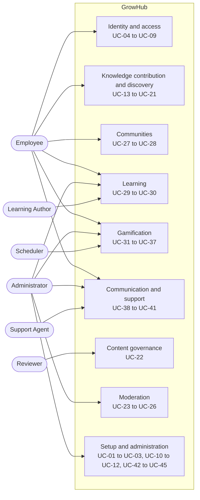

# GrowHub Use Case Specification and User Stories

| Item | Detail |
| :--- | :--- |
| Product | GrowHub, a configurable knowledge-sharing and gamification platform for organisations |
| Document version | 1.1 (draft for product owner review) |
| Document date | 19 November 2026 |
| Document status | Awaiting product owner approval |
| Source | [GrowHub Business Requirements Document v3.1](BRD.md) |

## How to read this document

This document describes how each user interacts with GrowHub to meet the requirements in the BRD. It is written before the system is built and describes no specific organisation.

- **Part A** specifies use cases: who acts, under what conditions, the main steps, and what happens when things go differently.
- **Part B** breaks the same behaviour into user stories that a delivery team can plan and estimate.
- **Part C** traces every business requirement to the use cases that satisfy it.
- IDs such as BR-xx, RUL-xx, SET-xx, CMP-xx, and RPT-xx refer to the BRD. Values that come from a setting are shown with the product default.
- Priorities follow the BRD and use MoSCoW: Must, Should, and Could.
- In flows, "the system" means GrowHub. Step references such as "4a" mean an alternative to step 4.

## Contents

- [Part A. Use case specification](#part-a-use-case-specification)
  - [1. Actors](#1-actors)
  - [2. Use case overview](#2-use-case-overview)
  - [3. Organisation setup](#3-organisation-setup)
  - [4. Identity and access](#4-identity-and-access)
  - [5. Knowledge contribution and discovery](#5-knowledge-contribution-and-discovery)
  - [6. Content governance and moderation](#6-content-governance-and-moderation)
  - [7. Communities](#7-communities)
  - [8. Learning](#8-learning)
  - [9. Gamification](#9-gamification)
  - [10. Communication and support](#10-communication-and-support)
  - [11. Administration and reporting](#11-administration-and-reporting)
- [Part B. User stories](#part-b-user-stories)
- [Part C. Traceability](#part-c-traceability)

---

# Part A. Use case specification

## 1. Actors

### 1.1 Human actors

| Actor | Description | Inherits from |
| :--- | :--- | :--- |
| Employee | Any active user of the organisation | — |
| Reviewer | Validates content submitted by others | Employee |
| Administrator | Configures and operates the installation | Reviewer |
| First administrator | The administrator who completes first-time setup | Administrator |
| Support Agent | Handles support tickets. Exists only when enabled by SET-05 | Employee |
| Learning Author | Manages learning modules. Exists only when enabled by SET-06 | Employee |
| Ticket handler | Whoever SET-05 assigns to tickets: administrators, or Support Agents and administrators | — |
| Implementation team | Installs GrowHub and creates the first administrator account | — |

An actor that inherits from another can perform all of that actor's use cases.

### 1.2 System actors

| Actor | Description |
| :--- | :--- |
| Email service | Delivers one-time codes, violation notices, and other emails |
| Scheduler | Triggers time-based events, such as leaderboard resets and retention clean-up, in the organisation's time zone |

## 2. Use case overview

| ID | Use case | Primary actor | Priority |
| :--- | :--- | :--- | :---: |
| UC-01 | Complete first-time setup | First administrator | Must |
| UC-02 | Change organisation settings | Administrator | Must |
| UC-03 | Maintain organisation units | Administrator | Must |
| UC-04 | Sign in | Employee | Must |
| UC-05 | Activate account | Employee | Must |
| UC-06 | Acknowledge ethics notice | Employee | Must |
| UC-07 | Sign out | Employee | Must |
| UC-08 | Change own password as administrator | Administrator | Must |
| UC-09 | Update own profile | Employee | Must |
| UC-10 | Manage user accounts | Administrator | Must |
| UC-11 | Reset a user's password | Administrator | Must |
| UC-12 | Import user accounts | Administrator | Should |
| UC-13 | Create and submit content | Employee | Must |
| UC-14 | Edit, withdraw, or resubmit own content | Employee | Must |
| UC-15 | Remove own content | Employee | Should |
| UC-16 | Track my contributions | Employee | Must |
| UC-17 | Search and browse content | Employee | Must |
| UC-18 | View content and attachments | Employee | Must |
| UC-19 | Like, save, or share content | Employee | Should |
| UC-20 | Comment on content | Employee | Should |
| UC-21 | View saved items and reading history | Employee | Should |
| UC-22 | Review submitted content | Reviewer | Must |
| UC-23 | Remove published content | Administrator | Should |
| UC-24 | Remove a violating comment | Administrator | Must |
| UC-25 | Decide on a suspension proposal | Administrator | Should |
| UC-26 | Manage ethics policies | Administrator | Must |
| UC-27 | Browse, join, and leave communities | Employee | Should |
| UC-28 | Create a community | Employee | Should |
| UC-29 | Study and complete a learning module | Employee | Should |
| UC-30 | Manage learning modules | Administrator or Learning Author | Must |
| UC-31 | View dashboard and progress | Employee | Should |
| UC-32 | View leaderboard | Employee | Should |
| UC-33 | Award or deduct points | System | Must |
| UC-34 | Configure point rules, levels, and badges | Administrator | Must |
| UC-35 | Configure and reset the leaderboard | Administrator | Should |
| UC-36 | Adjust a user's points manually | Administrator | Must |
| UC-37 | Run scheduled tasks | Scheduler | Should |
| UC-38 | View notifications | Employee | Should |
| UC-39 | View FAQs and support contact | Employee | Should |
| UC-40 | Submit and track a support ticket | Employee | Should |
| UC-41 | Handle a support ticket | Ticket handler | Must |
| UC-42 | Manage content categories | Administrator | Should |
| UC-43 | View audit history | Administrator | Must |
| UC-44 | View and export management reports | Administrator | Should |
| UC-45 | Export or anonymise personal data | Administrator | Should |

### 2.1 Common conditions

These conditions apply to every use case unless the use case says otherwise. Individual use cases do not repeat them.

| ID | Condition |
| :--- | :--- |
| CC-01 | The actor is signed in, the account is active and activated, and the ethics notice has been acknowledged in the current session (UC-04 to UC-06). |
| CC-02 | First-time setup is complete (BR-70). |
| CC-03 | The actor's organisation unit is within the rollout scope (RUL-12). |
| CC-04 | Permissions are checked by the service on every action, not only hidden in the interface (NFR-02). |
| CC-05 | Dates, times, and "days" use the organisation's time zone and working calendar (BR-77, RUL-35). |
| CC-06 | Every action marked "audited" is recorded with actor, action, affected record, and time (BR-68). |
| CC-07 | Employee functions are available on web and mobile. Reviewer, Administrator, Support Agent, and Learning Author functions are available on web (BR-80, BR-81). |

## 3. Organisation setup

### UC-01 Complete first-time setup

| Item | Detail |
| :--- | :--- |
| Primary actor | First administrator |
| Goal | Configure a new installation for the organisation so that employees can start using it |
| Priority | Must |
| Preconditions | The implementation team has installed GrowHub and created the first administrator account. The first administrator has activated the account (UC-05). CC-02 does not apply. |
| Trigger | The first administrator signs in to an installation whose setup is not complete. |
| Postconditions | Setup is marked complete, all values are saved and audited, and employees within the rollout scope can sign in once their accounts exist. |
| Requirements | BR-70 to BR-74, BR-76, BR-77, BR-82, BR-83, RUL-52, CMP-05 |

**Main flow**

1. The system opens the setup wizard at the first unfinished step.
2. The first administrator enters the organisation profile: name, logo, country, time zone, working week, public holidays, email sender details, support contact, and programme owner.
3. The system proposes a public holiday calendar based on the country. The first administrator accepts or edits it.
4. The first administrator defines departments and, optionally, locations and positions.
5. The system shows each setting SET-01 to SET-16, preselected with its product default and a short explanation of its effect.
6. The first administrator accepts or changes each setting.
7. The system shows each set of starter content: point rules, levels, badges, content categories, communities, ethics policies, leaderboard settings, ticket categories, and FAQs.
8. For each set, the first administrator accepts it, edits it, or starts empty.
9. The first administrator reviews or edits the data-use notice shown to employees.
10. The system shows a summary of every value.
11. The first administrator confirms the summary.
12. The system validates the minimum setup in RUL-52, marks setup complete, and records the event in the audit history.
13. The system offers to create accounts (UC-10) or import them (UC-12).

**Alternative flows**

- **2a–11a. Save and resume:** The first administrator leaves the wizard. The system saves the progress. On the next sign-in, the flow resumes at step 1.
- **5a. Employee ID format excludes the first administrator:** The format chosen for SET-02 does not match the first administrator's employee ID. The system refuses the value and explains why (RUL-53).
- **8a. Start empty:** For categories, ethics policies, and levels, the system requires at least one entry before step 12 (RUL-52).
- **10a. Change a value:** The first administrator selects a value in the summary. The system returns to that step and then back to the summary.

**Exceptions**

- **E1. Minimum setup incomplete:** At step 12 the system lists the missing items and does not complete setup.
- **E2. Invalid value:** A value is outside its allowed range. The system shows the allowed range and keeps the step open.

### UC-02 Change organisation settings

| Item | Detail |
| :--- | :--- |
| Primary actor | Administrator |
| Goal | Change the organisation profile or a setting after launch |
| Priority | Must |
| Preconditions | CC-01 to CC-03 |
| Trigger | The administrator opens organisation settings. |
| Postconditions | The new value applies from the time it is saved and does not recalculate past points, streaks, or completions. The change is audited with old and new values. |
| Requirements | BR-75, BR-76, RUL-53 to RUL-55 |

**Main flow**

1. The system shows the profile and each setting with its current value.
2. The administrator changes a value.
3. The system explains the effect of the change, including whether existing data is affected.
4. The administrator confirms.
5. The system validates the value, saves it, and records the change.

**Alternative flows**

- **3a. Community visibility (SET-03):** The system states how many existing community-linked items will change visibility.
- **3b. Role enablement (SET-05, SET-06):** When a role is turned off, the system states how many users hold that role. Those users keep Employee access only.

**Exceptions**

- **E1. Change would make data invalid:** For example, an employee ID format that some existing IDs do not match. The system refuses the change and lists the conflicting records (RUL-53).
- **E2. Value out of range:** The system shows the allowed range.

### UC-03 Maintain organisation units

| Item | Detail |
| :--- | :--- |
| Primary actor | Administrator |
| Goal | Keep departments, locations, and positions up to date |
| Priority | Must |
| Preconditions | CC-01 to CC-03 |
| Trigger | The organisation's structure changes. |
| Postconditions | Profiles, filters, leaderboards, reports, and rollout scope use the updated units. The change is audited. |
| Requirements | BR-71, BR-79, BR-78 |

**Main flow**

1. The administrator opens the list of departments, locations, or positions.
2. The administrator adds, renames, or retires a unit.
3. The system saves the change.

**Alternative flows**

- **2a. Retire a unit that has users:** The system asks the administrator to move those users to another unit first, or to retire the unit and keep it on existing records.
- **2b. Retire the last department:** The system refuses because at least one department must remain (RUL-52).

## 4. Identity and access

### UC-04 Sign in

| Item | Detail |
| :--- | :--- |
| Primary actor | Employee |
| Goal | Gain access to GrowHub |
| Priority | Must |
| Preconditions | The user has an account. CC-01 does not apply. |
| Trigger | The user opens GrowHub without an active session. |
| Postconditions | The user has a session that expires according to SET-11 (defaults: 30 minutes idle on web, 30 days on mobile). |
| Requirements | BR-01, BR-02, BR-06, BR-08, BR-70, BR-78, RUL-01, RUL-12, NFR-03 |

**Main flow**

1. The user enters an employee ID and password. The field uses the label from SET-02 (default "NIP").
2. The system checks the employee ID format.
3. The system verifies the credentials and that the account is active.
4. The system creates a session.
5. If the account is not activated, the flow continues with UC-05. Otherwise it continues with UC-06.

**Alternative flows**

- **5a. Daily sign-in reward:** On the first sign-in of the day, the system awards the daily sign-in points (UC-33).

**Exceptions**

- **E1. Invalid format:** The system states the expected format and does not check the credentials.
- **E2. Wrong credentials:** The system shows a general error that does not reveal which value was wrong.
- **E3. Inactive account:** The system refuses access.
- **E4. Outside rollout scope:** The system explains that GrowHub is not yet available for the user's unit (RUL-12).
- **E5. Setup not complete:** Only the first administrator can sign in (BR-70).
- **E6. Too many attempts:** The system blocks further attempts for a period (NFR-03).

### UC-05 Activate account

| Item | Detail |
| :--- | :--- |
| Primary actor | Employee |
| Supporting actor | Email service |
| Goal | Prove ownership of the registered email and replace the initial password |
| Priority | Must |
| Preconditions | The user has signed in with an account that requires activation (RUL-03). CC-01 does not apply. |
| Trigger | UC-04 step 5. |
| Postconditions | The account is activated, the initial password no longer works, and the flow continues with UC-06. |
| Requirements | BR-04, BR-10, BR-60, RUL-02 to RUL-04, RUL-06, NFR-01 |

**Main flow**

1. The system shows the user's registered email, partly masked.
2. The system sends a 6-digit one-time code to that email.
3. The user enters the code.
4. The system verifies that the code is correct, unused, and still valid (SET-09 default: 5 minutes).
5. The user enters and confirms a new password.
6. The system checks the password against SET-15 (default: at least 8 characters) and checks that it differs from the employee ID.
7. The system saves the password and marks the account as activated.

**Alternative flows**

- **3a. Request a new code:** After the resend wait (SET-09 default: 60 seconds), the user requests a new code. The previous code stops working.

**Exceptions**

- **E1. Wrong code:** The system shows the remaining attempts. After the attempt limit (SET-09 default: 5), the code stops working and the user must request a new one.
- **E2. Expired code:** The system asks the user to request a new code.
- **E3. Email not delivered:** The user asks an administrator to correct the email address (UC-10).
- **E4. Password rejected:** The system states which rule failed.
- **E5. Other activity attempted:** Any attempt to use another function before step 7 is refused (BR-04).

### UC-06 Acknowledge ethics notice

| Item | Detail |
| :--- | :--- |
| Primary actor | Employee |
| Goal | Read and accept the organisation's communication ethics rules |
| Priority | Must |
| Preconditions | The user has signed in and is activated. |
| Trigger | Every successful sign-in. |
| Postconditions | The acknowledgement is recorded with the user, policy version, and time, and the user reaches the home page. |
| Requirements | BR-49, BR-50 |

**Main flow**

1. The system shows the active ethics policies and the consequence of a violation.
2. The user confirms that they have read and accept them.
3. The system records the acknowledgement and opens the home page.

**Exceptions**

- **E1. User declines or closes the notice:** The user cannot continue. The system offers to sign out.

### UC-07 Sign out

| Item | Detail |
| :--- | :--- |
| Primary actor | Employee |
| Goal | End access on the current device |
| Priority | Must |
| Preconditions | The user is signed in. |
| Trigger | The user selects sign out. |
| Postconditions | The session on this device no longer works. |
| Requirements | BR-06 |

**Main flow**

1. The user selects sign out.
2. The system ends the session and shows the sign-in page.

### UC-08 Change own password as administrator

| Item | Detail |
| :--- | :--- |
| Primary actor | Administrator |
| Supporting actor | Email service |
| Goal | Change one's own password without another administrator's help |
| Priority | Must |
| Preconditions | CC-01 to CC-03 |
| Trigger | The administrator opens the change-password function. |
| Postconditions | The new password is saved, and sessions on other devices end. |
| Requirements | BR-10, RUL-04, RUL-06 to RUL-08, RUL-10 |

**Main flow**

1. The system sends a one-time code to the administrator's email.
2. The administrator enters the code, the current password, and a new password.
3. The system verifies the code and current password and checks the new password against SET-15.
4. The system saves the password and ends the administrator's sessions on other devices.

**Exceptions**

- **E1. Wrong code or current password:** The system refuses the change and applies the attempt limits.
- **E2. Non-administrator:** Other roles do not have this function. They ask an administrator to reset the password (UC-11, RUL-07).

### UC-09 Update own profile

| Item | Detail |
| :--- | :--- |
| Primary actor | Employee |
| Supporting actor | Email service |
| Goal | Keep one's photo and email address current |
| Priority | Must |
| Preconditions | CC-01 to CC-03 |
| Trigger | The user opens the profile. |
| Postconditions | The photo is updated, or the new email takes effect after verification. |
| Requirements | BR-09, RUL-05, CMP-03 |

**Main flow**

1. The system shows the profile: name, employee ID, email, department, location, position, photo, level, and points.
2. The user changes the photo.
3. The system saves it.

**Alternative flows**

- **2a. Change email:** The user enters a new email. The system checks that it is unique and, if SET-16 lists domains, that it uses an allowed domain. The system sends a one-time code to the new address. The new email takes effect only after the user enters the correct code. Until then, the old email remains in use.

**Exceptions**

- **E1. Other fields:** Name, employee ID, department, location, and position are maintained by administrators (UC-10).

### UC-10 Manage user accounts

| Item | Detail |
| :--- | :--- |
| Primary actor | Administrator |
| Goal | Create, edit, search, deactivate, and reactivate user accounts |
| Priority | Must |
| Preconditions | CC-01 to CC-03 |
| Trigger | A person joins, moves, or leaves the organisation, or their details change. |
| Postconditions | The account is saved and the change is audited. |
| Requirements | BR-02, BR-03, BR-07, BR-61, BR-63, BR-69, RUL-01, RUL-02, RUL-05, RUL-11 |

**Main flow (create)**

1. The administrator enters employee ID, name, email, role, department, and optionally location and position.
2. The administrator keeps the employee ID as the initial password or sets a custom initial password.
3. The system validates the employee ID format and uniqueness, email uniqueness and domain, and the password policy for a custom password.
4. The system creates the account as not activated and sends a welcome notification.

**Alternative flows**

- **Search:** The administrator searches by employee ID, name, email, role, unit, or status.
- **Edit:** The administrator changes name, email, role, or units. The employee ID cannot change (RUL-01). Role options include Support Agent and Learning Author only when enabled.
- **Deactivate:** The administrator deactivates an account. All of that user's sessions end immediately (BR-07). The user's published content remains unless SET-14 requires removal (BR-63).
- **Reactivate:** The administrator reactivates an account. The user signs in with the existing password.

**Exceptions**

- **E1. Duplicate or invalid employee ID or email:** The system refuses and states the reason.
- **E2. Last active administrator:** Deactivating or demoting the last active administrator is refused (RUL-11).

### UC-11 Reset a user's password

| Item | Detail |
| :--- | :--- |
| Primary actor | Administrator |
| Goal | Restore access for a user who forgot their password |
| Priority | Must |
| Preconditions | CC-01 to CC-03. The administrator has verified the requester's identity according to the organisation's procedure. |
| Trigger | A user asks for a password reset. |
| Postconditions | The user's sessions end, and the user must activate again at the next sign-in. The reset is audited. |
| Requirements | BR-05, RUL-02, RUL-03, RUL-09 |

**Main flow**

1. The administrator finds the user.
2. The administrator resets the password to the employee ID or sets a custom initial password.
3. The system saves the password, ends all of the user's sessions, and marks the account as requiring activation.
4. The administrator informs the user through the organisation's own channel.

### UC-12 Import user accounts

| Item | Detail |
| :--- | :--- |
| Primary actor | Administrator |
| Goal | Create many accounts at once from a spreadsheet |
| Priority | Should |
| Preconditions | CC-01 to CC-03 |
| Trigger | Initial onboarding or a large intake of staff. |
| Postconditions | All valid accounts are created as not activated, and the import is audited. |
| Requirements | BR-02, BR-62, RUL-01, RUL-05 |

**Main flow**

1. The administrator downloads the import template.
2. The administrator uploads the completed file.
3. The system validates every row: employee ID format and uniqueness, email validity, uniqueness, and domain, role, and units.
4. The system shows the number of rows to be created.
5. The administrator confirms.
6. The system creates the accounts and reports the result.

**Exceptions**

- **E1. Invalid rows:** At step 3 the system lists each error by row and creates no account until the file is corrected and uploaded again.
- **E2. Unknown unit:** The system reports the row. The administrator adds the unit (UC-03) or corrects the file.

## 5. Knowledge contribution and discovery

### UC-13 Create and submit content

| Item | Detail |
| :--- | :--- |
| Primary actor | Employee |
| Goal | Share knowledge with colleagues |
| Priority | Must |
| Preconditions | CC-01 to CC-03 |
| Trigger | The employee selects create content. |
| Postconditions | The item is saved as a draft visible only to the author, or it is pending review and reviewers are notified. |
| Requirements | BR-11 to BR-13, BR-17, BR-34, BR-35, RUL-13 to RUL-16, RUL-22, RUL-26 |

**Main flow**

1. The employee enters a title and body.
2. The employee selects one category and optionally a community and up to 8 tags.
3. The employee attaches files.
4. The system checks the attachment type and limits: up to 10 files of up to 50 MB each.
5. The employee selects submit for review.
6. The system validates the content: title of up to 200 characters, body of at least 20 characters.
7. The system sets the status to Pending, awards submission points once (UC-33), and notifies reviewers and administrators.

**Alternative flows**

- **2a. Community linked:** The system tells the author who can see the content, based on SET-03.
- **5a. Save as draft:** The system saves the item as Draft without full validation. Only the author can see it.

**Exceptions**

- **E1. Validation fails:** The system marks each invalid field and keeps the entered data.
- **E2. Unsupported or oversized file:** The system refuses that file and keeps the others.

### UC-14 Edit, withdraw, or resubmit own content

| Item | Detail |
| :--- | :--- |
| Primary actor | Employee (author) |
| Goal | Improve unpublished content and send it for review again |
| Priority | Must |
| Preconditions | CC-01 to CC-03. The actor is the author, and the item is Draft, Pending, or Rejected. |
| Trigger | The author opens an item in My Contributions. |
| Postconditions | The item is updated and its status is set as described below. |
| Requirements | BR-15, RUL-17, RUL-26 |

**Main flow**

1. The author opens a Rejected item.
2. The system shows the reviewer's rejection note.
3. The author edits the content.
4. The author selects resubmit.
5. The system validates the content and sets the status to Pending without awarding submission points again.

**Alternative flows**

- **1a. Edit a draft:** The author edits a Draft and saves it again or submits it (UC-13 step 5).
- **1b. Withdraw from review:** The author withdraws a Pending item. Its status returns to Draft.
- **4a. Save as draft:** The author saves the rejected item as Draft.

**Exceptions**

- **E1. Published content:** Published content cannot be edited (RUL-17).

### UC-15 Remove own content

| Item | Detail |
| :--- | :--- |
| Primary actor | Employee (author) |
| Goal | Take one's own content out of GrowHub |
| Priority | Should |
| Preconditions | CC-01 to CC-03. The actor is the author. |
| Trigger | The author selects remove. |
| Postconditions | The item and its attachments are no longer visible to anyone. Points already earned are not reversed. |
| Requirements | BR-16, RUL-18 |

**Main flow**

1. The author selects remove on an item.
2. The system asks for confirmation.
3. The author confirms.
4. The system removes the item.

### UC-16 Track my contributions

| Item | Detail |
| :--- | :--- |
| Primary actor | Employee |
| Goal | See the status of one's content and the engagement it receives |
| Priority | Must |
| Preconditions | CC-01 to CC-03 |
| Trigger | The employee opens My Contributions. |
| Postconditions | None |
| Requirements | BR-14 |

**Main flow**

1. The system lists the employee's items with status, date, and engagement counts.
2. The employee filters by status: Draft, Pending, Published, or Rejected.
3. The employee opens an item to see details, the rejection note if any, and the available actions.

### UC-17 Search and browse content

| Item | Detail |
| :--- | :--- |
| Primary actor | Employee |
| Goal | Find relevant knowledge quickly |
| Priority | Must |
| Preconditions | CC-01 to CC-03 |
| Trigger | The employee opens the Knowledge Feed or the home page. |
| Postconditions | None |
| Requirements | BR-25 to BR-27, BR-31, RUL-22 |

**Main flow**

1. The system shows published content the employee is allowed to see.
2. The employee enters keywords. The system searches title, body, and tags.
3. The employee filters by category, community, author, or media type.
4. The employee sorts by latest, most popular, or trending.
5. The employee opens an item (UC-18).

**Alternative flows**

- **1a. Home page:** The system shows highlights, recommendations, progress, and the leaderboard widget.
- **1b. Offline (mobile):** The device has no connection. The mobile client shows the last loaded feed page, marked as offline, and refreshes it when the connection returns.
- **2a. No results:** The system says so and suggests removing filters.

### UC-18 View content and attachments

| Item | Detail |
| :--- | :--- |
| Primary actor | Employee |
| Goal | Read an item and open its attachments |
| Priority | Must |
| Preconditions | CC-01 to CC-03. The employee is allowed to see the item. |
| Trigger | The employee opens an item. |
| Postconditions | The item is added to reading history, and reading points are awarded when that rule is on. |
| Requirements | BR-18, BR-30, RUL-22, RUL-30 |

**Main flow**

1. The system shows the item, its author, category, community, tags, engagement counts, and comments.
2. The system records the view in reading history and processes reading points (UC-33).
3. The employee opens an attachment.
4. The system checks that the employee is signed in and allowed to see the item, then delivers the file.

**Exceptions**

- **E1. Not signed in or not allowed:** Access to the item or attachment is denied, including through a direct link (BR-18).
- **E2. Item removed:** The system states that the item is no longer available.

### UC-19 Like, save, or share content

| Item | Detail |
| :--- | :--- |
| Primary actor | Employee |
| Goal | Show appreciation, keep an item for later, or pass it to colleagues |
| Priority | Should |
| Preconditions | CC-01 to CC-03. The item is published. |
| Trigger | The employee selects like, save, or share. |
| Postconditions | The interaction is recorded, points are processed, and the author is notified. |
| Requirements | BR-28, BR-48, RUL-25, RUL-27, RUL-29 |

**Main flow**

1. The employee selects like or save.
2. The system records it and updates the count.
3. The system processes points for the author (UC-33) and notifies the author.

**Alternative flows**

- **1a. Undo:** The employee removes a like or save. The count updates. Points are not deducted, and a repeat does not reward the author again (RUL-27).
- **1b. Share:** The system provides a link that opens the item for signed-in colleagues. Share points are processed once per sharer, item, and day (RUL-29).
- **3a. Own content:** No engagement points are awarded (RUL-25).

### UC-20 Comment on content

| Item | Detail |
| :--- | :--- |
| Primary actor | Employee |
| Goal | Discuss an item with its author and other readers |
| Priority | Should |
| Preconditions | CC-01 to CC-03. The item is published. |
| Trigger | The employee writes a comment or reply. |
| Postconditions | The comment is visible, points are processed, and the author or parent commenter is notified. |
| Requirements | BR-28, BR-29, RUL-21, RUL-25, RUL-28, RUL-46 |

**Main flow**

1. The employee writes a comment of up to 2,000 characters.
2. The system saves it and shows it under the item.
3. The system processes comment-given points for the commenter and comment-received points for the author (UC-33).
4. The system notifies the author.

**Alternative flows**

- **1a. Reply:** The employee replies to a top-level comment on the same item. Replies are one level deep. The system notifies the parent commenter.
- **1b. Remove own comment:** The employee removes their own comment and its replies. No penalty applies (RUL-46).

**Exceptions**

- **E1. Item not published:** Commenting is not available (BR-29).

### UC-21 View saved items and reading history

| Item | Detail |
| :--- | :--- |
| Primary actor | Employee |
| Goal | Return to content one saved or opened |
| Priority | Should |
| Preconditions | CC-01 to CC-03 |
| Trigger | The employee opens saved items or reading history. |
| Postconditions | None |
| Requirements | BR-30, SET-14 |

**Main flow**

1. The system lists saved items, or recently opened items within the retention period in SET-14 (default 12 months).
2. The employee opens an item (UC-18).

**Alternative flows**

- **1a. Item no longer visible:** Removed items, or items the employee can no longer see, are shown as unavailable or omitted.

## 6. Content governance and moderation

### UC-22 Review submitted content

| Item | Detail |
| :--- | :--- |
| Primary actor | Reviewer |
| Goal | Publish accurate and appropriate content, and give useful feedback on the rest |
| Priority | Must |
| Preconditions | CC-01 to CC-03 |
| Trigger | The reviewer opens the review queue, often after a new-submission notification. |
| Postconditions | The item is Published or Rejected, points are processed, the author is notified, and the decision time is recorded for turnaround reporting. |
| Requirements | BR-19 to BR-23, RUL-19, RUL-20, RUL-26, RUL-31, CMP-06 |

**Main flow**

1. The system lists Pending items, oldest first, with the working days each has waited against SET-13 (default 2 working days).
2. The reviewer opens an item and its attachments.
3. The reviewer selects approve and optionally adds a note of up to 1,000 characters.
4. The system publishes the item, awards publication points to the author and review points to the reviewer, and notifies the author.

**Alternative flows**

- **3a. Reject:** The reviewer selects reject and enters a mandatory note of up to 1,000 characters. The system sets the status to Rejected, awards review points to the reviewer, and notifies the author with the note.

**Exceptions**

- **E1. Own submission:** The approve and reject actions are unavailable, and the service refuses them (BR-22).
- **E2. Already decided:** Another reviewer or the author acted first. The system refuses the action because only Pending items can be decided (RUL-20).
- **E3. Rejection without a note:** The system refuses until a note is entered.

### UC-23 Remove published content

| Item | Detail |
| :--- | :--- |
| Primary actor | Administrator |
| Goal | Take inappropriate or outdated published content out of GrowHub |
| Priority | Should |
| Preconditions | CC-01 to CC-03 |
| Trigger | The administrator finds or is told about a problem with an item. |
| Postconditions | The item is no longer visible, the author is notified with the reason, and the action is audited. |
| Requirements | BR-24, BR-68, RUL-18 |

**Main flow**

1. The administrator opens the item and selects remove.
2. The administrator enters a reason.
3. The system removes the item, notifies the author with the reason, and records the action.

**Exceptions**

- **E1. No reason:** The system refuses until a reason is entered.

### UC-24 Remove a violating comment

| Item | Detail |
| :--- | :--- |
| Primary actor | Administrator |
| Supporting actor | Email service |
| Goal | Enforce the organisation's communication ethics |
| Priority | Must |
| Preconditions | CC-01 to CC-03. The comment belongs to another user. |
| Trigger | The administrator finds or is told about a violating comment. |
| Postconditions | The comment and its replies are removed, points are deducted, the owner is notified in the application and by email, and the action is audited. |
| Requirements | BR-51, BR-52, BR-54, BR-60, BR-68, RUL-33, RUL-43 to RUL-45, RUL-48 |

**Main flow**

1. The administrator selects remove on the comment.
2. The system asks the administrator to select the violated ethics policy.
3. The administrator selects a policy and confirms.
4. The system removes the comment and its replies.
5. The system deducts the ethics violation points (default 1 point) from the comment owner. The balance cannot fall below 0.
6. The system notifies the comment owner in the application and by email, stating the policy and the deduction.
7. The system records the action in the audit history.

**Alternative flows**

- **7a. Escalation threshold reached:** SET-08 is on, and the owner's violations within the rolling period reach a threshold. At the alert threshold (default 3 within 90 days), the system alerts administrators. At the suspension-proposal threshold (default 5 within 90 days), the system creates a suspension proposal (UC-25).

**Exceptions**

- **E1. No policy selected:** The system refuses the removal (RUL-44).
- **E2. Actor is not an administrator:** The action is refused (RUL-43).

### UC-25 Decide on a suspension proposal

| Item | Detail |
| :--- | :--- |
| Primary actor | Administrator |
| Goal | Decide whether a repeat violator's account is suspended |
| Priority | Should |
| Preconditions | CC-01 to CC-03. SET-08 is on, and a suspension proposal exists. |
| Trigger | The administrator opens the proposal from a notification. |
| Postconditions | The account is suspended or remains active, and the decision is audited. |
| Requirements | BR-54, RUL-48, CMP-04 |

**Main flow**

1. The system shows the user's violations within the rolling period, with policies, dates, and removing administrators.
2. The administrator confirms the suspension and enters a reason.
3. The system deactivates the account, ends its sessions, and records the decision.

**Alternative flows**

- **2a. Dismiss:** The administrator dismisses the proposal with a reason. The account stays active, and the decision is recorded.

### UC-26 Manage ethics policies

| Item | Detail |
| :--- | :--- |
| Primary actor | Administrator |
| Goal | Keep the organisation's conduct rules current |
| Priority | Must |
| Preconditions | CC-01 to CC-03 |
| Trigger | The organisation's conduct rules change. |
| Postconditions | The ethics notice shows the new policy version, and the change is audited. |
| Requirements | BR-50, BR-53, RUL-47 |

**Main flow**

1. The system lists the policies with name, description, and severity.
2. The administrator adds, edits, or removes a policy.
3. The system saves the change and creates a new policy version for acknowledgements.

**Exceptions**

- **E1. Removing the last policy:** The system refuses (RUL-47).
- **E2. Policy used in past violations:** The system keeps it on existing violation records.

## 7. Communities

### UC-27 Browse, join, and leave communities

| Item | Detail |
| :--- | :--- |
| Primary actor | Employee |
| Goal | Connect with colleagues who share an interest |
| Priority | Should |
| Preconditions | CC-01 to CC-03 |
| Trigger | The employee opens Communities. |
| Postconditions | The employee's membership is updated. |
| Requirements | BR-32, BR-35, RUL-22 |

**Main flow**

1. The system lists communities with name, focus, and member count, and marks those the employee has joined.
2. The employee opens a community and sees its content, subject to SET-03.
3. The employee selects join.
4. The system adds the employee as a member.

**Alternative flows**

- **3a. Leave:** The employee leaves a community. When SET-03 is members only, the community's content is no longer visible to them.
- **3b. Archived community:** An administrator has archived the community. It accepts no new members or content, and its existing content keeps its link.

### UC-28 Create a community

| Item | Detail |
| :--- | :--- |
| Primary actor | Employee |
| Goal | Start a group for a topic not yet covered |
| Priority | Should |
| Preconditions | CC-01 to CC-03 |
| Trigger | The employee selects create community. |
| Postconditions | The community exists and the creator is its first member. |
| Requirements | BR-33 |

**Main flow**

1. The employee enters a name and focus.
2. The system checks that the name is unique.
3. The system creates the community and adds the creator as a member.

**Exceptions**

- **E1. Duplicate name:** The system refuses and suggests the existing community.

## 8. Learning

### UC-29 Study and complete a learning module

| Item | Detail |
| :--- | :--- |
| Primary actor | Employee |
| Goal | Build a skill through short, self-paced learning |
| Priority | Should |
| Preconditions | CC-01 to CC-03. The module is published. |
| Trigger | The employee opens Learning. |
| Postconditions | The completion is recorded once and points are awarded. |
| Requirements | BR-36, BR-37, BR-39, RUL-32 |

**Main flow**

1. The system lists published modules with field, difficulty, duration, and the employee's completion status.
2. The employee opens a module and studies its content.
3. The employee marks the module as complete.
4. The system records the completion and awards points according to SET-07 (default: flat 15 points).

**Alternative flows**

- **1a. Progress:** The employee views completed modules and the share of available modules completed.

**Exceptions**

- **E1. Already completed:** The system shows the earlier completion date and awards no further points.

### UC-30 Manage learning modules

| Item | Detail |
| :--- | :--- |
| Primary actor | Administrator, or Learning Author when SET-06 enables that role |
| Goal | Keep learning content current without developer help |
| Priority | Must |
| Preconditions | CC-01 to CC-03 |
| Trigger | New or changed learning content is needed. |
| Postconditions | The module is saved with its status, and the change is audited. |
| Requirements | BR-38, BR-76 |

**Main flow**

1. The actor enters a title, field, difficulty, duration, description, and content, including text, images, video, or documents.
2. The actor saves the module as a draft.
3. The actor publishes the module.
4. The system makes it visible to employees.

**Alternative flows**

- **1a. Edit:** The actor edits a module. Existing completions remain.
- **3a. Retire:** The actor retires a module. It is hidden from the list, and existing completions remain in records and reports.

## 9. Gamification

### UC-31 View dashboard and progress

| Item | Detail |
| :--- | :--- |
| Primary actor | Employee |
| Goal | Understand one's points, level, streak, badges, and activity |
| Priority | Should |
| Preconditions | CC-01 to CC-03 |
| Trigger | The employee opens the dashboard. |
| Postconditions | None |
| Requirements | BR-14, BR-39, BR-41 to BR-44 |

**Main flow**

1. The system shows total points, current level, progress to the next level, current and longest streak, badges, contribution statistics, and learning progress.
2. The employee opens the point history.
3. The system lists each point change with date, rule or reason, and amount.

### UC-32 View leaderboard

| Item | Detail |
| :--- | :--- |
| Primary actor | Employee |
| Goal | See one's standing and recognise top contributors |
| Priority | Should |
| Preconditions | CC-01 to CC-03 |
| Trigger | The employee opens the leaderboard or the home page widget. |
| Postconditions | None |
| Requirements | BR-45 to BR-47, RUL-40 |

**Main flow**

1. The system shows the ranking for the current competition cycle, limited to the configured size (default top 50), with the top 3 podium when shown.
2. The employee switches between week, month, competition cycle, and organisation unit.
3. The system shows the employee's own rank, including when it is outside the displayed size, if that option is on.

**Alternative flows**

- **1a. Inactive users:** Deactivated users do not appear (RUL-40).

### UC-33 Award or deduct points

| Item | Detail |
| :--- | :--- |
| Primary actor | System |
| Goal | Apply point rules consistently to every qualifying event |
| Priority | Must |
| Preconditions | A qualifying event occurs in another use case. |
| Trigger | Sign-in, submission, publication, reading, like, comment, share, save, review, module completion, streak milestone, or ethics violation. |
| Postconditions | The point change, level, streak, and badges are updated and recorded. |
| Requirements | BR-40 to BR-44, BR-48, RUL-23 to RUL-33, RUL-35 to RUL-38 |

**Main flow**

1. The system finds the point rule for the event.
2. The system checks that the rule is on (RUL-23).
3. The system checks the anti-abuse rules: own content, once-only rules, and the daily limit (RUL-24 to RUL-30).
4. The system records the point change with its reason and updates the total.
5. The system updates the activity streak. On every 7th consecutive day, it awards the streak bonus (RUL-36, RUL-37).
6. The system recalculates the level. On a level increase, it notifies the user. A deduction can lower the level (RUL-38).
7. The system awards any newly earned badges. Earned badges are kept permanently.

**Alternative flows**

- **2a. Rule off, or 3a. check fails:** No points are awarded. The activity itself still succeeds.
- **4a. Deduction:** The system deducts no more than the current balance and records the amount actually deducted (RUL-33).

### UC-34 Configure point rules, levels, and badges

| Item | Detail |
| :--- | :--- |
| Primary actor | Administrator |
| Goal | Tune incentives to the organisation's goals |
| Priority | Must |
| Preconditions | CC-01 to CC-03 |
| Trigger | The programme owner decides to change incentives. |
| Postconditions | New values apply to future events only, and changes are audited. |
| Requirements | BR-64, BR-65, RUL-38, RUL-39, RUL-54 |

**Main flow**

1. The system lists the point rules with points, daily limit, and state.
2. The administrator changes a value or turns a rule on or off.
3. The system validates and saves the change.

**Alternative flows**

- **1a. Levels:** The administrator edits level names, descriptions, thresholds, and states. The system keeps level numbers and thresholds unique and ascending, and keeps at least one level active (RUL-39).
- **1b. Badges:** The administrator edits badge names, criteria, and states.

**Exceptions**

- **E1. Invalid ordering:** The system refuses thresholds that would break the ascending order.

### UC-35 Configure and reset the leaderboard

| Item | Detail |
| :--- | :--- |
| Primary actor | Administrator |
| Goal | Keep the competition fresh and fair |
| Priority | Should |
| Preconditions | CC-01 to CC-03 |
| Trigger | The administrator opens leaderboard settings. |
| Postconditions | Settings are saved and audited. A reset starts a new competition cycle. |
| Requirements | BR-46, BR-66, RUL-41, RUL-42 |

**Main flow**

1. The administrator sets the reset schedule, leaderboard size, widget size, podium display, and own-rank display.
2. The system validates the ranges and saves them.

**Alternative flows**

- **1a. Manual reset:** The administrator starts a reset and confirms. A new competition cycle starts immediately. Lifetime points, levels, and badges are unchanged.
- **1b. Cancel a manual reset:** The administrator cancels the last manual reset. The previous cycle resumes.

### UC-36 Adjust a user's points manually

| Item | Detail |
| :--- | :--- |
| Primary actor | Administrator |
| Goal | Correct points or recognise contributions that rules do not cover |
| Priority | Must |
| Preconditions | CC-01 to CC-03 |
| Trigger | A correction or special recognition is needed. |
| Postconditions | The adjustment appears in the user's point history and is audited. |
| Requirements | BR-41, RUL-33, RUL-34 |

**Main flow**

1. The administrator finds the user and enters a positive or negative amount.
2. The administrator enters a mandatory reason.
3. The system applies the adjustment, recalculates the level, and records it.

### UC-37 Run scheduled tasks

| Item | Detail |
| :--- | :--- |
| Primary actor | Scheduler |
| Goal | Apply time-based rules without manual work |
| Priority | Should |
| Preconditions | Setup is complete. |
| Trigger | A scheduled time is reached in the organisation's time zone. |
| Postconditions | The task completes and is logged. |
| Requirements | BR-46, BR-77, RUL-41, CMP-02 |

**Main flow**

1. At the time set by the reset schedule, the system starts a new competition cycle.
2. Each day, the system removes or anonymises records that have passed their retention period in SET-14.

## 10. Communication and support

### UC-38 View notifications

| Item | Detail |
| :--- | :--- |
| Primary actor | Employee |
| Goal | Stay informed about events that concern oneself |
| Priority | Should |
| Preconditions | CC-01 to CC-03 |
| Trigger | The employee sees the unread count or opens notifications. |
| Postconditions | The opened notifications are marked as read. |
| Requirements | BR-55 |

**Main flow**

1. The system shows the unread count.
2. The employee opens the notification list.
3. The employee selects a notification.
4. The system marks it as read and opens the related item.

**Alternative flows**

- **2a. Mark all as read:** The system marks every notification as read.

### UC-39 View FAQs and support contact

| Item | Detail |
| :--- | :--- |
| Primary actor | Employee |
| Goal | Find answers without raising a ticket |
| Priority | Should |
| Preconditions | CC-01 to CC-03 |
| Trigger | The employee opens Help. |
| Postconditions | None |
| Requirements | BR-56 |

**Main flow**

1. The system shows FAQs grouped by account, content, and gamification, with values taken from the organisation's settings.
2. The system shows the organisation's support contact.
3. If the answer is not found, the employee submits a ticket (UC-40).

### UC-40 Submit and track a support ticket

| Item | Detail |
| :--- | :--- |
| Primary actor | Employee |
| Goal | Get help from the organisation's support team |
| Priority | Should |
| Preconditions | CC-01 to CC-03 |
| Trigger | The employee selects submit ticket. |
| Postconditions | The ticket is Open, and the ticket handlers are notified. |
| Requirements | BR-57, BR-59, RUL-49 to RUL-51 |

**Main flow**

1. The employee enters a subject of up to 150 characters, selects a category, and writes a message of up to 3,000 characters.
2. The system creates the ticket with status Open and notifies the ticket handlers.
3. The employee opens ticket history to see the status and responses.

**Alternative flows**

- **3a. Update received:** When a handler responds or changes the status, the system notifies the employee.

**Exceptions**

- **E1. Validation fails:** The system marks each invalid field.
- **E2. Another user's ticket:** The system refuses access (RUL-51).

### UC-41 Handle a support ticket

| Item | Detail |
| :--- | :--- |
| Primary actor | Ticket handler (as set in SET-05) |
| Goal | Resolve employees' problems within the organisation's target |
| Priority | Must |
| Preconditions | CC-01 to CC-03 |
| Trigger | A new ticket notification, or the handler opens the queue. |
| Postconditions | The ticket is updated, the employee is notified, and the response time is recorded for reporting. |
| Requirements | BR-58, BR-59, RUL-50 |

**Main flow**

1. The system lists tickets by status, oldest first, and marks those past the first-response target in SET-05 (default 2 working days).
2. The handler opens a ticket.
3. The handler sets the status to In Progress and writes a response.
4. The system saves the response and notifies the employee.
5. The handler sets the status to Resolved.
6. The system notifies the employee.

**Alternative flows**

- **5a. Problem needs another function:** The handler performs it, such as a password reset (UC-11), when their role allows it, or passes it to an administrator.
- **6a. Reopen:** The problem returns after resolution. The handler reopens the ticket, its status returns to In Progress, and the employee is notified.

## 11. Administration and reporting

### UC-42 Manage content categories

| Item | Detail |
| :--- | :--- |
| Primary actor | Administrator |
| Goal | Keep the content categories meaningful for the organisation |
| Priority | Should |
| Preconditions | CC-01 to CC-03 |
| Trigger | The organisation's knowledge areas change. |
| Postconditions | The category list is updated and the change is audited. |
| Requirements | BR-67, RUL-52 |

**Main flow**

1. The system lists categories with name, purpose, and number of items.
2. The administrator adds, renames, or retires a category.
3. The system saves the change.

**Exceptions**

- **E1. Category in use:** A retired category stays on existing items but cannot be chosen for new items.
- **E2. Last category:** The system refuses to retire the last active category.

### UC-43 View audit history

| Item | Detail |
| :--- | :--- |
| Primary actor | Administrator |
| Goal | Investigate who changed what and when |
| Priority | Must |
| Preconditions | CC-01 to CC-03 |
| Trigger | An investigation, dispute, or compliance check. |
| Postconditions | None. Audit records cannot be edited or deleted except by the retention rule in SET-14. |
| Requirements | BR-68, RUL-55, NFR-15 |

**Main flow**

1. The administrator filters audit records by date, actor, action type, or affected record.
2. The system shows each record with actor, action, affected record, old and new values where relevant, and time.

### UC-44 View and export management reports

| Item | Detail |
| :--- | :--- |
| Primary actor | Administrator |
| Goal | Measure the programme against its objectives |
| Priority | Should |
| Preconditions | CC-01 to CC-03 |
| Trigger | A periodic review or a management request. |
| Postconditions | None, unless the report is exported. |
| Requirements | BR-23, BR-84, RPT-01 to RPT-08 |

**Main flow**

1. The administrator selects a report: adoption, content status, review turnaround, module completion, ethics violations, points by rule, support tickets, or KPI targets.
2. The administrator filters by date range, department, and location.
3. The system shows the report, with targets from SET-01, SET-05, and SET-13 where relevant.
4. The administrator exports the report to a spreadsheet format.

### UC-45 Export or anonymise personal data

| Item | Detail |
| :--- | :--- |
| Primary actor | Administrator |
| Goal | Respond to a valid personal data request |
| Priority | Should |
| Preconditions | CC-01 to CC-03. The organisation has verified the request according to its procedure. |
| Trigger | A data subject request is received. |
| Postconditions | The data is exported or anonymised, and the action is audited. |
| Requirements | CMP-03, CMP-07 |

**Main flow**

1. The administrator finds the user.
2. The administrator exports the user's personal data: profile, activity, point history, and conduct records.
3. The system produces a downloadable file.

**Alternative flows**

- **2a. Anonymise:** For a deactivated user, the administrator selects anonymise and confirms. The system replaces personal details with a neutral label and keeps retained content, which now shows the neutral label as its author.

**Exceptions**

- **E1. Active user:** Anonymisation is refused until the account is deactivated.

---

# Part B. User stories

Each story uses the form "As a *role*, I want *capability*, so that *benefit*." Acceptance criteria are summarised. The linked use case holds the full flows and exceptions.

## Epic E1. Organisation setup

| ID | User story | Acceptance criteria | Priority | Use case |
| :--- | :--- | :--- | :---: | :--- |
| US-01 | As a first administrator, I want a guided setup wizard, so that I can configure GrowHub without technical help. | Wizard opens on first sign-in; other users cannot sign in until it is complete. | Must | UC-01 |
| US-02 | As a first administrator, I want to enter our organisation profile, so that GrowHub shows our name, logo, time zone, and calendar. | Required fields are enforced; holidays are proposed from the country. | Must | UC-01 |
| US-03 | As a first administrator, I want each setting preselected with a recommended default and explained, so that I only change what differs for us. | All 16 settings show default, allowed range, and effect. | Must | UC-01 |
| US-04 | As a first administrator, I want to accept, edit, or skip each set of starter content, so that we begin with lists that fit our organisation. | Each set can be accepted, edited, or emptied; minimums in RUL-52 are enforced. | Must | UC-01 |
| US-05 | As a first administrator, I want to save my progress and resume later, so that I can collect answers from colleagues. | Progress persists between sessions; a summary is shown before confirmation. | Should | UC-01 |
| US-06 | As an administrator, I want to change settings after launch, so that our policies can evolve. | Changes apply forward only; invalid changes are refused with reasons; every change is audited. | Must | UC-02 |
| US-07 | As an administrator, I want to maintain departments, locations, and positions, so that reports and leaderboards match our structure. | Units can be added, renamed, and retired; the last department cannot be retired. | Must | UC-03 |
| US-08 | As a programme owner, I want to limit sign-in to pilot units, so that we can roll out gradually. | Users outside the rollout scope see an explanation and cannot sign in. | Should | UC-02, UC-04 |

## Epic E2. Identity and access

| ID | User story | Acceptance criteria | Priority | Use case |
| :--- | :--- | :--- | :---: | :--- |
| US-09 | As an employee, I want to sign in with my employee ID, so that I use the identifier I already know. | Field label follows SET-02; format is checked before credentials; errors do not reveal which value was wrong. | Must | UC-04 |
| US-10 | As an employee, I want to verify my email and set my own password on first sign-in, so that only I can use my account. | Code is 6 digits and single-use; validity, attempts, and resend wait follow SET-09; no other function works until activation. | Must | UC-05 |
| US-11 | As a programme owner, I want employees to acknowledge the ethics rules at every sign-in, so that conduct expectations stay visible. | Notice appears after each sign-in; acknowledgement is recorded with policy version and time. | Must | UC-06 |
| US-12 | As an employee, I want to sign out, so that the next person on a shared device cannot use my account. | Session on that device stops working immediately. | Must | UC-07 |
| US-13 | As an employee, I want my session to end after inactivity, so that a shared computer does not stay signed in. | Web and mobile session limits follow SET-11. | Must | UC-04 |
| US-14 | As an administrator, I want to change my own password with a one-time code, so that I do not depend on another administrator. | Requires code and current password; other sessions end. | Must | UC-08 |
| US-15 | As an employee, I want to change my email address safely, so that my notifications reach me. | New email takes effect only after code verification; allowed domains are enforced. | Must | UC-09 |
| US-16 | As an employee, I want to update my profile photo, so that colleagues recognise me. | Photo is saved; other details stay administrator-managed. | Should | UC-09 |

## Epic E3. User administration

| ID | User story | Acceptance criteria | Priority | Use case |
| :--- | :--- | :--- | :---: | :--- |
| US-17 | As an administrator, I want to create accounts with a role and units, so that new staff can join GrowHub. | Employee ID format, uniqueness, and email rules are enforced; account starts as not activated. | Must | UC-10 |
| US-18 | As an administrator, I want to import accounts from a spreadsheet, so that onboarding a large workforce is fast. | Every row is validated first; errors are listed by row; nothing is created until the file is valid. | Should | UC-12 |
| US-19 | As an administrator, I want to deactivate a leaver's account, so that they lose access immediately. | All sessions end at once; published content stays unless SET-14 says otherwise. | Must | UC-10 |
| US-20 | As an administrator, I want to reset a forgotten password, so that the employee can regain access safely. | User's sessions end; activation is required at next sign-in; reset is audited. | Must | UC-11 |
| US-21 | As an administrator, I want GrowHub to stop me removing the last administrator, so that the organisation never loses control of its installation. | Deactivating or demoting the last active administrator is refused. | Must | UC-10 |

## Epic E4. Knowledge contribution

| ID | User story | Acceptance criteria | Priority | Use case |
| :--- | :--- | :--- | :---: | :--- |
| US-22 | As an employee, I want to write content with photos, videos, and documents, so that I can share what works in practice. | Title, body, category, tag, and attachment limits are enforced; supported formats only. | Must | UC-13 |
| US-23 | As an employee, I want to save a draft, so that I can finish it later. | Drafts are visible only to me. | Must | UC-13 |
| US-24 | As an employee, I want to submit content for review, so that it can be published to everyone. | Status becomes Pending; submission points are awarded once; reviewers are notified. | Must | UC-13 |
| US-25 | As an employee, I want to link content to a community and know who will see it, so that I share it with the right audience. | The visibility message reflects SET-03. | Should | UC-13 |
| US-26 | As an author, I want to read the rejection note, fix my content, and resubmit, so that I do not start again. | Item returns to Pending; no additional submission points. | Must | UC-14 |
| US-27 | As an author, I want to withdraw a pending item, so that I can change it before review. | Status returns to Draft. | Should | UC-14 |
| US-28 | As an author, I want to remove my own content, so that outdated advice does not stay available. | Item and attachments are no longer visible to anyone. | Should | UC-15 |
| US-29 | As an author, I want to see the status and engagement of my contributions, so that I know their impact. | List shows status, dates, and counts, with a filter by status. | Must | UC-16 |

## Epic E5. Discovery and engagement

| ID | User story | Acceptance criteria | Priority | Use case |
| :--- | :--- | :--- | :---: | :--- |
| US-30 | As an employee, I want to search by keyword, so that I find answers quickly. | Searches title, body, and tags of content I may see. | Must | UC-17 |
| US-31 | As an employee, I want to filter and sort content, so that I can narrow results. | Filters by category, community, author, and media type; sorts by latest, popular, and trending. | Must | UC-17 |
| US-32 | As an employee, I want a personal home page, so that I see highlights and my progress at a glance. | Shows highlights, recommendations, progress, and leaderboard widget. | Should | UC-17 |
| US-33 | As an employee, I want attachments protected, so that internal documents never leak through a link. | Direct links fail when not signed in or not allowed to see the item. | Must | UC-18 |
| US-34 | As an employee, I want to like, save, and share content, so that I can appreciate and pass on good knowledge. | Author is rewarded once per user and item for likes and saves; shares once per day. | Should | UC-19 |
| US-35 | As an employee, I want to comment and reply, so that I can ask questions and add experience. | Only on published content; up to 2,000 characters; replies one level deep; author and parent commenter are notified. | Should | UC-20 |
| US-36 | As an employee, I want to revisit saved items and reading history, so that I can find content again. | Lists show available items within the retention period. | Should | UC-21 |
| US-37 | As an employee on the move, I want to read the last loaded feed while offline, so that a weak signal does not stop me. | Mobile client shows the last loaded feed page marked as offline and refreshes when online. | Must | UC-17 |

## Epic E6. Content governance and moderation

| ID | User story | Acceptance criteria | Priority | Use case |
| :--- | :--- | :--- | :---: | :--- |
| US-38 | As a reviewer, I want a queue ordered oldest first with waiting time shown, so that I meet our review target. | Waiting time is in working days against SET-13. | Must | UC-22 |
| US-39 | As a reviewer, I want to approve content, so that useful knowledge is published. | Item is published; author and reviewer earn points; author is notified. | Must | UC-22 |
| US-40 | As a reviewer, I want to reject content with feedback, so that the author can improve it. | Note is mandatory; author is notified with the note. | Must | UC-22 |
| US-41 | As a programme owner, I want reviewers blocked from deciding on their own content, so that review stays independent. | Approve and reject are refused for one's own submission. | Must | UC-22 |
| US-42 | As an administrator, I want to remove published content with a reason, so that harmful or outdated content is taken down. | Reason is mandatory; author is notified; action is audited. | Should | UC-23 |
| US-43 | As an administrator, I want to remove a violating comment by citing a policy, so that enforcement is consistent. | Policy is mandatory; points are deducted; owner is notified in app and by email; action is audited. | Must | UC-24 |
| US-44 | As a programme owner, I want repeat violations to escalate to an administrator's decision, so that serious misconduct is handled fairly. | Thresholds follow SET-08; suspension happens only after an administrator confirms. | Should | UC-24, UC-25 |
| US-45 | As an administrator, I want to maintain ethics policies, so that the rules reflect our code of conduct. | At least one policy remains; each change creates a new version for acknowledgements. | Must | UC-26 |

## Epic E7. Communities

| ID | User story | Acceptance criteria | Priority | Use case |
| :--- | :--- | :--- | :---: | :--- |
| US-46 | As an employee, I want to browse, join, and leave communities, so that I follow topics that matter to me. | Membership updates at once; content visibility follows SET-03; archived communities accept no new members or content. | Should | UC-27 |
| US-47 | As an employee, I want to create a community, so that colleagues with a shared interest can gather. | Name must be unique; creator becomes the first member. | Should | UC-28 |

## Epic E8. Learning

| ID | User story | Acceptance criteria | Priority | Use case |
| :--- | :--- | :--- | :---: | :--- |
| US-48 | As an employee, I want to study short modules, so that I can learn between tasks. | List shows field, difficulty, duration, and my status. | Should | UC-29 |
| US-49 | As an employee, I want to mark a module complete and be rewarded, so that my learning is recognised. | Completion is recorded once; points follow SET-07. | Should | UC-29 |
| US-50 | As an employee, I want to see my learning progress, so that I know what is left. | Shows completed modules and the share completed. | Should | UC-29 |
| US-51 | As an administrator or Learning Author, I want to create, publish, and retire modules, so that learning content stays current without developers. | Drafts are hidden; retiring keeps past completions. | Must | UC-30 |

## Epic E9. Gamification

| ID | User story | Acceptance criteria | Priority | Use case |
| :--- | :--- | :--- | :---: | :--- |
| US-52 | As an employee, I want to see my points, level, streak, and badges, so that I can follow my progress. | Dashboard shows each value and progress to the next level; earned badges are never removed. | Should | UC-31 |
| US-53 | As an employee, I want to see why my points changed, so that I trust the system. | Point history lists date, reason, and amount for every change. | Must | UC-31 |
| US-54 | As an employee, I want my consecutive activity rewarded, so that I build a habit. | Streak counting follows SET-04; every 7th day earns the bonus. | Should | UC-33 |
| US-55 | As an employee, I want to see the leaderboard by period and unit, so that I can compare fairly. | Week, month, cycle, and unit views; inactive users excluded; own rank shown when enabled. | Should | UC-32 |
| US-56 | As a programme owner, I want point rules protected against abuse, so that rankings stay credible. | Own-content, once-only, and daily-limit rules apply; activity still succeeds when no points are earned. | Must | UC-33 |
| US-57 | As an administrator, I want to configure point rules, levels, and badges, so that incentives match our goals. | Changes apply forward only; level thresholds stay unique and ascending. | Must | UC-34 |
| US-58 | As an administrator, I want to schedule or start leaderboard resets, so that newcomers can compete. | Reset never changes lifetime points, levels, or badges; a manual reset can be cancelled. | Should | UC-35, UC-37 |
| US-59 | As an administrator, I want to adjust a user's points with a reason, so that I can correct mistakes. | Reason is mandatory; adjustment appears in point history and audit history. | Must | UC-36 |

## Epic E10. Communication and support

| ID | User story | Acceptance criteria | Priority | Use case |
| :--- | :--- | :--- | :---: | :--- |
| US-60 | As an employee, I want in-app notifications about my content, comments, level, and tickets, so that I do not miss what concerns me. | Unread count shown; opening a notification marks it read and opens the item. | Should | UC-38 |
| US-61 | As an employee, I want FAQs that reflect our settings, so that answers are accurate for my organisation. | FAQ values come from current settings; support contact is shown. | Should | UC-39 |
| US-62 | As an employee, I want to submit a ticket and follow its progress, so that I get help when FAQs are not enough. | Field limits enforced; I see only my own tickets; I am notified of each update. | Should | UC-40 |
| US-63 | As a ticket handler, I want a shared queue that flags overdue tickets, so that I meet our response target. | Overdue is measured against SET-05; responses and status changes notify the employee; resolved tickets can be reopened. | Must | UC-41 |
| US-64 | As a programme owner, I want emails to carry our name and logo, so that employees trust them. | Sender details, name, and logo come from the organisation profile. | Should | UC-05, UC-24 |

## Epic E11. Administration, reporting, and compliance

| ID | User story | Acceptance criteria | Priority | Use case |
| :--- | :--- | :--- | :---: | :--- |
| US-65 | As an administrator, I want to manage content categories, so that content is organised the way we work. | Retired categories stay on existing items; at least one category remains. | Should | UC-42 |
| US-66 | As an administrator, I want a searchable audit history, so that I can investigate disputes. | Shows actor, action, record, old and new values, and time; records cannot be edited. | Must | UC-43 |
| US-67 | As a programme owner, I want reports against our KPI targets, so that I can show the programme's value. | Reports RPT-01 to RPT-08 filter by date and unit and export to a spreadsheet. | Should | UC-44 |
| US-68 | As an administrator, I want to export or anonymise a person's data, so that we can meet data protection requests. | Export covers profile, activity, points, and conduct; anonymisation only for deactivated users and keeps content. | Should | UC-45 |
| US-69 | As a compliance officer, I want data deleted when its retention period ends, so that we keep data no longer than allowed. | Scheduled clean-up follows SET-14. | Should | UC-37 |
| US-70 | As a product owner, I want production installations free of demo accounts and customer-specific data, so that each organisation starts clean. | No demo accounts or sample data exist in production; starter content only as chosen at setup. | Must | UC-01 |

---

# Part C. Traceability

Each business requirement in the BRD maps to at least one use case.

| Requirement | Use cases |
| :--- | :--- |
| BR-01 | UC-04 |
| BR-02 | UC-04, UC-10, UC-12 |
| BR-03 | UC-10 |
| BR-04 | UC-05 |
| BR-05 | UC-11 |
| BR-06 | UC-04, UC-07 |
| BR-07 | UC-10 |
| BR-08 | UC-04 |
| BR-09 | UC-09 |
| BR-10 | UC-05, UC-08 |
| BR-11 | UC-13 |
| BR-12 | UC-13 |
| BR-13 | UC-13 |
| BR-14 | UC-16, UC-31 |
| BR-15 | UC-14 |
| BR-16 | UC-15 |
| BR-17 | UC-13 |
| BR-18 | UC-18 |
| BR-19 | UC-22 |
| BR-20 | UC-22 |
| BR-21 | UC-22 |
| BR-22 | UC-22 |
| BR-23 | UC-22, UC-44 |
| BR-24 | UC-23 |
| BR-25 | UC-17 |
| BR-26 | UC-17 |
| BR-27 | UC-17 |
| BR-28 | UC-19, UC-20 |
| BR-29 | UC-20 |
| BR-30 | UC-18, UC-21 |
| BR-31 | UC-17 |
| BR-32 | UC-27 |
| BR-33 | UC-28 |
| BR-34 | UC-13 |
| BR-35 | UC-13, UC-27 |
| BR-36 | UC-29 |
| BR-37 | UC-29 |
| BR-38 | UC-30 |
| BR-39 | UC-29, UC-31 |
| BR-40 | UC-33 |
| BR-41 | UC-31, UC-33, UC-36 |
| BR-42 | UC-31, UC-33 |
| BR-43 | UC-31, UC-33 |
| BR-44 | UC-31, UC-33 |
| BR-45 | UC-32 |
| BR-46 | UC-32, UC-35, UC-37 |
| BR-47 | UC-32 |
| BR-48 | UC-19, UC-33 |
| BR-49 | UC-06 |
| BR-50 | UC-06, UC-26 |
| BR-51 | UC-24 |
| BR-52 | UC-24 |
| BR-53 | UC-26 |
| BR-54 | UC-24, UC-25 |
| BR-55 | UC-38 |
| BR-56 | UC-39 |
| BR-57 | UC-40 |
| BR-58 | UC-41 |
| BR-59 | UC-40, UC-41 |
| BR-60 | UC-05, UC-24 |
| BR-61 | UC-10 |
| BR-62 | UC-12 |
| BR-63 | UC-10 |
| BR-64 | UC-34 |
| BR-65 | UC-34 |
| BR-66 | UC-35 |
| BR-67 | UC-42 |
| BR-68 | UC-23, UC-24, UC-43 |
| BR-69 | UC-10 |
| BR-70 | UC-01, UC-04 |
| BR-71 | UC-01, UC-03 |
| BR-72 | UC-01 |
| BR-73 | UC-01 |
| BR-74 | UC-01 |
| BR-75 | UC-02 |
| BR-76 | UC-01, UC-02, UC-30 |
| BR-77 | UC-01, UC-37 |
| BR-78 | UC-03, UC-04 |
| BR-79 | UC-03 |
| BR-80 | All Employee use cases (CC-07) |
| BR-81 | All Reviewer, Administrator, Support Agent, and Learning Author use cases (CC-07) |
| BR-82 | UC-01 |
| BR-83 | UC-01 |
| BR-84 | UC-44 |
